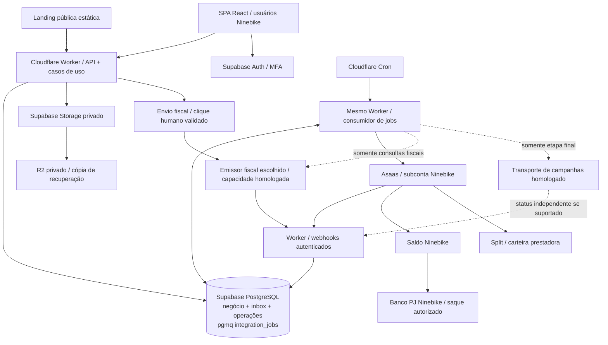

# NINEBIKE OS — arquitetura e requisitos técnicos

**Atualização v2.10.0 — 26/10/2026:** implementação suspensa por pedido do responsável; provedor financeiro em revisão (recebimento integral D+1, condições comerciais em revisão privada). O fiscal reúne Olist e SHOP Simples com aprovação/confirmação humanas; o responsável confirmou que os dados saem pendentes do Olist e são aprovados/emitidos no SHOP; arquivo/layout e homologação ainda precisam de validação. As referências financeiras anteriores não representam fornecedor atualmente escolhido. Ver [decisões atuais](../../README.md) e [fluxo fiscal](fiscal.md).

Criado em 14/10/2026; atualizado em 26/10/2026. Baseline técnica v2.10.0 do planejamento; sem código ou infraestrutura provisionados. Regras comerciais em [spec.md](spec.md); cenários exigidos em [acceptance.md](acceptance.md); plano em [plan.md](plan.md); frente fiscal em [fiscal.md](fiscal.md).

Esta revisão preserva cadastros, gastos, resultado e equipe da v2.2 e aprofunda o fluxo fiscal com revisão/aprovação/clique humanos, protocolos e pacote mensal verificável. O SHOP Simples foi identificado nos vídeos; arquivo, estado e passagem exatos continuam pendentes. Não presumir API Alterdata nem dois emissores simultâneos.

**Direção v2.10.0:** o produto reúne as funções selecionadas do Olist e a conferência/gestão fiscal observada no SHOP Simples. O responsável confirmou Olist pendente → SHOP aprova/emite; a passagem técnica exige validar arquivo/layout; o Ninebike usa provedor homologado (OS_PRIMARY somente após configuração/testes). A implementação permanece suspensa. UNDECIDED continua bloqueando transmissão antes da ativação; EXTERNAL_PRIMARY é alternativa futura/migração, sem implementação antecipada nem emissão dupla. Execução em [build-guide.md](build-guide.md).

## 1. Topologia escolhida

**Monólito modular TypeScript com arquitetura hexagonal, React/Vite, Cloudflare Workers e Supabase Pro.** Um repositório, um artefato de aplicação e uma fila durável. Landing pública estática; área interna SPA. Não há necessidade demonstrada de SSR na operação interna nem código Next.js existente a preservar.



Koin não aparece como API obrigatória: o fluxo App é externo e depende da homologação de QR, split e estorno/crédito. Tarifa fixa Pix foi aceita. Se API Koin compatível vier a ser contratada, entra como adaptador, sem alterar as regras de liquidação.

Cloudflare documenta React/Vite com API Worker e assets. Next.js adaptado também existe, mas acrescenta uma camada de compatibilidade desnecessária ao requisito atual. Fixar versões e `compatibility_date` quando implementar; não escolher versões a partir deste documento sem consultar as releases vigentes. [React na Cloudflare](https://developers.cloudflare.com/workers/framework-guides/web-apps/react/).

| Componente | Responsabilidade | Requisito de produção |
| --- | --- | --- |
| Worker HTTP | Sessão, autorização, comandos, consultas, webhooks | Workers Paid, limites/timeouts definidos e artefato testado no runtime. |
| Worker scheduled | Consumir fila, consultar provedores e reconciliar por lotes | Mesmo código de casos de uso; sem daemon ou execução infinita. |
| PostgreSQL | Estado durável, constraints, transações e livro gerencial | Projeto de produção separado de staging; migrações versionadas. |
| Auth | Login, verificação de sessão e MFA | Cadastro por convite; sem registro público de funcionários. |
| Storage | Documentos/mídia privados | URLs assinadas curtas e verificação de permissão. |
| pgmq logged | Trabalho assíncrono persistido na transação | Uma fila `integration_jobs`; acesso só por RPC interna. |
| R2 backup | Recuperar objetos e evidências fora do Storage ativo | Credencial de recuperação separada; integridade e restauração testadas. |

O caminho fiscal mutante só existe no modo `OS_PRIMARY`, após seleção/homologação do emissor e clique humano. Em `EXTERNAL_PRIMARY`, Worker/Cron não transmitem notas/eventos: o OS prepara/exporta e, após comando humano, importa/concilia evidência oficial do emissor externo. Modo `UNDECIDED` bloqueia transmissão. Uma configuração vigente define o emissor principal por emitente/ambiente/modelo; mudança exige conciliar numeração e intenções em voo.

Um Cloudflare Cron acorda o consumidor. Não ativar outro scheduler para os mesmos jobs, Cloudflare Queues, Redis, n8n, Workflows ou Edge Functions concorrentes. Supabase Cron existe, mas não é necessário nessa topologia. A mensagem pgmq escrita junto do negócio é a outbox; não duplicar uma tabela outbox apenas para publicar novamente em outra fila. [Supabase Queues](https://supabase.com/docs/guides/queues), [pgmq](https://supabase.com/docs/guides/queues/pgmq), [Cloudflare Cron](https://developers.cloudflare.com/workers/configuration/cron-triggers/).

## 2. Hexagonal sem camadas artificiais

```text
src/
  web/                         # telas, formulários, acessibilidade
  modules/
    identity/                  # papéis, permissões, aprovações
    crm/                       # cliente/fornecedor unificados, oportunidade, atividade
    sales/                     # proposta, pedido, entrega, devolução
    inventory/                 # unidade, quantidade, reserva, movimento
    finance/                   # cobrança, gastos, resultado, equipe, split, livro
    fiscal/                    # rascunhos, revisão humana, atos, evidências e pacote mensal
    communication/             # WhatsApp humano
    integrations/              # inbox, operações externas, fila, conciliação
  adapters/
    http/                      # rotas API/webhook; validação do transporte
    persistence/               # RPCs e mapeamento PostgreSQL
    providers/                 # Asaas, fiscal, Evolution, eventual Koin
  worker.ts                    # composição das dependências; fetch/scheduled
supabase/migrations/           # schema, funções, grants, constraints
```

Estrutura orientativa; criar pastas conforme o código real. Dentro de cada módulo, separar regras puras, casos de uso e suas portas quando existirem dependências externas reais. Não criar repositório/interface para cada tabela nem serviços HTTP entre módulos do mesmo processo.

- Domínio não importa SDK Asaas, Supabase, Cloudflare ou React.
- API e consumidor chamam os mesmos casos de uso; não duplicam cálculo de comissão ou autorização.
- Adaptador Asaas traduz status, payloads e erros; preserva dados brutos necessários à auditoria.
- Adaptador PostgreSQL garante commit e constraints; regras monetárias fundamentais são revalidadas no commit, sem confiar em valores do cliente.
- CRM não escreve saldo; estoque não cria recebimento; fiscal não marca pedido pago; financeiro não decide sozinho retorno físico.
- Portas úteis: persistência transacional, pagamentos, documentos fiscais, mensagens e relógio. O relógio do banco governa leases/reservas.

## 3. Banco e modelo mínimo

Usar schemas internos não expostos para tabelas sensíveis. Expor somente RPCs necessárias em schema API controlado. Data API por HTTPS evita conexões TCP/pools adicionais em Workers; transação de várias operações é uma RPC, não várias chamadas independentes `.from()`. [Transações PostgREST](https://docs.postgrest.org/en/stable/references/transactions.html).

| Módulo | Entidades persistentes mínimas | Integridade exigida |
| --- | --- | --- |
| Identidade | `profiles`, vínculos de papéis/permissões, `approvals`, `audit_events` | Usuário ativo, grants explícitos e aprovação ligada ao payload. |
| CRM | `contacts`, `contact_roles`, `lead_submissions`, `opportunities`, `activities` | Cliente/fornecedor podem ser a mesma pessoa; validação por papel; mesclagens auditadas; telefone não prova identidade. |
| Comercial | `quotes/items`, `orders/items`, `returns/items`, `deliveries` | Snapshot de preço/custo/regra, versionamento, vínculo de devolução. |
| Estoque | `products`, `inventory_units`, `inventory_movements`, `stock_reservations`, saldos de quantidade | Série única; reserva ativa única; quantidades não negativas. |
| Financeiro | `payment_allocations`, `payment_attempts`, `provider_objects`, `financial_facts`, `commission_rules`, `commission_allocations`, `refunds`, `transfers`, `payables`, `payable_settlements` | Tentativa não é recebimento; baixas parciais não duplicam despesa nem saldo. |
| Gestão financeira | Contas gerenciais, categorias, funcionários, regras/comissões da equipe e fechamentos versionados | Reutilizam o mesmo livro e autorização; comissão da equipe não é o split de software. |
| Livro e conciliação | `journals/lines`, `provider_transactions`, `balance_snapshots`, `reconciliation_runs/issues` | Lançamento equilibrado e imutável; transação externa única. |
| Integrações | `inbox_events`, `external_operations`, `operation_attempts`, fila pgmq | Dedup de evento e efeito; identidade durável antes do envio. |
| Fiscal | `issuer_configurations`, `fiscal_documents/actions/events`, `fiscal_exports` | Emissor principal definido; rascunho sem operação remota; cada ato aprovado/enviado humanamente; protocolo oficial separado. |
| Comunicação | `conversations`, `messages`, `message_status_events`, `attachments` | Mensagem única por conta/wamid; status não duplica mensagem. |

Essas são entidades lógicas. Tabelas auxiliares só são criadas se o fluxo requerer; não implantar o catálogo de dezenas de tabelas da v1.0 antes de justificar cada uma.

### Constraints e invariantes

1. Dinheiro: `BIGINT` em centavos, BRL explícito, limites de entrada e overflow. Transporte JSON usa strings decimais de centavos quando necessário; TypeScript usa `bigint` no cálculo e não converte silenciosamente acima do inteiro seguro. Conversão para o decimal exigido pela API é feita uma vez no adaptador, com duas casas e teste de serialização.
2. Valores e quantidades positivos nos objetos de intenção; sinais contábeis em linhas próprias. Estorno total acumulado não supera o recebido elegível.
3. Identificador externo único por `(ambiente, provedor, conta, tipo_recurso, external_id)`; IDs de sandbox nunca colidem com produção. IDs internos de tentativa e de cobrança/parcela folha são distintos e explicitamente mapeados na API; estorno tem alvo folha inequívoco.
4. Inbox única por `(ambiente, provedor, conta, event_id)` quando disponível. Se faltar ID, regra de dedup específica homologada por tipo de evento; hash do corpo sozinho não substitui identidade financeira.
5. Comando local único por escopo e idempotency key, além de trava/índice da intenção comercial. Nova key não pode criar segundo comando para a mesma obrigação por acidente. Mesma key com hash diferente retorna conflito.
6. Série/chassi normalizado único; reserva ativa única por unidade; expiração liberada transacionalmente. Pedido confirmado/entregue protege unidade de nova reserva.
7. Alocações ativas não excedem total comercial; soma de comissão rateada corresponde exatamente ao alvo do pedido. Tentativa substituída não cria comissão nova.
8. Livro: débitos e créditos se equilibram por lançamento, livro e moeda no commit. Não basta `CHECK` por linha; usar função transacional e mecanismo que impeça lançamento incompleto, como validação diferida. Linhas de lançamento postado não aceitam update/delete pelo papel operacional.
9. Uma transição gera seu movimento local uma vez, protegida por chave de efeito/fato de origem. Evento diferente sobre o mesmo pagamento não repete o recebimento.
10. Pedido, aprovação e operação têm versão esperada. Estado alterado entre leitura e confirmação causa conflito; reavaliar, não sobrescrever.

## 4. Livro gerencial e conservação do dinheiro

Dois livros separados quando houver visão da prestadora: Ninebike e prestadora. O split é despesa/saída para uma e receita/crédito para outra; não somar esses livros como faturamento da loja.

O livro registra fatos observados e ajustes compensatórios, não substitui escrituração do contador. Cadastro de venda, reconhecimento gerencial, recebimento, tarifa, split, reembolso, bloqueio e retirada são tipos distintos com data, fonte e correlação. Tabelas de indicadores são projeções reconstruíveis, sem contadores monetários editáveis à mão.

Exemplo para venda de R$ 8.000, custo histórico comprovado de R$ 6.000, tarifa Pix de referência R$ 1,99 e software R$ 120. Neste exemplo o reconhecimento contratual da despesa de software coincide com o reconhecimento da venda; o contrato deve confirmar esse momento antes da implementação. A ordem dos registros segue os fatos comprovados, não a ordem visual da tabela:

| Fato | Débito | Crédito |
| --- | --- | --- |
| Venda reconhecida na política gerencial | Clientes a receber 8.000 | Vendas 8.000 |
| CMV da bike efetivamente vendida | CMV 6.000 | Estoque 6.000 |
| Obrigação de software reconhecida uma vez | Comissão software 120 | Software a pagar 120 |
| Recebimento e tarifa comprovados | Liquidação em conciliação 7.998,01; tarifas 1,99 | Clientes a receber 8.000 |
| Split comprovado liquida obrigação | Software a pagar 120 | Liquidação em conciliação 120 |
| Líquido próprio reconhecido | Caixa Asaas Ninebike 7.878,01 | Liquidação em conciliação 7.878,01 |
| Saque concluído, exemplo sem tarifa de saída | Banco/transferência própria 7.878,01 | Caixa Asaas Ninebike 7.878,01 |

As etapas podem ser aplicadas juntas se a evidência chegar junta. Conta de liquidação em conciliação não representa saldo liberado para saque. Um split pendente não autoriza inventar disponibilidade. Se o provedor fornecer movimentos com semântica diferente, homologar o mapeamento preservando a identidade total e o estado do dinheiro.

Reembolso, chargeback e devolução comercial usam lançamentos próprios e referências ao original. Não apagar venda/recebimento para aparentar saldo zero. Bloqueio de saldo não é automaticamente perda ou despesa; registrar retenção/liberação e evitar subtrair duas vezes se o saldo oficial já a refletir.

Operação recebida sem pedido correspondente entra em conta de valores a identificar/obrigação, com divergência. Somente associação validada pode alocá-la. Diferença de conciliação jamais vira receita fictícia.

### Cadastros e custo histórico

Um contato pode ter os papéis cliente e fornecedor. Lead/cliente continua exigindo somente nome e celular; CPF, e-mail e observação permanecem opcionais. Fornecedor exige nome e tipo PF/PJ, com documento, endereço e contatos complementados quando o uso exigir. Adicionar o papel cliente exige celular válido. Cadastro de fornecedor não cria beneficiário de saque nem autoriza pagamentos.

Produto reutiliza catálogo e estoque existentes: nome, fotos, quantidade, SKU gerado e preço; marca, categoria, tamanho, cor, unidade, garantia, fornecedor, estoque mínimo e localização são opcionais. Custo de referência não reescreve entrada/venda anterior. Entrada documenta seu custo e alocação por unidade/lote; CMV usa esse histórico. Para acessórios, consumo de custo por FIFO entre entradas é a proposta inicial a validar com a loja; não usar custo atual do catálogo. Custo desconhecido permanece pendência, nunca zero implícito.

### Caixa, competência e gastos

Contas a pagar têm favorecido, categoria, competência, vencimento, valor, origem e documentos. Uma obrigação pode ter várias baixas parciais; baixar reduz obrigação e caixa conforme a evidência, sem repetir a despesa já reconhecida. Alteração de obrigação postada usa ajuste compensatório aprovado. Retornos comprovados reduzem o saldo da fonte reutilizável para baixas, descontando uma vez alocações líquidas/retornos/reservas sob lock; excesso fica em revisão, sem apagar o fato bancário. Pagamento automático a fornecedor/funcionário via Asaas permanece fora desta versão: somente registro externo comprovado em conta gerencial própria, sem alterar snapshot oficial Asaas.

`RecognizePayable(INVENTORY_PURCHASE)` é o único dono da capitalização e obrigação da aquisição. Entrada física registra unidades/quantidades e custo documentado/provisório; vincular entrada ao payable/documento não posta ativo novamente. Reconhecimento trava a obrigação/entradas vinculadas, verifica identidade de aquisição e soma de custos e posta um efeito único. Compra já reconhecida não é reconhecida de novo ao receber/editar cadastro. Entrada inicial sem documento é abertura sujeita a aprovação ou pendência; não inventa compra/despesa. Pagamento antecipado a fornecedor pode permanecer em pagamentos a alocar até aquisição/obrigação reconhecidas, sem resultado fictício.

Cada categoria tem uma classificação de resultado e caixa congelada no lançamento. Compra de estoque vira ativo e obrigação; seu pagamento reduz caixa; a venda reconhecida realiza CMV. Compra e CMV não são deduzidos juntos no resultado. Transferência para banco próprio usa trânsito até crédito comprovado; aporte e distribuição de sócio não são receita/despesa operacional. Remuneração por serviço e tarifa têm categorias próprias.

Proposta gerencial para validação: receita na entrega confirmada/transferência de controle, CMV no mesmo fato; recebimento anterior é adiantamento de cliente. Pedido ganho, captura, recebimento e nota não são sinônimos de receita. A política aceita fica versionada; exceções exigem evidência e aprovação. O sistema não substitui a escrituração do contador. [CPC 47, reconhecimento](https://www.cpc.org.br/Arquivos/Documentos/527_CPC_47_Rev%2021.pdf), [CPC 16, estoque e CMV](https://www.cpc.org.br/Arquivos/Documentos/243_CPC_16_R1_rev%2013_ComAVISO.pdf).

| Visão | Regra sem dupla contagem |
| --- | --- |
| Receita líquida gerencial | Receita reconhecida ajustada − tributos de venda informados/classificados; desconto já incorporado ao pedido não é abatido novamente. |
| Lucro bruto/margem | Receita líquida − CMV histórico; percentual somente com receita líquida positiva e custos completos. |
| Margem após custos diretos | Lucro bruto − tarifas por competência − software reconhecido − equipe reconhecida − demais custos diretos, cada valor uma vez. |
| Resultado gerencial | Margem após custos diretos − outras despesas/tributos por competência ainda não incluídos. |
| Caixa | Saldo inicial aprovado + entradas realizadas − saídas realizadas por conta; obrigações abertas não reduzem caixa realizado. |
| Líquido Asaas | Recebimento bruto − tarifas efetivas − split efetivo, com bloqueios/reversões separados; não é lucro. |

No exemplo acima, R$ 1.878,01 é margem após CMV/tarifa/software, antes de equipe, demais gastos e tributos. Sem esses dados completos não recebe o nome de lucro final. Custos/tributos/despesas/fontes ausentes geram `PARTIAL`, com itens afetados; não excluir vendas sem custo para produzir uma margem aparentemente completa. Margem com denominador zero/negativo retorna não aplicável.

### Comissão da equipe

Regras da equipe são independentes da regra de software de 150 bps. Taxa ou valor, base, atribuição, vigência, reconhecimento, liberação, vencimento e reversão estão pendentes de resposta/aceite da Ninebike. Sem regra aprovada, exibir “não configurada”; não criar comissão zero nem presumir 1,5%.

Funcionário tem identidade estável, mesmo sem login ou após desligamento. Atribuição e regra ficam congeladas na venda; mudança de vendedor no CRM não muda histórico. Previsto, reconhecido, liberado, vencido e pago são dimensões distintas. Reconhecimento cria uma obrigação de comissão e a despesa uma vez; liberação determina quanto pode ser quitado; baixa parcial só reduz obrigação/caixa. Reversão referencia o original e segue política aprovada, sem apagar pagamentos nem descontar automaticamente remuneração já paga.

Atos locais sensíveis seguem preparar solicitação → aprovar → executar o snapshot congelado. A solicitação já é `identity.approvals` PENDING, sem tabela duplicada; `/approvals` decide e a execução local consome uma aprovação uma vez no commit. Reversão de baixa só desfaz alocação; dinheiro efetivamente devolvido por fornecedor/funcionário usa movimento externo PAYMENT_RETURN, ligado à saída original, aprovado e limitado ao recuperável, sem classificá-lo como aporte/receita.

Extrato por funcionário: saldo anterior reconhecido + reconhecido no período + ajustes de crédito − reversões/débitos autorizados − pagamentos = saldo reconhecido final. Previsões não reconhecidas ficam fora dessa soma. Vencido exige obrigação reconhecida, saldo aberto positivo e vencimento conhecido anterior à data comercial; liberação é dimensão independente. Se a regra ainda não produziu vencimento, a data fica nula e não se presume atraso. Cada valor abre pedido, snapshot da regra, obrigação, ajuste e baixa. Vendedor vê somente a própria comissão mediante grant; custos/margens e outros funcionários permanecem restritos a financeiro/proprietário.

### Atualização e fechamento

Livro, obrigações, comissão, projeções e auditoria mudam na mesma RPC/transação. Tela refaz consulta após commit, ao abrir/reconectar e ao detectar lacuna de versão. Supabase Broadcast privado pode invalidar a visão com versão/escopo mínimo, publicado somente pelo backend/banco; a consulta Worker continua autorizando e calculando os valores. Canal não contém valores pessoais/financeiros nem concede leitura de tabelas de negócio. Polling autorizado é fallback, sem segundo scheduler/fila. [Broadcast](https://supabase.com/docs/guides/realtime/broadcast), [autorização dos canais](https://supabase.com/docs/guides/realtime/authorization).

Exibir `as_of`, versão e atualização da projeção, horário do fato no provedor, recebimento/processamento e última conciliação concluída. Distinguir dados locais após commit, eventos Asaas sujeitos a atraso e banco externo conhecido apenas até documento/importação. Notificação perdida ou conexão aberta não prova atualidade; autorização de dinheiro sempre revalida fonte/versão.

Completude de gastos depende também da conferência declarada pelo responsável sobre o período/fontes: o sistema detecta lacunas conhecidas, mas não descobre despesas nunca registradas. O selo COMPLETE significa critérios e declaração atendidos para o corte informado; não garante conhecimento de gasto oculto.

Fechamento mensal publica versão imutável, política, período, fontes/corte, valores e pendências. Ingestão de fatos tardios continua funcionando: preserva data original e data de registro, sinaliza impacto no mês fechado e exige revisão aprovada ou ajuste no período aberto conforme política. Não reescrever silenciosamente a versão publicada. Saldo inicial e obrigações de abertura precisam de origem/evidência/aprovação; não são receita nova.

## 5. Comandos e efeitos externos

Contrato interno de comando: identidade derivada da sessão, permissão, recurso, versão, key idempotente, payload validado e correlation ID. Respostas: concluído com evidência, aceito pendente com operation ID, conflito ou rejeição. O frontend pode consultar a mesma operação; não cria outra para “destravar”.

### Protocolo durável

1. **Preparar:** RPC verifica vínculo/permissão atuais, trava pedido/alocação/saldo reservado, valida cálculo e aprovação, cria `external_operations`, auditoria e mensagem pgmq na mesma transação. Se qualquer parte falhar, nada confirma.
2. **Consumir:** RPC lê pgmq com visibility timeout, trava operação e atribui `lease_token` e geração. Mensagens repetidas para operação terminal apenas são arquivadas. Operação já em execução não pode ser despachada por segundo consumidor.
3. **Autorizar envio:** RPC compare-and-set registra `dispatch_started`, referência, hash e tentativa antes da rede. Só retorno positivo permite HTTP. Verificar também controle de habilitação fora do banco para efeitos externos.
4. **Chamar provedor:** timeout explícito, payload congelado, credencial da conta correta. Não manter lock SQL durante HTTP.
5. **Finalizar:** RPC condicionada ao token/geração grava ID externo, resposta/evidência, estado, efeitos locais e arquiva mensagem. Resposta de consumidor antigo não sobrescreve reconciliação posterior.
6. **Queda antes de envio autorizado:** lease expirado permite retomada segura. **Queda após `dispatch_started`:** resultado é incerto até reconciliar; a reentrega inicia consulta, não novo POST financeiro.

Estados de `external_operations`: `PREPARED`, `DISPATCHING`, `PROVIDER_PENDING`, `SUCCEEDED`, `FAILED_FINAL`, `UNCERTAIN`, `NEEDS_REVIEW`. Cada tentativa é append-only; referência da intenção é estável. Uma consulta “não encontrado” isolada não prova que chamada atrasada não será efetivada.

**Exceção fiscal ao consumo de envios:** a criação/edição/validação de rascunho não cria operação remota. A aprovação interna também não transmite. Só o handler HTTP do clique final cria/recupera a operação fiscal e executa o protocolo de despacho acima, com `dispatch_origin=HUMAN_HTTP` derivado da sessão/caso de uso. pgmq recebe somente consulta/reconciliação/importação de evidência/exportação solicitada, nunca `FISCAL_SEND`. O consumidor scheduled não tem acesso à porta fiscal mutante; nem webhook, financeiro ou estoque podem chamá-la. Queda em PREPARED sem dispatch exige retomar a mesma intenção por novo clique humano; depois de dispatch_started, apenas consulta, sem reenvio automático.

Não presumir que Asaas garante `Idempotency-Key` genérico ou unicidade de `externalReference`. A chave local impede concorrência local; não torna rede e banco uma transação distribuída. Para cada endpoint, registrar mecanismo real de consulta/dedup e critérios seguros de reenvio. Se não houver prova suficiente, exige revisão humana. [Asaas: retries e idempotência](https://docs.asaas.com/docs/retries-e-idempot%C3%AAncia).

Erros de validação/autorização não entram em retry automático. `429`, falhas transitórias e rede têm política por endpoint, backoff, jitter e limite, considerando possibilidade de efeito. Saque/refund/cobrança com resposta perdida permanecem incertos. Quando esgotar processamento, arquivar mensagem e manter operação `NEEDS_REVIEW`; painel e alerta mostram o trabalho parado.

Usar fila logged, não `pop` destrutivo nem fila unlogged. Leitura pode reaparecer após visibility timeout; isso exige idempotência dos efeitos locais. Uma fila não promete execução externa exatamente uma vez. [pgmq](https://supabase.com/docs/guides/queues/pgmq).

### Contratos internos indicativos

| Comando | Pré-condição | Efeito local atômico |
| --- | --- | --- |
| `ConfirmOrder` | Proposta válida e desconto autorizado | Snapshot, alocações e reserva/compromisso. |
| `CreateCharge` | Alocação aberta, meio habilitado, split válido | Operação + comissão congelada + job. |
| `ReceiveProviderEvent` | Origem autenticada, conta conhecida | Inbox + job, antes de HTTP 200. |
| `ApplyFinancialFact` | Evidência oficial e vínculo inequívoco | Fato + livro + projeção + evento local único. |
| `RequestRefund` | Permissão/aprovação, valor elegível | Reserva de estorno + operação + job. |
| `RequestTransfer` | MFA/aprovação, beneficiário e saldo | Reserva de saída + operação + job. |
| `ConfirmDelivery` | Cobertura/risco/fiscal/estoque revalidados | Entrega e movimento físico único. |
| `RecognizeExpense` | Origem/categoria/competência aprovadas | Obrigação, despesa ou ativo, livro e projeção sem pagamento implícito. |
| `RecordExternalSettlement` | Obrigação, versão, liberação e evidência | Baixa parcial + vínculo ao movimento de caixa único; sem chamada de pagamento. |
| `RecognizeStaffCommission` | Regra aceita e fato elegível únicos | Comissão, obrigação e despesa uma vez; liberação é independente. |
| `PublishPeriodClosure` | Corte/completude avaliados e aprovação | Snapshot imutável de fechamento; fatos tardios não são descartados. |
| `PrepareFiscalDocument` | Permissão fiscal e origem visível | Rascunho/revisão, sem transmissão, conta ou movimento de estoque. |
| `RequestFiscalApproval` | Snapshot validado/revisado e versão atual | approval PENDING com hash; sem operação/envio. |
| `SubmitFiscalAction` | Clique humano, emissor OS_PRIMARY, aprovação/MFA/capacidade válidas | Operação + auditoria + job somente de consulta; handler HTTP autoriza/despacha uma vez. |
| `ImportFiscalEvidence` | Comando humano, arquivos privados e origem identificada | Evidência validada/deduplicada, sem emitir novamente nem lançar contas/estoque. |

São nomes internos, não endpoints oficiais. URLs da API interna podem ser REST sob `/api/*`; rotas não possuem autoridade financeira própria além dos casos de uso.

## 6. Webhooks bem definidos

### Asaas normal

- HTTPS; validar `asaas-access-token` contra segredo do webhook da conta/ambiente. Esse token é diferente da API key. Não implementar HMAC/timestamp inventado como requisito do Asaas. [Autenticação](https://docs.asaas.com/docs/receba-eventos-do-asaas-no-seu-endpoint-de-webhook).
- Limitar tamanho e validar envelope/identidade; não exigir que o provedor envie headers privados do OS.
- Persistir evento, identidade, hash, timestamps e job em uma transação. Payload bruto necessário fica restrito e com retenção, fora de logs abertos.
- Retornar **HTTP 200 após commit**. Duplicata já persistida também recebe 200; se ainda não processada, seu job existente continua recuperável. Banco indisponível retorna erro.
- Processar assíncrono, aceitando atraso e ordem invertida. Event ID deduplica entrega; chave do fato deduplica efeito econômico.
- Eventos com novos campos são aceitos. Enum novo não fabrica status; guardar, consultar e sinalizar revisão.
- Antes de efeitos financeiros positivos, confirmar recurso/conta/valor por consulta autenticada ao provedor e correlação. Retorno do navegador e screenshot jamais são fontes financeiras.

Entregas são repetíveis. Monitorar fila Asaas pausada: a documentação descreve interrupção após falhas consecutivas e retenção limitada de pendências. Corrigir causa e reativar quando aplicável; reconciliação precisa cobrir lacunas além da retenção. [Idempotência de webhook](https://docs.asaas.com/docs/como-implementar-idempotencia-em-webhooks), [fila pausada](https://docs.asaas.com/docs/fila-pausada).

### Autorização de saque: endpoint separado

O callback especial de autorização exige resposta síncrona `APPROVED`/`REFUSED`. Não pode ser tratado como notificação que responde 200 e decide depois. Proposta: habilitar para saídas autorizáveis após homologação; aprovar apenas se valor, conta, beneficiário e intenção durável coincidem. Operação desconhecida é recusada. Repetição retorna a decisão persistida. Incerteza/DB indisponível falha fechado, com alerta.

Cada intenção/aprovação autoriza **um único ID externo de transferência**. Se o callback chegar antes da resposta de criação, correlacionar por identificador estável efetivamente suportado e vincular atomicamente o primeiro ID à intenção; índice único e lock impedem outro ID de consumir a mesma aprovação. Não aprovar por igualdade de valor/beneficiário: duas transferências diferentes podem ter os mesmos dados. Callback do mesmo ID retorna decisão já gravada; ID diferente é recusado. Se o contrato não permitir correlação inequívoca antes da resposta, manter a saída bloqueada e ajustar o percurso com Asaas antes de ativar essa autorização.

Não ativar autorização de **split** por padrão: cancelamento por falha/recusa pode ocorrer sem evento específico de cancelamento. Se necessário contratualmente, homologar disponibilidade e consultar motivos/estado. O callback de autorização é controle adicional; não elimina risco de credencial principal ou painel externo. [Validação de saques](https://docs.asaas.com/docs/mecanismo-para-validacao-de-saque-via-webhooks).

### Outros emissores e captura pública

- Meta direto (somente se adotado em evolução posterior): verificar desafio de configuração e assinatura `X-Hub-Signature-256` sobre corpo bruto com App Secret; teste negativo com corpo adulterado obrigatório. Fixar versão Graph suportada. A documentação técnica deve ser revalidada na implementação: acesso direto da pesquisa retornou HTTP 429; política comercial oficial foi lida, e o contrato técnico não foi exercitado nesta sessão. [Documentação Meta](https://developers.facebook.com/documentation/business-messaging/whatsapp/webhooks/create-webhook-endpoint).
- Fiscal/Koin: usar exatamente autenticação e confirmação disponíveis no contrato. Sem assinatura confiável, consultar o recurso por API antes de aplicar fato crítico; webhook sozinho não recebe confiança adicional inventada.
- Landing pública: nenhum segredo compartilhado no JavaScript. Formulário usa proteção antispam/Turnstile, validação servidor, rate limit e submission ID. HMAC só para integração server-to-server externa, com segredo fora do browser, timestamp/replay protection nesse contrato próprio.

## 7. Split, parcelamento e alterações perigosas

Persistir a relação `order → allocation → attempt → checkout/charge/installment → payment → split`. Nem todo ID é propagado automaticamente; demonstrar como os recursos gerados são correlacionados, inclusive todas as páginas de parcelas. Não usar valor/nome como única chave.

Cobrança avulsa usa `split`; Checkout usa `splits`. Emissão tem conta e carteira em allowlist de configuração aprovada; payload gerado no servidor. Para 1,5% bruto, usar valor fixo calculado e verificar o que foi gravado antes de expor o link/QR. Se o contrato hospedado não suportar a configuração exata, não expor aquele meio.

Alteração de cobrança deve preservar split: não enviar `split: []` ou `null` por serialização acidental. Excluir/restaurar cobrança pode remover a configuração; a versão inicial proíbe “restaurar e cobrar” sem reaplicar e verificar split. [Atualização e restauração](https://docs.asaas.com/docs/split-em-cobrancas-avulsas).

Split acima do líquido pode entrar em divergência; Asaas publica prazo de correção e cancelamento posterior. Criar incidente com prazo real retornado/documentado, sem tratar término de bloqueio como sucesso. A correção não muda unilateralmente a comissão do contrato. [Regras de split](https://docs.asaas.com/docs/split-de-pagamentos).

Antecipação automática fica desabilitada na configuração proposta. Antecipação manual externa deve ser detectada: pode mudar líquido/tarifas e viabilidade do split. Descontos, acréscimos, multa e alteração de valor de cobrança fora do plano aprovado exigem conciliação; não recalcular silenciosamente um pedido histórico. [Split antecipado](https://docs.asaas.com/docs/split-em-cobrancas-antecipadas).

## 8. Reconciliação independente dos webhooks

Executar reconciliação periódica por lotes e fechamento diário, além de comando sob demanda autorizado. Intervalo inicial proposto para pendências recentes: cinco minutos; fechamento uma vez ao dia no fuso comercial. Ajustar intervalos e limites com teste/API budget; não são SLA.

Importar todas as páginas com cursor/checkpoint e sobreposição temporal, deduplicando por ID externo. Consulta do estado atual reconstrói projeção; extrato/histórico e evidência dos recursos são necessários para recuperar fatos econômicos intermediários. Snapshot “pago” não inventa o histórico de todas as tarifas/reversões.

Conferir:

1. Pedido e valor principal contratado; alocações, tentativas substituídas e pagamento excedente.
2. Cobrança/parcela e estado oficial; valor pago, taxa, bloqueio, refund e chargeback.
3. Split esperado versus valor/estado efetivos, inclusive comissão recebida na conta prestadora.
4. Movimentos do extrato por conta; operações realizadas externamente também são importadas.
5. Saldo inicial + entradas − saídas = saldo final para a semântica do extrato; disponibilização/bloqueios tratados conforme mapeamento homologado, sem duplo desconto.
6. Transferências pendentes/concluídas, tarifas e comprovantes; reserva local versus saída efetiva.

Não usar lista de splits “recebidos” como prova de liquidação se ela também incluir valores futuros. Conferir estado e movimentação. [Splits recebidos](https://docs.asaas.com/reference/listar-splits-recebidos), [extrato](https://docs.asaas.com/reference/recuperar-extrato).

Conciliação da conta principal importa somente comissões relacionadas à Ninebike para a visão da loja; não expõe outras operações da prestadora. Usar credencial de leitura disponível ou importação restrita homologada; nunca fornecer chave principal ao frontend.

Toda divergência tem valor em centavos, conta, recursos, janela, gravidade, responsável, evidência e resolução. Fechamento incompleto/paginação interrompida não recebe selo de conciliado. Ajuste manual preserva original e justificativa; não muda status oficial de pagamento.

## 9. Segurança e dados

- JWT verificado, com projeto/issuer, expiração e identidade corretos; sessão decodificada não autentica. Consultar funcionário ativo e permissões atuais em comandos. [Supabase getClaims](https://supabase.com/docs/reference/javascript/auth-getclaims).
- MFA TOTP `aal2` obrigatório para OWNER e comandos críticos. Para atos sensíveis, exigir MFA recente, com janela técnica inicial de cinco minutos: verificar timestamp do método `totp` no `amr` de JWT validado e vincular ator/sessão à aprovação. Refresh do JWT não renova a data do MFA. Se o projeto não fornecer evidência inequívoca, verificar novo desafio no backend antes de aprovar; nunca confiar em horário enviado pelo browser. Essa janela é parâmetro de segurança do planejamento, não prazo comercial. [Supabase MFA](https://supabase.com/docs/guides/auth/auth-mfa), [claims JWT](https://supabase.com/docs/guides/auth/jwt-fields).
- Secrets ficam em Workers Secrets por ambiente. Nenhuma API key em `VITE_*`, bundle, URL, logs ou anexos. Usuários de equipe não recebem credenciais Asaas. [Workers Secrets](https://developers.cloudflare.com/workers/configuration/secrets/).
- API key administrativa Supabase/`service_role` ignora RLS. Backend deve verificar autorização explicitamente; RLS não corrige código privilegiado que aceita pedido indevido. Browser só Auth e URLs de arquivos autorizadas. [RLS](https://supabase.com/docs/guides/database/postgres/row-level-security).
- Revogar acesso desnecessário de `PUBLIC`, `anon` e `authenticated` a comandos e tabelas internas. Funções SQL com grants explícitos, preferindo invoker; definer excepcional, `search_path` fixo, schemas qualificados e testes de negação. [Funções](https://supabase.com/docs/guides/database/functions).
- Conta/carteira de split e beneficiário não são campos livres de comando público. Nunca confiar em `actor_id`, papel, custo, preço ou desconto fornecido pelo cliente.
- Custos, resultado, categorias, regras da equipe e baixas exigem grants próprios; escrita de estoque não herda `finance.write`. Comprovante é evidência administrativa sujeita à aprovação, não confirmação automática de pagamento de venda. Canal privado e exportações respeitam o mesmo escopo; revogação fecha/revalida assinatura, e a API nega imediatamente dados/atos posteriores.
- Sessão única definida: SDK oficial Supabase Auth no browser, persistência em `sessionStorage` por aba, JWT bearer no header Authorization para a API. Browser não acessa tabelas de negócio nem usa cookies de autenticação próprios nesta versão. Configurar storage via opção oficial do cliente, sem escrever mecanismo de refresh próprio. Tokens não vão para URL, logs ou exports; fechamento/logout limpa a sessão e revoga aprovações locais aplicáveis. Storage no browser continua sujeito a XSS: CSP restritiva sem scripts de terceiros na área `/app`, sem HTML arbitrário, sanitização de conteúdo, dependências fixadas e MFA recente para dinheiro. [Inicialização Supabase JS](https://supabase.com/docs/reference/javascript/initializing).
- Rate limit por rota/ator; webhooks sem CAPTCHA. TLS, CORS explícito, cabeçalhos de segurança, limites de upload, tipo/tamanho, nomes seguros e acesso privado.
- Auditoria contém ator, ação, recursos, valores relevantes, decisão, versão/deploy e correlation ID; sem PAN/CVV, tokens ou documentos completos em logs.
- Auditoria append-only para o papel da aplicação; administrador de banco ainda pode alterá-la. Exportar marcos/fechamentos e evidências de operações privilegiadas para armazenamento separado com hashes/retenção; não anunciar inviolabilidade absoluta.
- Acesso humano a produção mínimo; contas pessoais com MFA, revisão de alterações sensíveis, credenciais de CI por ambiente e rotação documentada. Previews não recebem chave de produção nem callbacks financeiros válidos.
- Política LGPD/retensão e papéis de controlador/operador definidos com responsáveis; memória de desenvolvimento não armazena segredos ou payloads de clientes.

## 10. Operação, limites e falhas de infraestrutura

Cloudflare Worker não é servidor Node ilimitado. Jobs usam lotes limitados por quantidade/tempo, timeouts menores que lease, progresso persistido e margem de CPU. `waitUntil` não é armazenamento de obrigação financeira. Revalidar limites do plano na implementação. [Limites Workers](https://developers.cloudflare.com/workers/platform/limits/).

Propor Supabase São Paulo e medir latência; Cloudflare distribuída não transforma o banco em multirregião. Região brasileira do banco não garante localização de todos os logs/processadores. [Regiões Supabase](https://supabase.com/docs/guides/platform/regions).

| Falha | Resposta exigida |
| --- | --- |
| Asaas fora do ar | CRM/estoque podem continuar se banco estiver íntegro; comando financeiro pendente/incerto. Sem confirmação fictícia. |
| Supabase fora do ar | Sem sucesso de webhook ou comando sem commit; saldo/estoque não autorizam novas ações com cache antigo. |
| Worker/Cloudflare fora do ar | Provedores podem reenviar; após retomada, reconciliar lacuna e drenar fila com segurança. |
| Cron atrasado | Job permanece durável; alertar idade/último consumidor; próxima execução respeita operação incerta. |
| Fiscal fora do ar; transporte de campanha futuro indisponível | Fiscal mantém pendência própria; campanha afetada permanece pendente sem bloquear o núcleo. N8n externo não é dependência do Ninebike. |
| Conta/chave bloqueada | Bloquear novas ações dependentes, preservar intenção e avisar proprietário; não tentar com conta errada. |
| Internet da loja caída | Sem confirmação offline de pagamento/entrega pelo OS; procedimento manual aprovado e registro posterior conciliado. |

Monitorar última execução útil do consumidor, idade do job mais antigo, operações incertas, erros webhook, fila Asaas pausada, splits divergentes, diferenças de saldo, atrasos fiscais, expiração de certificado e falha de backup. Logs correlacionam pedido, operação, evento, conta, tentativa e deploy. Alertas financeiros críticos imediatos ao responsável; limites de atraso operacionais propostos devem ser ajustados no piloto. Não notificar clientes automaticamente por evento técnico.

Responsável e substituto por incidente/reconciliação precisam ser nomeados antes da produção. Runbooks cobrem revogar chave, parar saídas, corrigir/reativar webhook, reconciliar, restaurar e comunicar internamente. Manutenção não deve solicitar aprovação às cegas para repetir uma transferência incerta.

## 11. Backup, restauração e implantação

Supabase Pro oferece backups; PITR é add-on com requisitos/custo próprios. Backup do PostgreSQL não inclui os objetos do Storage. Proposta para produção financeira: contratar PITR compatível com a janela de perda aceita, manter cópia independente dos objetos/XMLs e testar recuperação. Sem contratação/ensaio, não prometer RPO de minutos ou RTO específico. [Backups Supabase](https://supabase.com/docs/guides/platform/backups).

Arquivos: cópia privada R2 com nomes/versionamento imutáveis por hash, manifesto e verificação de integridade; acesso de recuperação separado. Retenção/bucket locks conforme necessidade acordada. Não presumir que lock impede qualquer administrador da plataforma. [R2 bucket locks](https://developers.cloudflare.com/r2/buckets/bucket-locks/).

### Procedimento obrigatório de restore

1. Entrar em manutenção; bloquear novas ações e efeitos externos por controle **fora do PostgreSQL restaurado**, como binding de implantação. Ausência desse controle deve falhar fechado.
2. Pausar scheduler/handlers de saída, interromper ou aguardar invocações conhecidas e registrar operações em voo. Parar Cron sozinho não elimina tentativa atrasada.
3. Preservar snapshot/evidências e registrar ponto temporal, deploy, migrations, keys/configuração necessários. Ambiente de teste/restore não recebe poder de sacar em produção.
4. Restaurar banco/objetos e verificar integridade, fila, grants/Auth e arquivos. Configurações de Auth/Storage/secrets não são presumidas restauradas pelo dump de banco.
5. Reconciliar todas as operações externas da janela que começa antes do ponto recuperado até a parada efetiva. Aplicar fatos observados por IDs/extratos, sem reenvio financeiro.
6. **Proibir replay automático de cobranças, saques, estornos, notas e mensagens restaurados.** Marcar já realizados com evidência; pendentes/incertos exigem resolução da tentativa anterior. Provedor não volta no tempo quando o banco volta.
7. Reabrir leitura, depois comandos internos e por último efeitos externos, com conferência do responsável. Registrar perda efetiva, tempo e divergências restantes.

Deploy: CI valida tipos/build, testes relevantes, dependências/segredos e migrations em staging. Homologar o artefato em Workers, não apenas servidor local. Migrações compatíveis em etapas; rollback de código não desfaz operação externa nem esquema. Mudanças de comissão, carteira, autorização, ledger e estados exigem revisão antes de liberar.

## 12. Decisões registradas e limites aceitos

### Fiscal com revisão humana e evidência oficial

Fluxo: preparar → validar sem transmitir → revisar snapshot → aprovação humana → clique em enviar → processamento oficial. HUMAN_APPROVED é uma decisão interna; AUTHORIZED depende do resultado individual oficial e protocolo. HTTP 200, assinatura, lote processado, impressão de DANFE ou rótulo “emitida” de outro sistema não autorizam entrega fiscal por si. Preservar status bruto, origem, instante, mapping_version e evidência. DENIED_LEGACY pode aparecer em histórico/importação; não o presumir retorno corrente de emissão em 2026. [NF-e55](https://www.confaz.fazenda.gov.br/legislacao/ajustes/2005/AJ007_05), [NFC-e65](https://www.confaz.fazenda.gov.br/legislacao/ajustes/2016/AJ_019_16).

`fiscal_actions` diferencia ISSUE, CANCEL, CCE e VOID_NUMBER_RANGE, com revisão/validação/aprovação/operação próprias. Inutilização não exige documento fictício; protege faixa/emitente/modelo/ano/série e não cancela uma nota autorizada. CC-e é restrita ao modelo/ato elegível: NFC-e65 não a admite; NF-e55 não permite usá-la como edição livre de imposto, emitente/destinatário ou datas. Elegibilidade/prazos e vigência são validados pelo responsável fiscal e contrato, sem prazo único hardcoded nem contingência automática. Mudança relevante do snapshot, origem, configuração/certificado/capacidade/schema invalida aprovação ainda não despachada. Documento/ato submetido é imutável; correção após rejeição conclusiva exige nova revisão/aprovação/clique e contrato que comprove uso seguro da referência/numeração.

Salvar/autorizar/cancelar/importar nota não cria nem estorna contas, estoque, Asaas ou comissão. Caso a loja precise aplicar um efeito de negócio a partir da evidência, usa comando humano separado do módulo dono, com origem única e locks, evitando repetir uma venda/entrada já registrada. Imprimir/baixar DANFE só gera artefato/auditoria, sem alterar o status fiscal. Essas fronteiras são melhorias propostas: o material estático Olist mostra gatilhos e impressão com alteração local de situação; não são garantias a herdar.

Rascunho fiscal usa schemas fechados, perfis tributários aceitos e códigos/tabelas por vigência. Quantidade e preço unitário fiscais podem exigir frações: usar strings decimais sem expoente e cálculo inteiro escalado/decimal exato, com escala/arredondamento do XSD/perfil homologados; totais monetários permanecem centavos. Não reutilizar float/toFixed da UI analisada como cálculo autoritativo, nem deduzir CST/CSOSN/CFOP/NCM/alíquota/IBS-CBS a partir de menu. Fixar pacote XSD/NT/tabelas e hashes somente após baixar/verificar os arquivos e cronograma oficial; índice de busca do portal não comprova ZIP homologado. [Esquemas oficiais](https://www.nfe.fazenda.gov.br/portal/listaConteudo.aspx?AspxAutoDetectCookieSupport=1&tipoConteudo=BMPFMBoln3w%3D).

XML autorizado e protocolo, XMLs de eventos e DANFE são artefatos distintos e imutáveis. Exportação mensal nasce de solicitação humana; o worker monta ZIP/manifesto privados com filtro/corte/lista congelados, paginação retomável, identidade fiscal, papéis de artefatos, hashes, contagens, eventos do mês inclusive de notas antigas e pendências. Arquivo ausente/consulta incompleta gera PARTIAL, não “completo”. Nova geração tem revisão explícita. Não enviar/importar automaticamente para outro aplicativo nem anunciar sua compatibilidade/recibo antes de conhecê-lo. Exportações não contêm certificado/senha nem código proprietário/dados reais da inspeção.

A1 e senha são segredos separados de anexos comuns. Preferir custódia/assinatura pelo emissor escolhido quando contratualmente suportado; OS guarda binding/fingerprint/validade/revisão. Se custódia no OS for indispensável, exigir desenho específico de criptografia/chaves separadas, acesso/MFA, rotação/recuperação e compatibilidade do runtime antes de habilitar. Não criar assinador PKI no Worker por suposição. Certificado expirado/rotacionado ou comprometido bloqueia novos envios e invalida aprovações afetadas, preservando consultas dos atos já transmitidos.

Proveniência da revisão: UI fiscal e modal de exportação XML/planilha inspecionados sem gerar arquivos; 165 campos DOM incluem ocultos e não demonstram formulário novo. REA analisou 5 scripts públicos/47.582 bytes sem falha de parsing; leitura estática dirigida de 13 scripts e documentação primária complementam a análise. Menu exibir “autorizar/lançar/clonar/devolver/excluir” não prova ação executada, backend, elegibilidade tributária ou uso pela Ninebike. O planejamento não publica dados reais, scripts proprietários, certificado ou payloads da conta. Detalhes e aceites FIS em [fiscal.md](fiscal.md).

| Decisão | Motivo | Consequência |
| --- | --- | --- |
| SPA + Worker | Área interna sem SSR obrigatório; runtime direto | Rotas/dados explícitos; landing estática para indexação. |
| Monólito modular hexagonal | Fronteiras claras com um deploy | Integridade financeira compartilhada sem microsserviços. |
| RPC transacional | Atomicidade entre negócio, auditoria e fila | Algumas invariantes permanecem no SQL; testes de commit necessários. |
| pgmq único | Durabilidade no banco já contratado | Processamento pode atrasar; efeitos remotos exigem reconciliação. |
| Asaas como fonte financeira | Saldo e eventos reais do provedor | Falha do provedor impede novas confirmações financeiras. |
| Split fixo para 1,5% bruto | Contrato diverge da base percentual nativa | Rateio e viabilidade por modalidade precisam de homologação. |
| Pix incluído; Koin condicionada | Tarifa fixa Pix aceita; Koin exige integração comprovada | Pix entra no financeiro principal; Koin aguarda gates próprios. |
| Uma região primária | Porte de uma loja e infraestrutura simples | Indisponibilidade real é possível; recuperação precisa ser ensaiada. |
| Cadastro unificado por papéis | Cliente e fornecedor podem ser a mesma pessoa | Validação por uso; papel fornecedor não concede acesso nem autorização bancária. |
| Mesmo livro para caixa e competência | Resultado e pagamento são fatos diferentes do mesmo negócio | Classificação/custo histórico precisam estar completos; baixas não repetem despesas. |
| Comissão staff por regra aceita | Condições ainda não informadas | Funcionalidade fica não configurada até aceite; split de software segue independente. |
| Broadcast privado + consulta autorizada, em vez de saldo no evento | Atualizar telas sem expor tabelas/valores | Mais configuração que polling puro; fallback e timestamps são obrigatórios, sem promessa de eventos infalíveis. |
| Fiscal mutante só no HTTP humano | Aprovação e clique final separados; scheduled apenas consulta | Queda antes de dispatch requer retomada humana; sem fila de transmissão fiscal automática. |
| Um emissor principal por percurso | Outro software pode emitir ou apenas receber arquivos | Modo desconhecido bloqueia transmissão; emissor externo não é duplicado pelo OS. |

Não há justificativa atual para Kubernetes, Redis, Kafka, banco de saldo em cache, event sourcing completo ou failover multirregião. O livro financeiro e a trilha de eventos necessários à auditoria permanecem obrigatórios.

## 13. Vínculos entre módulos e automação segura

Cada informação tem um dono: CRM mantém o contato atual; catálogo descreve o produto; estoque mantém unidades/movimentos/reservas; vendas congela proposta/pedido/itens; financeiro mantém fatos, obrigações e livros; fiscal mantém revisão, atos e evidências oficiais. A tela integrada consulta esses registros e seus IDs; não mantém clientes, saldos ou estoque próprios por tela. FKs e validações transacionais garantem mesma empresa, contato, pedido, produto/unidade e origem; proibir associações cruzadas mesmo quando cada UUID existe isoladamente. Snapshots guardam o que foi contratado/autorizado e não são atualizados em cascata ao editar o cadastro.

Comandos locais relacionados compartilham RPC e rollback. Efeitos assíncronos carregam recurso/versão/origem e key econômica única; consumidor e reconciliação não criam cópias da venda. Nenhum grafo genérico de automações ou novo barramento é necessário: reutilizar casos de uso, command_receipts, inbox/pgmq e auditoria existentes. Dados conhecidos preenchem rascunhos e cálculos; o backend continua validando. “Menos manual” não altera o consentimento de um saque, aprovação financeira ou o envio humano de um ato fiscal.

A importação usa as mesmas regras e comandos locais dos módulos, com caminho explícito para cadastros históricos incompletos e abertura aprovada. Não usa INSERT privilegiado para contornar invariantes e não dispara cobrança, reconhecimento de receita, nota, WhatsApp ou comissão histórica como nova. O esquema de lotes/vínculos em [data-model.md](data-model.md) preserva origem; a cadeia de verificação em [plan.md](plan.md) demonstra integridade de ponta a ponta. Quarentena é resolução de exceções, sem exigir revisão manual de cada registro automaticamente válido.

## 14. Campanhas finais sem inbox ou alteração no n8n

Manter Worker + Supabase/pgmq e comunicação somente em T12 após núcleo aceito. SELLER/OWNER têm campanhas no escopo atual; IA apenas gera conteúdo em porta backend restrita, não conversa com clientes nem acessa ferramentas/dinheiro/fiscal. Evolution/n8n atuais continuam externos: nenhum redirect de callback, novo webhook de atendimento, handoff ou remoção de saída direta. Quota70 só controla os disparos Ninebike; não controla o tráfego independente do bot externo.

Diretório comercial do número usa adaptador/capability testados e cache privado mínimo com origem, referência opaca, endpoint comprovado e as_of/source_revision. Nunca confiar que filtro remoto protege carteira: servidor filtra/autoriza e trata paginação/completude, contatos sem nome/LID e indisponibilidade conforme versão real. Consulta de contatos não é opt-in nem cria CRM. [Rota oficial Evolution de referência](https://github.com/evolution-foundation/evolution-api/blob/main/src/api/routes/chat.router.ts); isso não homologa a instalação da loja.

Reutilizar external_operations para CAMPAIGN_PREPARE/GENERATE/SEND e importação de diretório, com fila logged, CAS/lease/recibo e snapshots. Geração remota pode ser repetida somente dentro de orçamento/tentativas aceitos e sem substituir READY/approved com revisão diferente. Prompt inclui somente dados autorizados e instrução imutável; saída estritamente validada, sem tool calling. O slot de envio só é consumido no despacho, não ao chamar IA. Falha de IA usa base aprovada ou exclui, sem simular personalização.

RPC de autorização trava quota do dia São Paulo, gate de canal, destinatário/operação e ocorrência em ordem estável; revalida perfil/carteira/regra/campanha/master/consentimento/horário e reserva vaga+dispatch_started no mesmo commit. Quota fixa global 70 com slots únicos por dia+endpoint e operação; somar RESERVED/DISPATCHING como reservado, CONSUMED como consumido e UNCERTAIN como incerto; transições e contadores são uma RPC, conforme API. Não há chamada externa sob lock. Em fluxonormal, dispatcher verifica validade/dia novamente imediatamente antes da rede; autorização atrasada sem prova de ausência de envio não é migrada/repetida por relógio.

Gate de envio persiste next_dispatch_at e geração/lease; intervalo uniforme da faixa aceita é sorteado uma vez no avanço confirmado e reaproveitado nos retries. Canal serializa concorrentes para não juntar campanhas e mandar em rajada. Cron bounded consulta vencimentos; sem sleep, Redis ou segundo scheduler. Execução pode atrasar em relação ao vencimento, nunca antecipar o intervalo. Falha depois de possível despacho não libera quota/gate por expiração; consulta/reconciliação ou revisão conserva a intenção.

Birthday rule habilitada congela receita/scope/horário/política, cron cria run único por regra/data; reconciliação pode adicionar novos elegíveis da data sem repetir jámaterializados. Desligamento/revisão ou troca de dono do lead invalida preparos e é revalidada antes de dispatch. Regra pessoal do responsável ativo precede geral; seleção e trava anual/diária fecham disputas entre execuções. Aniversariantes priorizados no dia é default proposto, sem garantia de entrega; excesso expira naquela data, campanha geral pode continuar amanhã. Não usar catch-up automático para pessoas de aniversário passado.

Snapshot de saída/status preserva conta+endpoint+ID bruto canônico; callback independente autenticado/consulta não cria conversas, leads ou turnos. Sem suporte de status/opt-out/consulta suficiente, capability fica indisponível, preservando o bot existente. Restore congela disparos por controle fora do banco, reconcilia quotas e ocorrências com evidência independente da janela e não libera contagem por voltar no tempo. Se o limite de 70 do dia não puder ser provado, manter novos envios bloqueados; dias novos não removem a incerteza anual de envios anteriores. Sem garantia de exactlyonce ou anti-ban.

O master automations_enabled afeta apenas aniversário automático; campaign_sends_enabled é pausa geral de disparos Ninebike. A regra STORE habilitada é única na loja, OWNED única por responsável, sem duas receitas gerais disputarem a mesma ocorrência. Estados/contadores do slot são os da API, atualizados atomicamente inclusive ao mudar dia; não implementar contagem alternativa por campanha.
