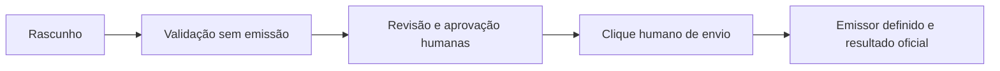

# NINEBIKE OS — fiscal com aprovação humana v2.10.0

**Atualização v2.10.0 — 26/10/2026:** implementação suspensa por pedido do responsável; provedor financeiro em revisão (recebimento integral D+1, condições comerciais em revisão privada). O fiscal reúne Olist e SHOP Simples com aprovação/confirmação humanas; o responsável confirmou que os dados saem pendentes do Olist e são aprovados/emitidos no SHOP; arquivo/layout e homologação ainda precisam de validação. As referências financeiras anteriores não representam fornecedor atualmente escolhido. Ver [decisões atuais](../../README.md) e [fluxo fiscal](fiscal.md).

26/10/2026. Especificação de planejamento; nenhum emissor, certificado ou integração fiscal foi implantado ou homologado. Complementa [escopo](spec.md), [arquitetura](architecture.md), [dados](data-model.md), [API](contracts/api.md) e [aceite](acceptance.md). Os vídeos identificam SHOP Simples / Nota Fácil, da Alterdata. A passagem exata do Olist para esse software ainda não foi demonstrada de ponta a ponta. A implementação permanece suspensa por orientação do responsável.

## 1. Decisão obrigatória e fronteira do escopo

**Nenhuma nota é emitida, transmitida, cancelada, corrigida, inutilizada ou lançada em outro sistema automaticamente.** O fluxo é: pessoa prepara rascunho → valida dados → revisa conteúdo → aprova → clica explicitamente em enviar. Aprovar no Ninebike não significa autorização pela SEFAZ. Cada ato com efeito fiscal tem sua própria aprovação e confirmação final.

Pagamento Asaas, split, comissão, pedido ganho, entrega, movimento de estoque, fechamento do mês e webhook podem mostrar uma pendência fiscal, mas não criam nem enviam nota automaticamente. Não herdar as automações configuráveis do ERP de referência. Ler uma nota, consultar status, visualizar prévia ou abrir exportação também não autoriza emissão.

Consultas de status, recuperação de protocolo/arquivo e conciliação podem ocorrer em segundo plano. Elas não corrigem rejeição, retransmitem documento, escolhem contingência ou executam eventos. O envio mutante nasce exclusivamente do clique humano autenticado no handler HTTP; Cron e fila não recebem capacidade de transmissão fiscal. Transporte técnico após o clique usa somente aquela intenção congelada, sem iniciar outra ação.

Este planejamento cobre o ciclo de NF-e de mercadorias e a distinção necessária para NFC-e quando aplicável. NFS-e, operações rurais, importação/exportação comercial, produção industrial e integrações de fulfillment vistas no ERP não entram por simples existência de campos. Finalidades de devolução, complemento, ajuste, entrada ou contingência só são habilitadas se usadas pela loja, permitidas pelo percurso contratado e validadas pelo responsável fiscal.

## 2. O que foi observado no Olist

Inspeção autorizada em modo somente leitura da aba `notas_fiscais#list`. Nenhuma nota, rascunho, configuração, lançamento, autorização, cancelamento ou arquivo real foi criado, alterado ou exportado. Dados pessoais, números, chaves, valores e totais reais das notas não compõem o portal.

| Superfície | Evidência da interface ou do artefato | Melhoria prevista |
| --- | --- | --- |
| Lista | Pesquisa por cliente; número, emissão, cliente, UF, valor, marcadores e integrações; situações todas/pendentes/emitidas/canceladas | Acrescentar revisão humana, resultado oficial, pendência de arquivo e divergência como dimensões distintas. |
| Ações gerais | Autorizar/enviar pendentes, DANFEs, importar XML, inutilizar, contingência, verificar protocolo e exportar | Nenhuma autorização genérica sobre tudo que estiver pendente; cada documento/ato precisa de revisão e intenção própria. |
| Menu por nota | Autorizar SEFAZ, imprimir/salvar DANFE, compartilhar, lançar contas/estoque, clonar, devolver, excluir, inutilizar e outras opções | Preparação, leitura e atos fiscais separados; nenhuma exclusão de histórico oficial nem duplicação de contas/estoque. Ações não foram executadas. |
| Formulário presente no DOM | Inventário de 165 controles não ocultos por tipo, além de campos técnicos, sem abrir inclusão e sem ler seus valores | Cadastro progressivo e grupos claros; campo presente no HTML não comprova obrigatoriedade, habilitação ou uso da loja. |
| Exportação XML | Preparação com opções de CC-e, canceladas e agrupamento por UF | Pacote mensal explícito, manifesto e conferência de completude. Nenhum download real foi iniciado. |
| Exportação planilha | Preparação oferece itens, XLSX/CSV/XLS e envio por e-mail | Usar formato comprovado pelo destino; e-mail/envio externo desabilitados sem pedido específico. Nenhum arquivo foi gerado. |
| Exportação PDF | Opção presente na interface e fluxo público de geração/ZIP | PDF auxiliar, separado do XML protocolado e sem representar autorização. Geração não foi executada. |

REA analisou cinco scripts públicos observados, totalizando 47.582 bytes, com cinco arquivos interpretados e nenhuma falha de parsing na amostra. O inventário dessa amostra ficou completo, mas a semântica permanece incerta, com 2.093 incógnitas. Leitura estática adicional cobriu treze scripts selecionados de notas, itens, tributos, eventos e exportação. Isso não comprova execução, backend, permissões ou integridade da configuração do Olist.

Cuidados encontrados nos scripts: incluir nota chama inicialização temporária no backend; imprimir DANFE pode alterar situação; salvar e reenviar contém gatilhos para contas/estoque e continuação de envio. São observações estáticas, sem confirmação de seus efeitos em execução. Esses caminhos não foram acionados na conta real e não serão copiados para o Ninebike.

## 2.1 SHOP Simples: o que os dois vídeos comprovam

Análise dos vídeos de 20/10/2026, com aproximadamente 59 e 74 segundos. Foram examinados 45 quadros a cada três segundos, mais os detalhes das telas relevantes. São filmagens de um monitor, com cortes, reflexos e resolução limitada. A fala transcrita localmente é parcial e não confirma o processo fiscal. Dados pessoais, chaves, séries de bikes e linhas reais não são publicados.

| Trecho | Observação verificável | Limite / consequência para o Ninebike |
| --- | --- | --- |
| Primeiro vídeo, início | Marca SHOP Simples; Movimentações, abertura de PDV — Cupom fiscal / Nota Fácil | Navegação e espera; não comprova preenchimento, importação ou aprovação. Remover essas idas e voltas da jornada comum. |
| Segundo vídeo, início | Verificação da validade do certificado, inicialização e grade inicialmente vazia | Certificado e carregamento com estados explícitos; grade vazia não equivale a falha nem sucesso de importação. |
| Segundo vídeo, cerca de 30–73 s | Movimento de Estoque, aba Nota Fiscal Eletrônica; filtros e grade com espécie, referência, emissão, hora, número, operação, cliente/fornecedor, NF-e/NFC-e, status, eventos, chave e observação | Ordem horizontal da lista legada não define XML nem DANFE. Manter lista enxuta e detalhe completo. |
| Segundo vídeo, cerca de 36–47 s | Recebimento Autorizado, Cancelamento Autorizado e links de eventos | Estados fiscais do aplicativo, não recebimento financeiro. Conferir protocolo oficial e preservar origem do rótulo. |
| Segundo vídeo, cerca de 49–65 s | Chaves fiscais e observações com cor, tamanho e identificação física da bike | Vínculo nota → item → unidade/chassi/série, quando confirmado. Não deduzir produto/unidade apenas por texto livre nem divulgar observação interna indevida no documento. |
| Barras de ações | Gerar NF-e, reenviar XML, cancelar, importar NF-e, DANFE, devolver, informações, atualizar status, CC-e e configuração | Botão visível não comprova uso, permissão ou execução. Nenhuma ação foi executada nesta análise; reenvio não é resposta automática a timeout. |

A documentação oficial corrobora Nota Fácil como fluxo de vendas e descreve importação XML com seleção de operação, fornecedor/produtos, unidade, tributos e duplicatas. São capacidades do produto, não escolhas comprovadas da loja. Não copiar cadastros, recálculos, baixas ou downloads silenciosos da referência. [Alterdata: Nota Fácil](https://ajuda.alterdata.com.br/shopbase/configurar-nota-facil-216227677.html), [Alterdata: importação XML](https://ajuda.alterdata.com.br/shopsimples/metodo-xml-pdv-cupom-fiscal-224467372.html), [Alterdata: Movimento de Estoque](https://ajuda.alterdata.com.br/sat/recursos-nf-e-movimento-de-estoque-278266067.html).

**Ainda não visto:** exportação no Olist, seleção/importação de arquivo no SHOP, formulário/itens/tributos, aprovação final e resposta SEFAZ da mesma operação. Não há exemplar XML/DANFE analisado nem contrato/API Alterdata homologado. Esta inspeção é funcional/visual, não análise de código, tráfego ou backend pelo REA.

## 3. Quem emite e onde termina o processo

**Direção da fase1 confirmada pelo responsável:** o Ninebike entrega o fluxo fiscal equivalente ao Olist, com aprovação/clique humanos e emissão pelo provedor homologado (`OS_PRIMARY`). O papel de preparo no Olist e de aprovação/emissão no SHOP foi confirmado pelo responsável; o Ninebike reúne ambos sem transferência entre dois programas nas vendas novas. Provedor, emitente/configuração, modelos, numeração e perfil tributário ainda exigem validação antes de habilitar transmissão; intenção de produto não é capacidade já homologada.

**Atualização de 21/10:** reunir no Ninebike o preparo comercial antes feito no Olist e a conferência/gestão fiscal mostrada no SHOP, preservando aprovação humana. O responsável confirmou em 21/10/2026: **os dados saem pendentes do Olist; a pessoa aprova e emite no SHOP Simples**. O fluxo principal do Ninebike reúne essas etapas nativamente: rascunho → conferência → aprovação humana → clique explícito Emitir NF-e → retorno oficial. Essa confirmação é regra operacional informada pelo responsável, não prova de arquivo/XML ou homologação técnica. Documento já autorizado é apenas exceção histórica/externa e nunca será emitido outra vez. Os percursos abaixo descrevem essa decisão e a transição, não três emissores ativos para a mesma venda nem obrigação de manter conector Alterdata.

| Percurso | Comportamento do Ninebike |
| --- | --- |
| Hoje, no legado — confirmado pelo responsável | Olist prepara dados pendentes; a pessoa confere, aprova e emite no SHOP Simples. Arquivo/layout e passagem técnica ainda não foram auditados. |
| Fluxo principal futuro no Ninebike | Preparo e revisão na mesma aplicação; aprovação e clique manual transmitem pelo provedor homologado. Status oficial, XML, protocolo e DANFE ficam vinculados à venda, sem exportar/importar entre dois programas. |
| Exceção: documento histórico/externo já autorizado | Incorporar evidência e vincular após conferência/aprovação humanas, sem nova emissão. Qualquer exportação/escrituração externa continua com finalidade e confirmação próprias. |

Na primeira versão configurar somente o percurso Ninebike/provedor homologado; durante desenvolvimento sem configuração aceita, manter UNDECIDED e transmitir nada. O código de modos alternativos não precisa ser implementado antecipadamente. Selecionar um único emissor por operação/modelo/ambiente antes de habilitar transmissão. O modo desconhecido bloqueia atos mutantes. Exportar rascunho ou planilha não cria chave, protocolo, autorização ou comprovante de importação. Asaas financeiro e emissão de mercadorias são fronteiras distintas; não presumir que uma API de NFS-e substitua NF-e de bicicletas.

### 3.1 Fluxo principal confirmado e adaptação para o Ninebike

Venda/pedido e bike já cadastrados → preparar documento ou selecionar arquivo de transição → leitura/comparação sem efeitos → corrigir pendências → revisão dos dados e vínculos → aprovação humana → confirmação explícita da ação exata → resultado e arquivos no histórico da mesma venda.

| Origem comprovada | Ação após revisão/aprovação humanas | Resultado permitido |
| --- | --- | --- |
| Venda no Ninebike / dados pré-emissão confirmados | Preparar rascunho e depois aprovar emissão; clicar Emitir NF-e | Uma emissão pelo provedor homologado. Importar dados não significa emitir. |
| Documento já autorizado em outro emissor | Aprovar incorporação e clicar Incorporar documento | Guardar/verificar artefatos e vincular à mesma venda, sem segunda emissão, renumeração ou XML autorizado reescrito. |
| Sem prova suficiente de estado, origem, empresa ou vínculos | Resolver pendência e classificar com evidência | Leitura em quarentena; bloquear incorporação operacional, lançamentos e nova emissão até esclarecer. Ausência de protocolo não basta para classificar como rascunho. |

Leitura, sugestões, divergências e consultas podem ocorrer por trás. **Incorporar documento, alterar cadastros operacionais, aplicar efeitos nos módulos e emitir/eventuar exigem intenção e aprovação humanas próprias.** Não obrigar exportação/importação entre telas do próprio Ninebike: importação é para transição/documentos externos, não etapa artificial de toda venda nova.

## 4. Campos, grupos e validação progressiva

| Grupo | Dados relevantes | Controle |
| --- | --- | --- |
| Identificação | Emitente, ambiente, modelo, tipo entrada/saída, finalidade, natureza, série/número, datas/horas, destino/presença/consumidor final e referências quando aplicáveis | Identidade/configuração deriva do binding autorizado; sem ambiente/emitente escolhido livremente pelo vendedor ou numeração trocada para resolver timeout. |
| Destinatário | Nome/razão, PF/PJ, CPF/CNPJ, IE/contribuinte, endereço/município/UF/CEP/país e contato quando exigido | CPF/e-mail continuam opcionais no CRM. Solicitar aqui apenas os dados exigidos pelo modelo/UF/operação; validar documento e cadastro sem inventar identidade. |
| Itens | Produto/SKU, descrição comercial, unidade, quantidade, preço, descontos, rateios, NCM/CFOP e classificação tributária aplicável | Snapshot comercial e fiscal; código ou tributo não é escolhido por inferência do modelo da bike. Controle de serial/estoque permanece no módulo próprio. |
| Tributos e totais | Bases, valores/deduções, frete, seguro, despesas, descontos, totais e demais grupos exigidos pelo schema vigente | Perfil aceito pelo responsável fiscal e versão homologada. Cálculo pode sugerir/validar no rascunho; não aprova nem transmite. |
| Transporte/entrega | Modalidade/responsabilidade, transportador, volumes, pesos, veículo e endereço distinto quando pertinentes | Campos progressivos, sem obrigar transportadora em toda venda de balcão. |
| Pagamento fiscal | Meio, valor, parcelas/referências, dados de integração exigidos no XML e origem da evidência | Descrição fiscal não marca Asaas recebido nem cria cobrança. Koin, Pix, cartão e entrada/saldo precisam de mapeamento contratual comprovado, sem códigos presumidos. |
| Complementares | Observações, informações fiscais, referências de origem e anexos | Texto validado/limitado; sem HTML ativo, segredos ou notas internas indevidas no documento do cliente. |

O formulário deve começar com os dados da operação já conhecida e destacar apenas as pendências pertinentes. Rascunho incompleto pode ser salvo; validação, aprovação e envio são bloqueados pelos dados realmente necessários. Campos de serviços, importação, exportação, produtor rural ou cupons legados não aparecem na jornada comum sem capacidade explícita.

Dinheiro final é armazenado em centavos. Quantidade fiscal, preço unitário e bases intermediárias que exigem maior precisão usam decimal exato em strings/NUMERIC, com escala/arredondamento do schema homologado; nunca float de JavaScript. Não arredondar preço unitário prematuramente para dois dígitos. A unidade fiscal precisa de conversão explícita compatível com o estoque; não transformar fração fiscal em uma bike fracionada.

Total da nota, total comercial, valores de pagamento, frete, descontos e tributos precisam de reconciliação explicada. Diferença não é corrigida com receita, desconto ou imposto fictício. Finalidades especiais podem ter composição diferente da venda: exigir regra e justificativa aprovadas, sem igualdade ingênua entre todos os documentos.

Versões de XSD, notas técnicas, tabelas e perfil fiscal ficam vinculadas ao ambiente/vigência. IBS/CBS e outros campos exigidos pelo percurso vigente são tratados por schema/perfil homologado, sem construir motor tributário universal ou presumir alíquota. Catálogo indexado não substitui download/verificação do pacote e testes do provedor. [Portal NF-e: schemas oficiais](https://www.nfe.fazenda.gov.br/portal/listaConteudo.aspx?tipoConteudo=BMPFMBoln3w%3D).

### 4.1 Ordem dos dados e correspondência do documento

**Sequência proposta para preencher e revisar no Ninebike:** identificação da operação/emitente → destinatário → itens → tributos e totais → transporte/entrega → pagamento fiscal → informações complementares → prévia e aprovação → clique de envio. Essa é a organização de uso do Ninebike; não é uma afirmação de que todo campo do Olist apareça nessa ordem, nem define a sequência técnica do XML ou o layout do DANFE.

| Camada | Regra de ordem e correspondência | Evidência exigida antes de liberar |
| --- | --- | --- |
| Tela e revisão humana | Grupos na sequência acima, campos condicionais pelo percurso e itens com posição estável; a revisão mostra todos os dados relevantes que serão transmitidos, inclusive os derivados. | Jornada com exemplo fictício, erros/pendências e correspondência ao snapshot aprovado. |
| Snapshot e adaptador | Mapa por campo contendo origem, nome interno, destino no contrato fiscal, condição de obrigatoriedade, tipo/escala, transformação/arredondamento e responsável pela regra. Não confiar na ordem das propriedades de um objeto JSON para definir XML. | Matriz de mapeamento do provedor/modelo efetivamente escolhido; nenhuma transformação relevante ausente da revisão ou feita depois sem invalidar aprovação. |
| XML e protocolo | Serialização, sequência, cardinalidade, namespaces, identificação dos itens e precisão seguem o XSD/contrato homologados da versão aplicável. XML de emissão, XML autorizado protocolado e XML de evento têm papéis distintos. | Validação dos bytes finais contra schema verificado, resposta individual/protocolo e comparação de destinatário, itens, quantidades, valores e totais com o aprovado; dados técnicos atribuídos pelo emissor são identificados separadamente. |
| DANFE/PDF | Representação produzida pelo percurso homologado a partir do mesmo documento, com vínculo inequívoco à identidade e ao protocolo quando autorizado; prévia não autorizada continua identificada. Layout não é deduzido da posição dos campos da tela. | Conferência visual do modelo final e comparação com XML/protocolo: identidade, destinatário, ordem/descrição dos itens, quantidades, valores/totais e informações aplicáveis. Imprimir não altera status ou lança valores. |

**Limite da inspeção realizada:** foram inventariados os campos do DOM e os fluxos dos scripts; não foi gerado/baixado XML ou DANFE real nem validado um exemplar final desta conta. Portanto, o fluxo e o agrupamento estão especificados; a ordem técnica exata do XML e a apresentação final do documento permanecem como aceite obrigatório do percurso fiscal, sem serem declaradas já verificadas.

## 5. Revisão e aprovação humana final

1. **Preparar:** pessoa com `fiscal.prepare` cria rascunho ligado à origem e versão do pedido; nenhum job de transmissão ou lançamento nasce desse ato.
2. **Validar:** conferir campos, matemática, schema, configuração/certificado e capacidades. Validação remota só é permitida se comprovadamente não emitir ou transmitir.
3. **Revisar:** mostrar emitente/ambiente/modelo/finalidade, destinatário, itens/quantidades/valores, tributos, referências, transporte, avisos e prévia marcada como não autorizada. O snapshot é o mesmo que fundamentará o envio.
4. **Solicitar e aprovar:** registrar aprovação humana por ação, alvo/revisão/hash, dependências, usuário, instante, sessão e MFA recente. Preparar, revisar, aprovar e enviar são permissões distintas. Modo de proprietário único é explícito; modo duplo separa solicitante/aprovador.
5. **Enviar:** outro comando explícito, após a revisão, revalida aprovação e cria/consome uma única intenção. Aprovação sozinha não dispara transmissão. Duplo clique, refresh ou nova key não cria segunda nota.
6. **Acompanhar:** informar resultado individual e protocolo oficial; HTTP 200, lote processado, tela de sucesso ou arquivo PDF não comprovam autorização. Falta de evidência deixa pendência visível.

Mudança de conteúdo relevante, pedido de origem, emitente, ambiente, modelo/finalidade, destinatário, itens, valores/tributos, texto do evento, identidade/numeração, configuração/certificado ou versão do mapeamento invalida a revisão/aprovação. Não executar aprovação antiga contra payload novo. Alteração apenas administrativa sem efeito fiscal precisa de classificação explícita e auditada.

Após início de despacho, snapshot e identidade são imutáveis. XML autorizado nunca é editado ou apagado operacionalmente. Se houver seleção de várias notas, cada uma conserva revisão, aprovação e intenção próprias; mostrar lista, totais e exceções, sem “autorizar tudo que estiver pendente” ou estender aprovação a notas que chegaram depois.

## 6. Estados e falhas sem emissão duplicada

| Dimensão | Exemplos de estado | O que não significa |
| --- | --- | --- |
| Revisão interna | Rascunho, inválido, pronto para revisão, revisão solicitada, aprovado pelo humano, aprovação invalidada, envio iniciado | Aprovação interna não é autorização fiscal. |
| Operação durável | Preparada, despacho iniciado, pendente no provedor, concluída, falha conclusiva, incerta, revisão necessária | Timeout não é rejeição nem prova de ausência da nota. |
| Resultado oficial | Não enviado, processando, autorizado, rejeitado, cancelado, desconhecido; códigos brutos preservados | “Emitida” genérico não substitui estado/protocolo individual. |
| Artefatos | Pendente, verificado, ausente, inconsistente | Nota autorizada pode ter arquivo ainda indisponível; isso continua uma pendência. |
| Eventos | Solicitado/aprovado/enviado e resultado aceito/rejeitado/incerto próprios | CC-e aceita não cria outra nota e cancelamento solicitado não é cancelamento concluído. |

Guardar resposta bruta segura, código/motivo, origem, identificador remoto, recibo/protocolo e datas. Códigos históricos, inclusive denegação quando importada, permanecem representáveis sem copiar retorno legado como regra corrente. Novo código desconhecido não é forçado a autorizado ou rejeitado.

Queda **antes de iniciar despacho comprovado** permite retomar a mesma intenção somente por novo clique humano e revalidação; Cron não envia. Queda após início de despacho ou resposta ambígua bloqueia repetição: consultar/reconciliar a mesma referência. “Não encontrado” isolado não libera outra numeração ou reenvio. Sem prova suficiente, manter revisão necessária.

Rejeição oficial conclusiva permite corrigir em nova revisão e repetir validação/aprovação/clique, respeitando identidade e contrato do provedor. Não usar `finally`, reconexão, expiração de lease, consulta, callback ou restauração como gatilho de envio. Restore bloqueia saídas por controle externo ao banco e reconcilia antes de qualquer nova ação humana.

Identidade única por emitente, ambiente, modelo, série/número e chave fiscal; origem/finalidade/revisão também impede duas intenções concorrentes do mesmo documento. Modelo/série/número não são impostos antes de confirmar quem os atribui. Homologação e produção não compartilham identidades como se fossem a mesma nota.

## 7. Cancelamento, correção, inutilização e contingência

Cada ato segue preparar → validar elegibilidade → revisar → aprovar → clicar enviar → confirmar resultado oficial, com intenção/versão/permissão próprias. Número disponível, prazo, motivo e condições são verificados conforme modelo, UF e vigência; não há prazo universal hardcoded.

- **Cancelamento:** preservar nota original, XML, protocolo e pedido/resultado do evento. Recusa ou timeout não marca cancelada. Cancelar fiscalmente não devolve dinheiro, cancela crédito Koin, desfaz split ou repõe bike.
- **CC-e:** disponível apenas quando modelo e regra vigente permitirem; não editar XML original ou corrigir campos vedados. Para NFC-e, a CC-e é vedada. Texto deve refletir correções anteriores conforme regra aplicável; aceite do evento não certifica o mérito tributário. [Ajuste SINIEF 7/05](https://www.confaz.fazenda.gov.br/legislacao/ajustes/2005/AJ007_05), [Ajuste SINIEF 19/16](https://www.confaz.fazenda.gov.br/legislacao/ajustes/2016/AJ_019_16).
- **Inutilização:** tratar faixa/ano/modelo/série/emitente/ambiente, motivo e protocolo. Não é cancelamento. Bloquear sobreposição conhecida com números usados, ações pendentes ou de resultado incerto; não criar nota fictícia para representar faixa.
- **Contingência:** capacidade específica por modelo/UF/provedor, revisão e ação humanas. Falha de rede não ativa contingência nem retransmite na reconexão. Se percurso exigir transmissão posterior, planejar sua exigência/prazo com o responsável e executar manualmente; não declarar contingência operacional sem resolver esse procedimento.
- **Devolução/complemento/ajuste/entrada:** documentos e referências próprios, quando efetivamente usados. Clonar só prepara dados em nova identidade de rascunho; não duplica chave, pagamento, contas, estoque ou aprovação.

Não oferecer “excluir nota” como exclusão de documento oficial. Rascunho não enviado pode ser arquivado com trilha e verificação de inexistência de despacho. Numeração não é liberada por apagar registro local.

## 8. Vínculo com vendas, dinheiro e estoque

A origem comercial preserva pedido, itens, valores, responsável e versões. Dados fiscais e comerciais são relacionados, mas não são a mesma máquina de estados. Documento não confirma pagamento. Emitir/visualizar/exportar/importar/cancelar nota não cria cobrança Asaas nem reconhece nova receita automaticamente.

Movimentos de estoque e obrigações já existentes são vinculados por identidade de origem. Se alguma operação realmente exigir lançamento a partir da nota, a tela mostra os vínculos existentes e exige comando humano separado, permissão e efeito único. Não recriar AP/AR/CMV ou entrada/saída só porque chegou XML, inclusive em importação histórica.

Estorno financeiro, retorno físico, correção de aquisição, cancelamento fiscal e reversão de comissão conservam seus próprios fluxos/evidências. Uma pendência não é resolvida simulando sucesso no outro módulo. Olist documenta que exclusão não desfaz automaticamente contas/estoque; nosso controle usa referências e compensações explícitas. [Olist: utilização das notas de saída](https://ajuda.olist.com/tipos-de-documentos-fiscais-e-suas-operacoes/notas-fiscais-de-saida-nfe-utilizacao-1).

## 9. XML, protocolo, DANFE e importação supervisionada

Documento eletrônico autorizado e seu protocolo não se confundem com DANFE/PDF auxiliar. Guardar XML autorizado protocolado, XML/protocolo dos eventos e representações em artefatos distintos, com bytes originais, hash SHA-256, tamanho, origem, empresa/ambiente/chave e estado de verificação. Não reconstruir XML autorizado a partir de planilha ou PDF. [MOC: visão geral](https://www.confaz.fazenda.gov.br/legislacao/arquivo-manuais/moc7-visao-geral.pdf).

Visualizar/imprimir/download no Ninebike não muda situação oficial, gera lançamento ou transmite evento. Prévia de rascunho tem identificação clara de ausência de autorização. Mesmo com status conhecido, ausência/divergência do XML ou protocolo é mostrada e impede selo de pacote completo.

Importar XML externo exige seleção humana, validação de empresa/modelo/ambiente/chave/protocolo e deduplicação. Parser sem entidades externas, limites de bytes/expansão/itens e proteção contra caminhos ZIP. XML recebido não é confiável apenas por extensão, URL ou nome do arquivo. Correlacionar evidência oficial quando suportado; importação não emite novamente nem lança contas/estoque por efeito colateral.

### 9.1 Aprovação da incorporação e dos lançamentos

Upload guarda apenas arquivo privado em quarentena. A pré-análise compara nota/empresa/modelo/ambiente/estado alegado e comprovado, destinatário/emitente, itens/posições/unidades/quantidades/preços/tributos/totais, pagamentos/duplicatas/referências e observações pertinentes. Não cadastra produto/fornecedor, altera custo, movimenta estoque, baixa títulos, reserva numeração ou transmite.

A revisão mostra origem/hash do arquivo, operação, diferenças, vínculos sugeridos e existentes, pendências e efeitos exatos. Nome/preço/valor isolados não autorizam merge. Unidade/conversão desconhecida bloqueia aplicação; quadro/série exigem associação à unidade física correta. Preservar bytes, ordem dos itens e dados originais; ajuste local fica separado do conteúdo autorizado.

OWNER aprova o snapshot e confirma a ação final nomeada. Aprovação sem confirmação não incorpora; mudança no arquivo, destino, mapeamento, vínculo ou efeito invalida a revisão. SELLER pode preparar rascunhos da própria venda e consultar documentos permitidos; não aprova incorporação, emissão ou lançamento sensível. Acesso ao XML não concede financeiro.

O lote registra resultado por arquivo/item; repetição não multiplica documento nem efeito. Documento existente recebe apenas evidência/vínculo compatível, preservando eventos distintos; conflito abre pendência. Falha parcial mostra o que foi confirmado, sem Tudo concluído. Retomada preserva identidades e exige nova confirmação dos itens ainda não aplicados.

Efeitos em estoque/financeiro seguem comandos/aprovações próprios e chave única de origem, verificando antes o que já ocorreu na venda. Documento histórico pode entrar só para arquivo/conciliação. Não gerar AP/AR/receita/CMV, custo zero, quitação ou saída de bike porque o XML contém valores. Aprovações podem compartilhar uma revisão visual, sem autorização genérica de atos não apresentados.

## 10. Pacote mensal e transição do software atual

Fluxo proposto: escolher mês/empresa/modelo/ambiente → conferir critérios/lista/pendências → solicitar geração do pacote → revisar resumo/manifesto → baixar explicitamente. Esse fluxo só prepara arquivos; não emite nota, envia e-mail, agenda execução mensal ou importa/escritura no outro software.

1. Mostrar mês completo, fuso `America/Sao_Paulo`, início inclusivo e primeiro instante do mês seguinte exclusivo. Não herdar silenciosamente “últimos 30 dias”. Critério de emissão/autorização e eventos do mês precisa ser aceito pelo responsável/destino; exibir o eixo escolhido.
2. Congelar corte da fonte, filtros, documentos/versões e eventos. Incluir eventos ocorridos no mês ligados a notas anteriores, conforme critério aprovado, com referência/artefatos necessários; não perdê-los filtrando só emissão de notas daquele mês.
3. Reunir XMLs/protocolos e eventos pertinentes, incluindo cancelamentos/CC-e e inutilizações aplicáveis, com relatório separado de rascunhos/rejeições/pendências. Não rotular um XML sem autorização como autorizado.
4. Percorrer todas as páginas com ordenação estável/checkpoint; dedup por identidade fiscal e identidade do evento/artefato. XML original e evento são distintos; não deduplicar pelo valor, nome ou apenas hash do PDF.
5. Manifesto inclui export_id/revisão, solicitante/momento, emitente/ambiente/modelos, período/eixo/fuso/corte, fontes/versões, documentos/estados e eventos, caminhos/hash/tamanho dos arquivos, contagens, totais com critério explícito, faltantes/exceções e cobertura de conciliação.
6. Geração interrompida ou arquivo/protocolo ausente mantém pacote incompleto/parcial. Mostrar quais registros faltam; não chamar “completo” um ZIP só porque o download terminou. Manifesto não detecta gasto/nota nunca informado sem conferência das fontes pelo responsável.
7. Novo evento tardio gera novo pacote/revisão aprovado para entrega; arquivo já entregue não muda silenciosamente. Baixar de novo o mesmo arquivo não cria nova nota nem novo fechamento.
8. XML/ZIP, PDF e planilha são opções com propósitos distintos. XLSX/CSV e colunas/layout só serão fechados após conhecer o destino. Valores decimais, datas, codificação, chave e identificadores devem sobreviver à exportação sem notação científica ou perda de zeros.

Olist documenta XML/ZIP e filtros de período, além de permissão específica de exportação. Isso descreve a referência, não prova que um pacote real desta conta esteja completo. [Olist: exportar XML](https://ajuda.olist.com/acoes-e-ajustes-em-notas/como-exportar-o-xml-das-minhas-notas).

**Confirmado pelo responsável:** saída pendente do Olist e aprovação/emissão no SHOP. **Pendente da passagem técnica:** arquivo/método real e versão, documentos/eventos aceitos, critério mensal, campos obrigatórios, lotes, idempotência, aprovador e evidência de conclusão. O vídeo não mostrou essa passagem nem um pacote mensal. O objetivo é encerrar o retrabalho no produto unificado, com migração/corte aprovados; não adicionar automação de cliques no Windows nem supor API Alterdata. A lista exportada não prova importação ou escrituração.

## 11. Segurança, papéis e recuperação

Preparar, revisar, aprovar, submeter, cancelar/corrigir/inutilizar, configurar e exportar são grants distintos. Vendedor só prepara/consulta no escopo concedido; poderes fiscais não vêm automaticamente do papel financeiro. Proprietário define aprovadores e substitutos. Suporte não transmite nem obtém certificado; acesso diagnóstico temporário é auditado.

XMLs, DANFEs, anexos e pacotes contêm dados pessoais/fiscais: arquivos privados, URLs curtas autorizadas, sem indexação pública, sem dados de clientes no portal de planejamento. Auditoria registra identidades/ações/hash/versões e resultado seguro, sem senha, certificado ou payload pessoal desnecessário.

Preferir custódia/assinatura no provedor fiscal contratado se suportado. A1/senha não entram em Storage comum de fotos/anexos, browser público, logs, backups de exportação ou memória do projeto. Se o contrato exigir trânsito/custódia no OS, definir fluxo de segredo específico, criptografia com chave separada, retenção mínima e recuperação/rotação comprovadas antes de habilitar. Não construir assinatura local no Worker sem necessidade demonstrada. [Olist: certificado digital](https://ajuda.olist.com/primeiros-passos-para-emitir-notas-fiscais/como-configurar-o-certificado-digital-no-erp).

Expiração/revogação/rotação/configuração incompatível invalida aprovações afetadas e bloqueia novos envios; consultas de operações já iniciadas continuam pelo percurso suportado. Backup de banco não substitui cópia de objetos/protocolos; restore mantém bloqueio externo de transmissão e reconcilia os atos que ocorreram fora do banco restaurado.

## 12. Aceite e condições ainda abertas

Os cenários FIS-01–30 em [acceptance.md](acceptance.md) exigem evidência de implementação futura. Esta inspeção não os executou. Critérios de interface não substituem teste por ato no provedor/autorizador, incluindo resultado individual, timeout, evento, arquivo, numeração, ambiente e permissões.

Continuam pendentes para ativação: provedor fiscal/capacidades/configuração do emitente, arquivo/layout da passagem pré-emissão confirmada, UF/IE/CRT/regime/credenciamento, modelos/finalidades realmente usados, certificado/titularidade, perfil tributário e conversões, schemas/vigências, numeração e consulta após incerteza, prazos/contingência/elegibilidade, política de aprovação e critério/layout mensal. Ausência de definição não vira padrão inventado nem botão disponível.

O módulo unificado fica definido como preparo → comparação → revisão → aprovação → confirmação da ação → resultado. O estado pendente na saída do Olist e o papel emissor do SHOP estão confirmados pelo responsável; arquivo/layout, campos fiscais, perfil e provedor continuam como gates de homologação. Ver menus e notas existentes nos vídeos não comprova o fluxo de importação nem autoriza implementação ou transmissão.
