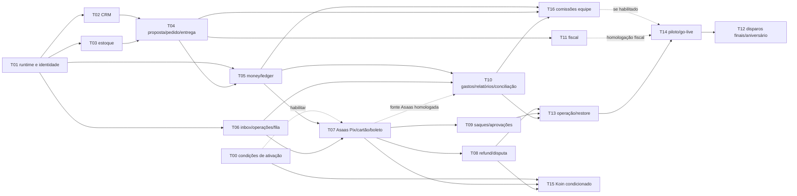

# NINEBIKE OS — plano de implementação v2.10.0

**Atualização v2.10.0 — 26/10/2026:** implementação suspensa por pedido do responsável; provedor financeiro em revisão (recebimento integral D+1, condições comerciais em revisão privada). O fiscal reúne Olist e SHOP Simples com aprovação/confirmação humanas; o responsável confirmou que os dados saem pendentes do Olist e são aprovados/emitidos no SHOP; arquivo/layout e homologação ainda precisam de validação. As referências financeiras anteriores não representam fornecedor atualmente escolhido. Ver [decisões atuais](../../README.md) e [fluxo fiscal](fiscal.md).

> Para execução por agentes: usar Superpowers `subagent-driven-development` ou `executing-plans`, mantendo esta especificação como referência. Os checkboxes em [tasks.md](tasks.md) registram execução futura; nenhum indica código pronto nesta entrega.

**Objetivo:** construir a operação de uma única Ninebike com equivalência funcional às áreas inspecionadas do Olist, melhorias de uso/segurança e controles solicitados, mantendo split fixo de 1,5% bruto e dinheiro rastreável do pedido ao banco. Depois, incorporar os fluxos do outro software no mesmo Ninebike quando forem conhecidos.

**Arquitetura:** monólito modular hexagonal TypeScript, SPA e landing estática em Cloudflare Workers. Banco, Auth, Storage e fila logged no Supabase; um Cron desperta o mesmo Worker. Os efeitos remotos são coordenados por intenção durável, confirmação e conciliação, sem transação distribuída presumida.

**Stack:** React, Vite, TypeScript, SDK Supabase oficial, Workers, PostgreSQL/pgmq, Asaas, API fiscal e, somente na etapa final, transporte de campanhas homologado. Versões suportadas serão fixadas no lockfile no primeiro incremento, após teste de runtime; este plano não inventa números de versões de um repositório inexistente.

**Spec:** [spec.md](spec.md), [architecture.md](architecture.md), [data-model.md](data-model.md), [contratos API](contracts/api.md), [fiscal](fiscal.md), [design](design.md) e [aceite](acceptance.md). Atualizado em 18/10/2026: começar pelo [guia de construção até produção](build-guide.md), executar as 17 tarefas T00–T16 e manter os 175 cenários como aceite futuro. Referências visuais virão depois; não impedem construir base/telas acessíveis conforme design atual. Este portal é planejamento, não repositório do produto.

**Produto unificado:** contatos/clientes/fornecedores, produtos/estoque, comercial, financeiro/relatórios/equipe e fiscal conforme regras aprovadas. Olist e vídeos do SHOP Simples fornecem referência funcional, sem provar backend ou uso de todos os botões. T11 reúne preparo, conferência, aprovação e confirmação humanas; upload/preview não lançam, evidência autorizada não reemite e dados pré-emissão só preparam rascunho. Saída pendente do Olist e aprovação/emissão no SHOP confirmadas; arquivo/layout da passagem continuam pendentes; nenhum conector Alterdata é presumido. A implementação está suspensa e a escolha do provedor financeiro foi reaberta.

**Prontidão do núcleo — 26/10/2026:** começar por capacidades independentes do PSP conforme [guia, seção 2.1](build-guide.md) e reaproveitar o rascunho local somente depois de inspecioná-lo. Pendente de financeiro significa contratação/integração/ativação externas, não suspensão de todo domínio gerencial. Preservar atomicidade T04/T05, testes de permissão e completude. Nenhum saldo, pagamento, split, saque, emissão fiscal ou cálculo de equipe sem regra pode ser simulado como realizado. O início de execução requer orientação explícita; ainda não foi retomado nesta revisão.

## 1. Restrições globais

- Uma empresa usuária e BRL; não criar plataforma multiempresa. Conta prestadora e subconta Ninebike são dois titulares financeiros, não dois clientes SaaS.
- Comissão 1,5% do bruto comercial aprovado, em centavos, com snapshot, rateio cumulativo e split fixo. Não substituir por percentual líquido Asaas.
- Tarifa fixa Pix aceita. Custos ficam registrados internamente e no detalhe autorizado ao OWNER, sem textos extras de tarifas nas telas comuns; confirmações sensíveis mostram o impacto total. Taxa percentual Pix exige revisão do responsável; cartão possui tabela própria. Nenhum custo de provedor é somado ao faturamento.
- Nome e celular obrigatórios no lead; CPF/e-mail/observação opcionais. Modelos/fotos/quantidade cadastráveis pela própria loja; custo ausente não vira margem fictícia. Série/chassi pode ser completado depois do cadastro inicial, antes da entrega aplicável.
- Nenhuma confirmação de pagamento por botão manual, redirect, comprovante ou status Koin isolado.
- Identidade, autorização e integridade revalidadas no commit; `service_role` não é defesa contra ação indevida do backend.
- Um registro durável por intenção e uma fila pgmq. Timeout/lease vencido depois de dispatch inicia consulta, sem repetir dinheiro automaticamente.
- Saques iniciais só para banco PJ validado da Ninebike, com MFA/aprovação de valor e tarifa. Suporte/vendedor sem poder financeiro.
- Teste financeiro que passa em simulador não substitui homologação da conta/produto. Nenhum teste real implica autorização para cobrar ou sacar sem instrução específica.
- Planejar com diretórios abaixo, mas ajustar ao repositório real se existir na implementação; não criar arquivos vazios para cumprir uma lista.
- Separar **CONSTRUIR/TESTAR** de **HABILITAR EM PRODUÇÃO** por capacidade. T00 acompanha os contratos em paralelo e bloqueia efeitos dependentes, sem bloquear T01–T04 ou código de domínio por falta de Koin/conta fiscal/regra da equipe. Simuladores/fixtures são exclusivos de desenvolvimento/teste; produção sem capacidade retorna indisponível, nunca sucesso fictício.
- Direção fiscal da fase 1: Ninebike OS controla o fluxo equivalente ao Olist por provedor escolhido, modo OS_PRIMARY após contrato/certificado/modelos/UF/perfil homologados. O software seguinte desconhecido não impede codar. Não ativar emissor concorrente; se a direção mudar, revisar a configuração antes de transmitir, preservando histórico e numeração.

## 2. Fronteiras e interfaces que permanecem estáveis

| Fronteira | Contrato do planejamento | Quem implementa |
| --- | --- | --- |
| Browser → API | `/api/v1`, JWT bearer, IDs UUID, centavos como strings, versões e Idempotency-Key nos comandos | Adaptador HTTP + telas |
| Auth → aplicação | Identidade validada; permissões atuais; aal/MFA recente para ações sensíveis | Módulo identity |
| Caso de uso → persistência | Commit específico por operação; constraints/locks/auditoria/pgmq na mesma RPC | Adaptador PostgreSQL |
| Operação → provedor | Referência/payload congelados e resultado conhecido/pendente/incerto. Fiscal mutante só pelo handler do clique humano; scheduled não transmite | Adaptador Asaas/fiscal/Meta |
| Evento → negócio | Inbox durável; autenticação do emissor; dedup entrega e dedup fato econômico separados | Integrações + módulo dono |
| Financeiro → dashboard | Projeções transacionais por fatos/snapshots; caixa e competência separados, fontes/completude/versão e datas de atualização/conciliação | Leitura/relatórios |

Os nomes e campos normativos estão em [contracts/api.md](contracts/api.md) e [data-model.md](data-model.md). O plano evita criar uma segunda definição dos mesmos schemas. Se surgir conflito entre arquivos, corrigir o planejamento antes de implementar a fronteira, sem resolver por suposição do agente.

## 3. Estrutura de arquivos do aplicativo futuro

| Caminho previsto | Responsabilidade |
| --- | --- |
| `src/worker.ts` | Composição e handlers fetch/scheduled. |
| `src/web/` e `public/` | Base de layout/componentes acessíveis, área interna e landing, sem depender de referências visuais futuras para iniciar. |
| `src/modules/identity/` | Ator, grants, aprovações e alçadas. |
| `src/modules/crm/` | Contatos, captura, oportunidades e atividades. |
| `src/modules/inventory/` | Série, quantidade, reserva, movimentos e inspeção. |
| `src/modules/sales/` | Proposta, snapshot, pedido, entrega e devolução. |
| `src/modules/finance/money.ts` | Cálculos inteiros e rateio/reversões; sem SDK. |
| `src/modules/finance/` | Cobranças/recebíveis, despesas/AP/baixas, software, comissões da equipe, estorno/saque, livro e resultado gerencial. |
| `src/modules/integrations/` | Inbox, estados de operação, consumidor, políticas de tentativa e reconciliação. |
| `src/modules/fiscal/`, `communication/` | Documentos fiscais e WhatsApp humano. |
| `src/adapters/http/`, `persistence/`, `providers/` | Transporte, RPC e tradução dos contratos externos. |
| `supabase/migrations/` | Tabelas, constraints, funções, grants e fila. |
| `tests/unit/`, `integration/`, `db/`, `e2e/` | Verificações proporcionais aos riscos tratados. |
| `docs/operations/` | Runbooks e evidências de homologação/restore, sem segredos. |

Cada tarefa em [tasks.md](tasks.md) declara ownership por esses caminhos. Duas pessoas/agentes não editam migrations ou contratos compartilhados simultaneamente. Integrações independentes podem andar em paralelo depois de dados/contratos estabilizados.

## 4. Roteiro e dependências

Ordem de construção detalhada no [build-guide](build-guide.md); setas sólidas indicam contratos/código necessários e pontilhadas indicam habilitação. T00 corre em paralelo. T11 constrói o fluxo humano da fase 1 conforme [fiscal.md](fiscal.md); contrato/certificado/modelos/UF/perfil e payload/XML final verificados são condições para habilitar transmissão, sem esperar o outro software para codar. Cron/fila fiscal somente consultam e reconciliam. T16 permite construir regras em rascunho/extrato/obrigações enquanto a política está pendente; cálculo/liberação permanecem indisponíveis até aceite e ensaio. T12 é adiado após T14 e condicionado ao canal contratado, sem inbox ou integração da IA e T15 à prova Koin. Gastos/AP/relatórios reutilizam T10/livro e fornecedores reutilizam T02.

As tarefas representam entregas verificáveis; nenhuma operação real é autorizada por um checkbox do plano. Pix faz parte de T07. Koin é T15, com adaptador/jornada de App somente após evidência do produto compatível; não criar integração fictícia enquanto aguarda contrato. Um lançamento parcial de CRM/estoque pode ocorrer após seus próprios gates, sem habilitar controles financeiros/fiscais não homologados e sem declarar a fase 1 completa.

## 5. Contratos externos e capacidades

Registrar por ambiente/conta os percursos realmente suportados: cobrança Pix dinâmica com split fixo, boleto, checkout hospedado à vista, parcelamento hospedado com total fixo correto, refund total/parcial, consulta inequívoca de operação e retirada para mesma titularidade.

Não criar feature-flag engine: configuração restrita de capacidades com evidência, validade e responsável é suficiente. API bloqueia rota/meio quando capacidade não está aprovada; botão oculto não é barreira.

Para cartão parcelado, demonstrar o percurso hospedado específico e o somatório por cobrança/split. O fato de parcelamento API ter `totalFixedValue` não comprova esse campo no Checkout. Se a combinação ainda faltar, os demais meios homologados podem ser entregues, mantendo parcelamento como requisito bloqueado identificado; não declarar o escopo integral implementado.

Condições financeiras a obter em T00:

1. Aprovação conta/subconta, BaaS/identificação, gestão de chaves e emissão de R$ 4 mil–R$ 15 mil.
2. Tarifas atuais e vigências; referência pública Pix R$ 1,99/promo R$ 0,99 não vira garantia de contrato.
3. Split fixo, prazo de liquidação, reversões/falta de saldo/MED/chargeback e responsabilidades da principal.
4. Autorização de saque/correlação, rate limits e consulta segura após timeout de cada endpoint.
5. Fiscal: direção OS_PRIMARY da fase 1, único emissor ativo, provedor/capacidades por ato, UF/regime/modelos/numeração/certificado e critérios mensais. Papel/integração do software seguinte são fase posterior; WhatsApp/número/WABA têm gate próprio.
6. Koin: cobrança específica, QR, originador, financiamento e cancelamento coordenado do crédito.
7. Equipe: política remuneratória aprovada, percentuais/valores/base/atribuição, reconhecimento/liberação/vencimento/reversão; saldos de abertura, custos e classificação gerencial/contábil validados. Nenhuma regra do Olist é presumida apenas pela tela.

Esses gates exigem documentos/evidências externas. A arquitetura e o comportamento de falha estão definidos enquanto eles são obtidos.

## 5.1 Migração, corte e responsabilidade operacional

T13 prepara e T14 executa o roteiro de migração aprovado: inventário das fontes, exportação manual autorizada, chaves estáveis de origem, dry-run sem efeitos externos, relatório de duplicatas/lacunas e conferência de abertura por responsável. Abrange contatos/fornecedores, produtos/unidades/quantidades/custos, pedidos e cobranças em aberto, AP/AR, comissões/saldos anteriores e saldos/extratos conciliados no mesmo corte. XML/chave/emitente/ambiente/modelo/série/número preservam a identidade fiscal para nunca reemitir nota antiga. Não copiar segredos ou credenciais do Olist.

Antes de transferir a operação, nomear uma autoridade de escrita para estoque, cobrança e fiscal após o corte; Olist e Ninebike não emitem nem movimentam a mesma venda em paralelo. Cobranças/atos anteriores continuam acompanhados pela origem até conciliação e regra de transição explícita; novo pedido não recria obrigação já importada. Abertura não vira receita do mês, compra não duplica CMV e saldo anterior da equipe não é comissão nova. Diferenças não resolvidas impedem ativar o fluxo afetado.

Rollback de código só retorna versão compatível: congelar comandos/efeitos, preservar evidência, reconciliar operações remotas e decidir retomada. Não restaurar banco para “desfazer” Pix/split/saque/nota; regras de restore em T13/architecture continuam obrigatórias. Na produção, entregar runbooks, responsáveis/substitutos, permissões, rotinas de conciliação/backup e capacidade efetivamente ligada/desligada, sem prazo/SLA inventados.

## 6. Parâmetros operacionais do primeiro incremento

São valores técnicos iniciais para ensaio, ajustáveis por configuração restrita; não são KPIs comerciais inventados nem SLA prometido.

| Parâmetro | Padrão de planejamento | Revisão necessária |
| --- | --- | --- |
| Dinheiro e fuso | BRL; UTC persistido; America/Sao_Paulo em relatórios | Mudança exige migração de regra, não preferência de tela. |
| MFA recente | TOTP validado nos últimos cinco minutos para aprovar dinheiro | Testar claims/refresh/sessão; ausência de prova exige novo desafio. |
| Consumidor | Cron a cada minuto; lote máximo inicial 10 mensagens, execução com orçamento de 20 s de parede | Medir latência; subdividir trabalho sem perder progresso. |
| Rede de provedor | Timeout inicial 5 s; lease inicial 60 s | Ajustar por contrato/medição; expiração não autoriza segundo POST. |
| Consultas/retries seguros | Backoff com jitter, até cinco tentativas automáticas de consulta/transporte comprovadamente sem efeito | Resultado financeiro incerto segue revisão/consulta, não contador de retry genérico. |
| Pendências recentes | Reconciliação a cada cinco minutos por lotes | Respeitar limites Asaas e evitar polling por objeto sem necessidade. |
| Fechamento | Diário com janela e timezone explícitos; sobreposição temporal nas importações | Horário escolhido na operação; não faz diferença ao cálculo. |
| Limites de interface | Paginação padrão 50, máximo 100; valores/quantidades/tamanho de payload validados | Configurar limites por rota na implementação e testar rejeição. |
| Reserva e proposta | Prazo e alçada explicitamente cadastrados pelo proprietário antes de liberar vendas | Sem configuração, não reservar indefinidamente nem autorizar desconto. |
| Pix | Tarifa fixa contratada, snapshot de vigência; absorvida no líquido Ninebike | Percentual ou condição desconhecida bloqueia novas emissões até aceite. |

Se o lote não couber em 20 s, terminar com checkpoint antes do próximo item e deixar os restantes duráveis. Não disparar dez requisições sequenciais de cinco segundos sem respeitar orçamento. Conciliações grandes são paginadas e retomáveis.

Para rede com resposta perdida, o estado incerto não expira por relógio. Números acima controlam consumo de recursos, não definem prova de execução financeira.

## 7. Estratégia de verificação

Scripts esperados no aplicativo futuro:

| Comando | O que deve provar |
| --- | --- |
| `npm run typecheck` | Tipos/contracts consistentes, sem números inseguros para money. |
| `npm run build` | Artefato SPA/Worker compilado, sem secrets públicos. |
| `npm run test:unit -- <arquivo>` | Regras puras, autorização e tradução de estados relevantes. |
| `npm run test:integration -- <arquivo>` | HTTP/consumer/provedor simulado com erro, timeout e concorrência. |
| `npm run test:db` | Transações/constraints/grants com PostgreSQL real do ambiente de teste. |
| `npm run test:e2e -- <arquivo>` | Jornadas críticas e negação de permissões no navegador. |

T01 cria os scripts com ferramentas compatíveis e versões fixadas. A existência dessa tabela não significa que os comandos já possam rodar nesta pasta documental. Vitest cobre TS e Playwright cobre jornadas; usar o menor número de ferramentas necessário e não criar um harness de orquestração próprio.

Para lógica crítica, escrever o teste que falha, observar falha pelo motivo esperado, implementar o mínimo e observar sucesso. SQL/concor­rência exige banco real; simulador não prova locks. Repetir testes apenas após mudança ou falha relevante, seguindo [acceptance.md](acceptance.md).

### 7.1 Cadeia de verificação e critérios para avançar

| Etapa | Verificação obrigatória proporcional ao risco | Evidência/condição de avanço |
| --- | --- | --- |
| Local | Tipos/build e teste da regra alterada; propriedades de dinheiro e parsing; PostgreSQL real para locks, grants/RLS, constraints e rollback. | Falha observada pelo motivo esperado quando aplicável, execução após correção e cenário identificado. |
| Pull request | Instalação pelo lockfile; build Worker no runtime; unitários/contratos; instalação limpa e upgrade de schema com dados sintéticos; APIs negativas e poucas jornadas de navegador. | Check exigido bloqueia merge com falha material; migrations revisadas. Não aceitar retry que esconda falha. |
| Staging | Mesmo artefato/commit da liberação, Auth/Storage/pgmq/Cron de teste, jornadas entre módulos, falhas induzidas, dry-run dos imports e restore isolado. | Versão, cenário, esperado/observado, evidência sanitizada e limitações; nenhum segredo ou dado real da loja em preview/CI. |
| Homologação | Ambiente oficial e percurso contratado: identidades, payloads, split, parcelas, taxas, estornos, consulta após incerteza e fiscal humano/XML/DANFE. | Capacidade provada no adaptador efetivo; limitações do sandbox registradas. Mock não substitui esta etapa. |
| Piloto e corte | Operações reais especificamente autorizadas, contas nos dois titulares, estoque físico, fiscal aplicável, abertura e restauração. | Responsável confere totais/fontes, diferenças resolvidas e capacidades explicitamente liberadas. |

Implementar com Vitest compatível com Workers e PostgreSQL/pgTAP pelo fluxo oficial Supabase quando pertinente; Playwright para jornadas que dependem do browser. Não usar SQLite ou mock de banco para provar locks/RLS. Testes concorrentes abrem sessões reais independentes com coordenação explícita; uma única transação SQL não prova disputa. Banco/fixtures de cada teste são isolados, tempo controlado, espera por condição e trilhas de falha com dados sintéticos. Não impor porcentagem de cobertura ou repetição fixa como prova de ausência de bugs. [Workers/Vitest](https://developers.cloudflare.com/workers/testing/vitest-integration/), [testes de banco Supabase](https://supabase.com/docs/guides/database/testing).

### 7.2 Provas financeiras e falhas nas fronteiras

Propriedades reproduzíveis complementam exemplos: comissão/rateio fecham o alvo inteiro; parciais acumulados não superam bases originais; devolução integral zera a comissão econômica remanescente; nenhum lançamento desequilibrado ou fato duplicado é aceito. Cobrir zero/limites/entradas inválidas/resíduos e persistir seed/exemplo quando houver geração. Não confundir teste aritmético com prova do split efetivo.

Injetar falha antes do commit; depois do commit antes da resposta HTTP; após persistir inbox antes de consumir; antes/depois de dispatch_started; após aceite remoto antes da persistência; durante fato+livro+projeção+arquivo da mensagem. Exigir rollback local completo ou progresso confirmado retomável, e ausência de segundo POST diante de resultado remoto incerto. Reutilizar FIN/SEG/OPS/FIS existentes; mudança de enum/campo no provedor não vira sucesso local nem trava todo webhook por atributo adicional desconhecido.

Poucas jornadas integradas demonstram os vínculos: lead → proposta → reserva/pedido → recebimento/split → fiscal humano → entrega → relatório; compra/entrada → obrigação → baixa parcial → venda/CMV; devolução parcial → refund → retorno/inspeção → comissão/fechamento; abertura importada → evento tardio relacionado. Conferir IDs/FKs, snapshots e contagens, além da aparência. Cadastro atualizado não reescreve venda histórica. Migração aplica/reaplica/interrompe/retoma e compara identidades/quantidades/valores no mesmo corte, conforme LOJ-28–33.

### 7.3 Registro de execução

Por cenário aplicável, registrar `scenario_id,commit,schema_version,environment,source_mapping_version?,expected,observed,result,evidence_ref`. Resultado é PASS/FAIL/BLOCKED/NOT_RUN; ausência de contrato/dados não é PASS. Evidência de provedor mantém IDs sanitizados suficientes para correlação; nenhum CSV real, CPF, telefone, chave, XML de cliente ou senha nos artefatos de CI. Revisão independente das mudanças de autorização, livro e emissão acompanha os testes. A cadeia reduz e detecta falhas; não certifica risco zero ou funcionamento perpétuo.

## 8. Foco de revisão

Cinco condições que atravessam módulos e merecem revisão explícita:

- Cobrança substituída/QR vencido paga tarde, depois que a bike já foi reservada por outra pessoa: T04/T07 devem criar exceção, sem segunda entrega.
- Confirmação de cartão integral seguida de múltiplas liquidações e refunds: T05/T08/T10 devem conservar obrigação e receita sem duplicar cobertura.
- Saque externo idêntico tenta reutilizar uma aprovação: T09 deve vincular um único ID remoto, inclusive com callbacks concorrentes.
- Promoção/tarifa muda entre intenção, aprovação e execução: T07/T09 preservam custo aceito, detectam alteração e reavaliam antes de despachar.
- Compra/CMV, comissão reconhecida/pagamento, transferência própria e descontos: T05/T10/T16 precisam impedir dupla dedução e indicar dados incompletos.
- Banco volta no tempo enquanto o provedor preserva saques/notas: T13 deve bloquear todas as saídas restauradas e reconciliar antes de reabrir.

## 9. Definição de encerramento do planejamento

O planejamento fica consolidado com escopo, regras monetárias, papéis, modelo de dados, contratos, tarefas, falhas/aceite e procedimento de validação ligados entre si. Parâmetros comerciais não informados ficam como configuração obrigatória da implantação; capacidades de terceiros não demonstradas ficam bloqueadas por gates explícitos.

Não há código, conta homologada, operação real ou SLA certificado nesta etapa. A implementação deverá produzir evidências por tarefa e registrar qualquer alteração desta baseline, preservando a autorização e as decisões do responsável.

## 10. Repriorização v2.7

Executar T01–T11/T13/T16 conforme dependências do núcleo e T14 para seu piloto/corte; Koin segue condicionada. T02 acrescenta apenas aniversário opcional e consulta por carteira. T12 passa para depois do aceite do núcleo e entrega disparos/campanhas de aniversário por OWNER. A numeração das tarefas é identificador, não ordem crescente obrigatória. Não criar tabelas/rotas vazias de comunicação ou bloquear core por falta de canal de campanha.

A decisão substitui o plano v2.6 de inbox e gateway com IA. Não executar plano antigo de alteração no n8n/Evolution ou corte de envio direto; nenhuma integração de atendimento será criada. Campo de aniversário é dado do CRM; aniversário/idade não são dados financeiros nem prova de consentimento. Listar aniversariantes não precisa de transporte/conta WhatsApp. Disparo só ocorre na fase final pelo percurso aceito, após prévia/agenda humana. Régua anual automática permanece opcional e desligada até decisão própria, sem novo scheduler obrigatório.

## 11. Regras de comunicação da revisão v2.8

T12 permanece final, mas passa a permitir SELLER e OWNER nas fontes/contatos autorizados, composição IA sem chatbot e aniversário diário automático por switch. Não aplicar as restrições antigas OWNER-only ou “clique diário”/“automação anual desabilitada como requisito”. Núcleo T01–T11/T13/T14 continua independente. Configuração e poderes financeiros/fiscais permanecem exclusivos dos donos; o n8n atual não recebe credencial nem alteração.

Aproveitar a fila/Cron/intenções existentes: importação mínima de diretório, geração de texto, quota 70global, slots e gate persistidos, birthday rule/run e trava anual. Cada tabela/comando só nasce em T12, sem scaffolding antecipado.70/dia é limite dos disparos Ninebike e não promessa de controlar envios externos. Os defaults de horário/faixa/AI off são propostas de produto sujeitas à configuração aceita, não regras descobertas no Olist. Revalidar capacidades reais do canal/modelo na implantação, com teste de concorrência e falhas.
