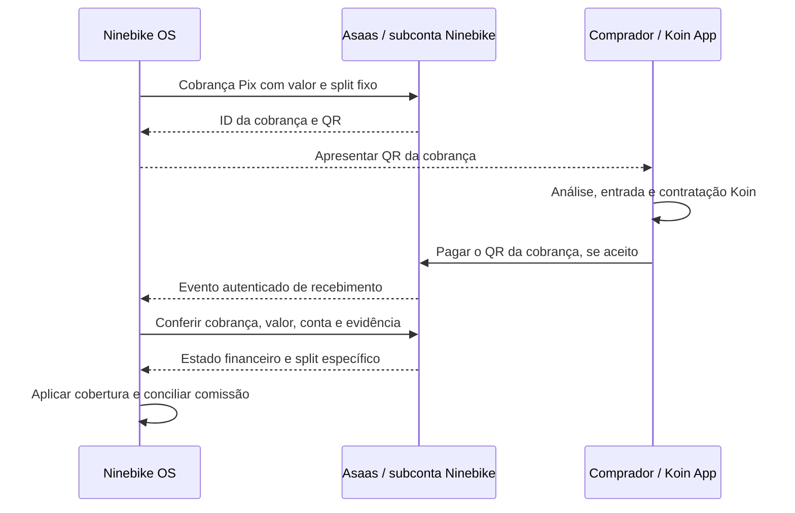

# NINEBIKE OS — especificação funcional v2.10.0

**Atualização v2.10.0 — 26/10/2026:** implementação suspensa por pedido do responsável; provedor financeiro em revisão (recebimento integral D+1, condições comerciais em revisão privada). O fiscal reúne Olist e SHOP Simples com aprovação/confirmação humanas; o responsável confirmou que os dados saem pendentes do Olist e são aprovados/emitidos no SHOP; arquivo/layout e homologação ainda precisam de validação. As referências financeiras anteriores não representam fornecedor atualmente escolhido. Ver [decisões atuais](../../README.md) e [fluxo fiscal](fiscal.md).

Criado em 14/10/2026; atualizado em 26/10/2026. Baseline de planejamento consolidada v2.10.0: referência funcional Olist, execução de ponta a ponta, design inicial e fiscal com aprovação humana final. Evolui a v2.1 com contatos cliente/fornecedor, catálogo administrado pela loja, caixa/resultado separados, baixas parciais, comissão da equipe e atualização verificável. Mantém tarifa fixa Pix aceita e CRM simples. Nenhuma implementação, contratação, homologação ou teste funcional é declarada concluída.

## 1. Objetivo e limites

Permitir à Ninebike atender leads, negociar, reservar bicicletas, vender, acompanhar pagamentos, controlar gastos e resultado gerencial, apurar comissão dos funcionários e retirar seu saldo Asaas. A prestadora de software recebe 1,5% do bruto por split nativo de cada cobrança elegível, separado da comissão da equipe. Todo valor exibido precisa indicar origem, estado, completude e momento de atualização.

O sistema deve prevenir efeitos duplicados, impedir ações sem permissão, detectar divergências e permitir recuperação auditável. Não existe garantia tecnicamente honesta de ausência absoluta de bugs, queda, fraude, chargeback ou prejuízo. Falhar de forma segura, parar operações incertas e recuperar o estado financeiro são requisitos de funcionamento.

Escopo: uma organização, uma operação de loja, moeda BRL. Manter CRM, estoque, vendas, financeiro, disparos somente na etapa final, sem integrar a IA n8n e fiscal da proposta. Não incluir multiempresa, banco próprio, crédito próprio, novo agente IA nativo, Open Finance generalizado, microsserviços ou recorrência usada para simular financiamento. Expansão para filiais/múltiplos estoques exige revisão explícita.

**Direção da primeira versão, confirmada em 18/10/2026:** manter equivalência funcional com as áreas selecionadas do Olist e melhorar interface, segurança e consistência; o outro software entra numa evolução posterior do mesmo Ninebike. Não ampliar para todo o ERP. [build-guide.md](build-guide.md) define a execução de ponta a ponta e [design.md](design.md) define as regras visuais iniciais, a refinar com as referências futuras.

**Recorte fiscal:** o fluxo está em [fiscal.md](fiscal.md): preparar/validar/revisar/aprovar e confirmar a ação, sem lançamentos fiscais automáticos. Ninebike unifica o preparo e a gestão fiscal vistos no Olist/SHOP Simples via provedor homologado, sujeito à configuração e testes antes de ativar. Saída pendente do Olist e aprovação/emissão no SHOP confirmadas; arquivo/layout da passagem continuam pendentes; nenhum conector Alterdata é presumido. Dados tributários ausentes mantêm resultado parcial, sem alíquota inventada.

## 2. Decisões e políticas propostas

**Confirmado pelo responsável:** subconta PJ Ninebike, conta principal PJ prestadora, comissão do software de 1,5% do bruto, Cloudflare + Supabase, acesso restrito de vendedores e aceitação de tarifa fixa por recebimento Pix, inclusive no percurso Koin. A restrição anterior de tarifa zero foi substituída; tarifa percentual de recebimento Pix não está aceita. O pedido atual inclui gastos, lucro/resultado, métricas corretas atualizadas e comissão dos funcionários.

**Escolhas técnicas adotadas neste planejamento:** React/Vite e Worker; fila pgmq; transações por RPC; comissão calculada em centavos; operação financeira incerta bloqueia nova tentativa; saque inicialmente apenas para conta PJ validada da Ninebike.

**Políticas padrão do planejamento:** base da comissão do software definida no item 6; reversão proporcional dessa comissão em devoluções; ausência de antecipação automática; descontos, reservas e liberação de entrega controlados. Sua formalização contratual e configuração operacional são condições de implantação, sem reabrir a arquitetura. Mudanças dessas regras exigem revisão da especificação.

**Comissão da equipe adiada pelo responsável em 17/10/2026, que informará a regra depois:** fórmula/modalidade, base, taxa ou valor, beneficiário/atribuição, competência/reconhecimento, gatilho de liberação, vencimento e reversão. Ausência de regra significa “não configurado”, sem assumir 0%, 1,5%, pagamento na venda ou desconto automático de valores já pagos. Regra da equipe e split do software têm configurações, históricos e destinatários independentes.

## 3. Titularidade e fonte dos dados

| Objeto | Titular/fonte | Regra |
| --- | --- | --- |
| Venda, cliente, bicicleta, entrega | Ninebike / OS | Relações comerciais e estoque internos. |
| Cobrança e saldo da loja | Subconta PJ Ninebike / Asaas | Emitir com a chave operacional da subconta. |
| Comissão do software | Prestadora / contrato + split Asaas | Direito previsto e recebimento efetivo separados; regra de 1,5% do bruto. |
| Comissão da equipe | Ninebike / política aprovada + vendas e quitações | Previsão, obrigação reconhecida, liberação e pagamento separados; regra ainda pendente. |
| Contatos, fornecedores e despesas | Ninebike / cadastros e documentos da operação | Papel de fornecedor ou vínculo à despesa não autoriza destino de transferência. |
| Saldo bancário externo | Banco PJ Ninebike | OS conhece a transferência Asaas, não todas as movimentações do banco. |
| Crédito do comprador | Koin | OS acompanha somente os dados disponibilizados pelo produto contratado. |
| Nota fiscal autorizada | Provedor fiscal/SEFAZ | Envio de solicitação não equivale a autorização. |

O restante líquido da cobrança permanece na Ninebike. Não incluir a carteira emissora como recebedora do próprio split. Não emitir vendas da loja na conta principal para contornar a subconta. [Asaas: split](https://docs.asaas.com/docs/split-de-pagamentos).

A criação técnica de subconta não comprova aprovação regulatória. O período de avaliação publicado limita emissão por subconta; as bikes de R$ 4 mil a R$ 15 mil exigem liberação anterior às vendas reais. Modelo BaaS, gerenciamento continuado de chaves e identificação do Asaas precisam ser definidos com o provedor. [Criação de subcontas](https://docs.asaas.com/docs/criacao-de-subcontas), [avaliação](https://docs.asaas.com/docs/faq-periodo-de-avaliacao).

Os termos publicados incluem responsabilidades da conta principal pelas subcontas. O contrato específico deve definir perdas, autorização do titular e encerramento do serviço. Não prometer que a prestadora tem exposição financeira limitada à comissão. [Termos Asaas, seção 5](https://central.ajuda.asaas.com/hc/pt-br/articles/32096847160859-Termos-e-Condi%C3%A7%C3%B5es-de-Uso).

## 4. Dois perfis e prevenção de desvio

**Decisão do responsável em 18/10/2026:** somente dois perfis humanos: SELLER (vendedora) e OWNER (dono). Uma conta individual por pessoa, com o mesmo login e navegação adaptada ao perfil; não são duas senhas compartilhadas. Convite e troca de perfil são exclusivos de OWNER com MFA recente/auditoria. Não criar gerente, financeiro, estoquista ou suporte como perfis alternativos nesta versão. Credenciais de infraestrutura seguem separadas da operação e não concedem sessão de dono.

| Capacidade | Vendedora — SELLER | Dono — OWNER |
| --- | --- | --- |
| Contatos, pipeline, propostas, reservas e pedidos | Carteira atribuída/compartilhada, dentro da política | Toda a loja; distribui carteira e configura etapas/alçadas |
| Aniversariantes | Consulta/cadastro no escopo; ativa/pausa sua regra automática de carteira na fase final | Loja inteira; regra geral e master de automações |
| Campanhas/disparos em lista | Cria/inicia/agenda/pausa/cancela suas campanhas no escopo e fonte comercial autorizada;70/dia compartilhados | Mesmas ações e supervisão da loja; canal/modelo/master globais |
| Catálogo/estoque | Consulta comercial de preço/disponibilidade, sem custos; pode reservar | Cadastra produtos/fotos/entradas/recontagem/abertura e custos |
| Cobrança de pedido aprovado | Solicita QR/link com valor calculado; acompanha situação comercial | Mesma regra; configura os meios homologados |
| Desconto | Dentro da alçada aceita; ausência de limite nega desconto | Aprova exceção e configura política |
| Devolução | Solicita e acompanha a própria venda | Decide parte comercial, retorno físico e estorno financeiro |
| Caixa, saldo, extrato, despesas, margem, taxas e split | Sem acesso, inclusive busca/export/API/eventos | Acesso financeiro completo e auditado; interface diária enxuta |
| Saque, transferência, beneficiário, refund, ajuste/baixa/despesa | Negado, inclusive preparação financeira | Prepara/aprova/executa conforme intenção, MFA e capacidade |
| Comissão da equipe | Só a própria se habilitada explicitamente | Configura/aprova, acompanha e registra pagamentos |
| Fiscal | Prepara rascunho da própria venda, consulta situação e documento autorizado permitido | Revisa, aprova e clica enviar; eventos/configuração/export mensal |
| Usuários, permissões, integrações, imports e exportação geral | Negado | Administra com grants/escopo e auditoria |
| Marcar pagamento como recebido | Nunca | Nunca: confirmação vem da fonte financeira oficial |

Grants refinam escopo dentro do teto do perfil; nunca transformam SELLER em financeiro ou OWNER por concessão avulsa. Alteração de perfil é comando próprio de OWNER, validado no servidor/commit; impedir autoelevação e remoção/desativação do último OWNER ativo. Revalidar perfil/vínculo atual mesmo com JWT ainda válido; projeção vendedora não recebe custo, tarifa, comissão do software ou dados bancários para depois esconder em CSS. API, Storage, busca, exportação e atualizações em tempo real obedecem ao mesmo teto.

Solicitação financeira congela valor, moeda, origem, destino, tarifa interna, débito total, versão e autor. Qualquer alteração invalida aprovação. Quando houver dois donos e política de dupla aprovação, solicitante/aprovador são OWNER distintos; OWNER_SINGLE explícito usa MFA recente e intenção própria. Vendedora não prepara saque para o dono apenas aprovar. Alterar split/comissão do software continua fluxo contratual bilateral, não campo livre nem poder automático de qualquer OWNER.

**Interface clean:** não exibir banners, percentuais do split, explicações de tarifas ou rótulos de custo do provedor nas telas comuns. Valores reais continuam incluindo todos os custos; dono aprova valor total a debitar, destino e líquido aplicável, com detalhes contábeis em extrato restrito sob demanda. Remover texto excessivo não remove confirmação de ato sensível, trilha, divergência ou valor essencial da decisão. Light/dark compartilham as mesmas permissões e estados.

WEBHOOK/JOB internos são identidades técnicas separadas, nunca terceiro perfil humano ou OWNER. Não criar credencial/porta de contexto ou resposta n8n no Ninebike. A IA já existente permanece no n8n, fora da integração deste projeto e sem poder financeiro/fiscal no Ninebike. Acesso de manutenção é excepcional, temporário, auditado e não habilita atos financeiros/fiscais; poder de administrador de infraestrutura não é eliminado pela matriz da aplicação.

## 5. CRM, contatos, catálogo, estoque e vendas

### 5.0 Referência observada no Olist → melhoria para a Ninebike

A referência abaixo descreve telas e controles visíveis observados no Olist autenticado. Não comprova comportamento do backend, configuração financeira correta, uso efetivo de todas as funções ou equivalência entre os modelos internos. Nenhum nome, documento, valor ou outro dado pessoal da operação é reproduzido.

| Escopo observado na interface | Requisito/melhoria Ninebike |
| --- | --- |
| Contatos: informações gerais/complementares, anexos, observações e papéis | Um contato pode ser cliente e fornecedor; cadastro progressivo, documentos privados e histórico, mantendo nome + celular suficientes para lead. |
| Produtos: custo, preço, foto, estoque físico e disponível | Loja mantém catálogo/fotos/entradas; custo por entrada e snapshot histórico; disponibilidade derivada, sem custo ausente virar margem fictícia. |
| Caixa: categoria, tipo entrada/saída/saldo, data, valor, histórico e cliente/fornecedor | Movimentos com origem, conta e evidência; “saldo” vira abertura/conferência, sem permitir ajuste livre ou misturar caixa com lucro. |
| Contas a pagar: em aberto, emitidas, pagas, atrasadas e canceladas | Obrigação e pagamento separados, com baixa parcial, vencimento, competência e emissão documental em dimensão própria. |
| Contas a receber: abertas, recebidas, atrasadas e canceladas | Vínculo pedido/alocação/cobrança, recebimentos oficiais e saldo remanescente; sem marcar venda paga manualmente. |
| Relatórios: Balancete de entradas/saídas, fluxo de caixa futuro, categorias, pagar/receber | Resumo de caixa realizado, agenda de obrigações futuras e DRE gerencial separados, todos rastreáveis ao fato/documento. |
| Comissão: mês/vendedor, saldo anterior, comissão, vencidas, devoluções, outros créditos/débitos, pagamentos, pendentes e saldo | Extrato por funcionário com regra histórica, reconhecimento/liberação distintos, ajustes justificados e quitação vinculada; software em bloco separado. |

Adotar somente os recursos necessários à operação pedida. Não copiar módulos de produção, kits, e-commerce, SEO ou um ERP genérico.

| ID | Requisito | Critério observável |
| --- | --- | --- |
| CRM-01 | Capturar formulário público, cadastro manual e atendimento WhatsApp; guardar origem/UTM e finalidade do contato. | Submissão tem identidade estável e histórico de origem. |
| CRM-02 | Uma pessoa pode evoluir de lead a cliente sem novo cadastro. Normalizar telefone/e-mail; não mesclar pessoas automaticamente por semelhança. | Mesclagem ambígua exige decisão auditada; histórico preservado. |
| CRM-03 | Pipeline com responsável, atividades, motivo de perda e etapas editáveis. | Mover para ganho não altera pagamento, estoque nem nota. |
| CRM-04 | Exportações e acesso por carteira/equipe respeitam permissões; SELLER não exporta toda a base. | Requisição direta fora do escopo é negada. |
| VEN-01 | Proposta tem validade, itens, descontos aprovados, frete quando houver e condições de pagamento. | Pedido guarda snapshot e versão da proposta aceita. |
| VEN-02 | Pedido tem total calculado no servidor e histórico de alterações. | Valores enviados pelo navegador não substituem os cálculos. |
| EST-01 | Bikes com unidade interna individual; série/chassi vinculado quando conhecido e conferido antes da entrega quando aplicável; acessórios por quantidade. | Cadastro inicial por modelo/quantidade permitido; série preenchida duplicada rejeitada e saldo não negativo. |
| EST-02 | Reserva atômica com prazo configurado. | Duas reservas concorrentes deixam no máximo uma reserva ativa por bike. |
| EST-03 | Disponível, reservada, comprometida por venda, entregue, devolvida em inspeção, manutenção e baixada são situações distintas. | Devolução financeira não recoloca automaticamente a bike à venda. |
| EST-04 | Recebimento físico, ajuste, perda e troca deixam movimento imutável com motivo/autor. | Correção acrescenta compensação, sem apagar movimento original. |
| VEN-03 | Entrada e saldo são alocações de um pedido; tentativas substituídas ficam no histórico. | Soma de alocações ativas corresponde ao total ainda contratado. |
| VEN-04 | Pagamento após reserva vencer/cancelamento gera exceção de atendimento. | Não capturar automaticamente outra bike nem vender a mesma unidade duas vezes. |
| VEN-05 | Troca registra devolução física e novo pedido/itens vinculados, com diferença financeira explícita. | Não alterar retroativamente preço/custo da venda anterior. |
| ENT-01 | Entrega exige cobertura integral confirmada, unidade correta, ausência de bloqueio de risco e situação fiscal exigida pela operação. | Revalidação ocorre no commit da entrega; entrega parcial só com regra aprovada específica. |

Para Pix e boleto, cobertura aceita para entrega exige recebimento confirmado pelo Asaas na cobrança correta. Para cartão, política proposta permite entrega após captura/confirmado da compra integral e análise de risco, mesmo com parcelas ainda a receber; a Ninebike precisa aceitar o risco de chargeback. Na fase piloto, proprietário aprova a entrega de cartão. Autorização sem captura, foto de comprovante e página de sucesso não atendem.

O split pode liquidar depois da confirmação financeira. Atraso normal de comissão não altera o pagamento do comprador; divergência de integridade ou cobrança sem split obrigatório abre incidente antes de nova ação sensível.

Cancelamento comercial, cancelamento da cobrança, reembolso, cancelamento fiscal e retorno físico são processos relacionados com estados independentes. O sistema exibe o que falta concluir.

### 5.1 Cadastro simples de leads e clientes

**Decisão expressa do responsável em 15/10/2026:** o cadastro inicial pede somente nome e número de celular. CPF, e-mail e observação são opcionais. Não adicionar campos obrigatórios de endereço, documento, modelo de interesse ou valor para criar um lead. Não exigir login do comprador no CRM interno.

| Campo inicial | Obrigatório | Regra |
| --- | --- | --- |
| Nome | Sim | Texto não vazio, preservando acentos e nomes completos; sem exigir sobrenome separado. |
| Celular | Sim | Máscara amigável, DDD/DDI e armazenamento normalizado; não é prova de identidade nem de titularidade do Pix. |
| CPF | Não | Vazio vira null; se informado, normalizar e validar formato/dígitos; não consultar crédito sem finalidade/autorização. |
| E-mail | Não | Vazio vira null; validar somente quando preenchido. |
| Observação | Não | Texto simples; sem interpretar HTML; acesso conforme carteira/equipe. |

Responsável, origem, datas e etapa são definidos pelo sistema/política; usuário pode ajustar os campos permitidos. Interesse por modelo, etiquetas, previsão de compra e valor potencial são opcionais e ficam em detalhes, sem alongar o formulário básico.

O mesmo contato é usado na oportunidade, WhatsApp, proposta e pedido; converter em cliente não duplica pessoa. Cadastro manual pesquisa possíveis duplicatas por celular/CPF/e-mail sem proibir automaticamente telefone familiar compartilhado. Submissão repetida com mesma identidade de envio é deduplicada; submissão nova de pessoa conhecida pode gerar nova oportunidade somente por regra explícita, sem apagar histórico.

Edição distingue campo omitido de campo explicitamente limpo. CPF/e-mail/observação não preenchidos não geram alerta permanente de cadastro incompleto. Se Asaas ou documento fiscal exigir dado adicional numa etapa posterior, solicitá-lo nessa etapa com motivo; essa exigência específica não torna CPF/e-mail obrigatórios para todos os leads.

#### Contato único e papel de fornecedor

Contato tem identidade interna estável e pode acumular os papéis **cliente/fornecedor**. Oportunidade, pedido, atendimento, produto/entrada e despesa referenciam esse contato quando cadastrado; ativar papel não cria cópia da pessoa nem concede acesso de funcionário. Preservar snapshots nominais/documentais de transações antigas quando o cadastro atual mudar.

Cadastro inicial de fornecedor pede **nome/razão social e tipo PF/PJ**. Celular/telefone, e-mail, endereço e CPF/CNPJ são solicitados somente quando necessários à etapa/documento, com validação se preenchidos; não exigir celular para fornecedor que não está sendo criado como lead. Converter o mesmo contato em lead exige nome e celular válidos. Busca por nome/documento/celular sugere duplicatas; mesclagem ambígua continua explícita e auditada.

Detalhes gerais/complementares, observações e anexos ficam acessíveis em um só cadastro, com autorização e arquivos privados. Vínculo de fornecedor ao produto é informação comercial; a entrada guarda o fornecedor efetivo e o custo daquela aquisição. Cadastro de fornecedor, CNPJ/CPF, Pix ou conta em anexo **não** constitui beneficiário financeiro validado nem permite saída a terceiros.

### 5.2 Pipeline comercial completo

Um pipeline inicial da loja, em Kanban e lista, com etapas padrão: **Novo → Contato → Qualificação → Proposta → Negociação → Aguardando pagamento → Ganho / Perdido**. OWNER pode renomear, ordenar e arquivar etapas; oportunidades existentes devem ser movidas explicitamente antes de remover uma etapa. Não apagar histórico nem transformar etapa comercial em status bancário.

Card mostra nome, celular, responsável, modelo de interesse se informado, última interação e valor potencial se houver. Abrir card mostra observações, histórico, atividades, propostas/pedidos e próxima ação humana. Filtros por etapa, vendedor, origem, modelo e período; busca por nome/celular. Arrastar card exige permissão e versão atual; conflito com outro atendente não sobrescreve mudança silenciosamente.

**Arraste completo:** mover cartões entre etapas e ordenar dentro da etapa; gestor com `pipeline.manage` também reordena colunas. A ordem é persistida no banco e permanece após recarregar, trocar de aparelho ou abrir outra aba. Usar alça de arraste em mouse/toque, rolagem das colunas e indicação clara do destino; não transformar toda a tela em zona que impeça rolar ou selecionar texto. Menu “Mover para”/“Posicionar” e controles equivalentes para colunas funcionam por clique, toque e teclado, com foco preservado, Escape para cancelar e anúncio da mudança. Essas alternativas complementam o arraste e atendem pessoas que não conseguem realizá-lo. [W3C: movimentos de arraste](https://www.w3.org/WAI/WCAG22/Understanding/dragging-movements).

Movimento comum grava sem confirmação repetitiva; perda solicita motivo. A UI pode antecipar visualmente a mudança, mas mostra pendência até o commit. Erro conclusivo restaura a ordem confirmada; conflito reconsulta e avisa; resposta perdida consulta o command receipt/estado atual antes de repetir ou anunciar que desfez. Filtros e páginas parciais não viram uma nova ordem global: posição é relativa a um cartão identificado ou ao fim real da etapa. Cards ocultos conservam sua ordem relativa. Contadores usam o conjunto autorizado, separado do número carregado; valor potencial continua sem representar receita.

Atividades: anotação, ligação/contato registrado, tarefa e prazo de retorno humano, sem disparo automático. Vendedor vê e atende sua carteira ou carteira compartilhada autorizada; gestor distribui/reassume oportunidades. Motivo de perda fica em histórico. Reabrir negociação não altera pagamentos/estornos de pedido anterior.

Ganho pode ser sugerido automaticamente quando a venda vinculada cumprir a regra comercial, com evento auditável. Movê-lo manualmente nunca marca cobrança paga, liquida split ou entrega bicicleta. Métricas comerciais mostram leads, oportunidades por etapa, ganhos/perdas e conversão com denominador e período explícitos; não tratar valor potencial do pipeline como faturamento.

**Vínculo entre módulos e redução de retrabalho:** contato → oportunidade → revisão da proposta → pedido/itens → grupo de reserva → alocações/tentativas/recebíveis → fatos financeiros/livro; documento fiscal e entrega apontam ao pedido e aos itens correspondentes. O pedido alcança a oportunidade pela proposta aceita, sem cadastro paralelo de cliente. Criar proposta a partir do card preenche contato/interesse; aceitar a revisão e confirmar o pedido reutiliza itens, preços aprovados e reserva, sem redigitação. A API deriva e valida valores, permissões e vínculos; a interface mostra estados próprios e links para o registro responsável, conforme o acesso. Alterar cadastro atual não reescreve snapshots históricos nem aprovação fiscal. Ações locais relacionadas são atômicas; chamadas externas usam operações duráveis, sem “transação única” presumida entre provedores.

Automatizar normalização, cálculos, preenchimento conhecido, atualização após commit, ingestão/consulta/conciliação e detecção de divergências. Preservar aprovações financeiras já definidas e revisão/aprovação/clique fiscais. Comprovante, etapa do Kanban, importação de catálogo ou botão de “ganho” não confirmam dinheiro nem emitem nota. Importar clientes antigos não cria oportunidades, tarefas, funcionários, contas Asaas ou mensagens automaticamente.

### 5.3 Catálogo e estoque administrados pela própria loja

Usuários autorizados da Ninebike cadastram, editam e arquivam modelos sem depender de desenvolvedor. Cadastro rápido: **nome do modelo, fotos e quantidade inicial**, com detalhes de preço/variação quando necessários. Fotos são suportadas no próprio formulário; sua ausência pode usar imagem padrão sem impedir um rascunho. Quantidade inicial admite zero. Preço precisa estar definido antes de gerar proposta vendável; custo ausente é “não informado”, nunca custo zero para inflar margem.

| Campo do modelo | Uso |
| --- | --- |
| Nome/modelo | Obrigatório; nome exibido no estoque, proposta e pedido. |
| Fotos e foto principal | Upload pelo usuário autorizado, preview, ordem, substituição/remoção e imagem padrão; validar tipo/tamanho e acesso. |
| Tipo | Bike por padrão; acessórios/peças quando aplicáveis. |
| Código interno/SKU | Gerado se não informado; não exigir conhecimento técnico para cadastrar. |
| Preço de venda | Necessário para vender; alterações futuras não mudam pedidos anteriores. |
| Custo por entrada/aquisição | Restrito a autorizados; opcional no cadastro, obrigatório para resultado completo; histórico por unidade/lote e snapshot na venda, sem seguir custo atual do catálogo. |
| Quantidade inicial | Inteiro não negativo; gera entrada auditada, não saldo editável sem histórico. |
| Marca/categoria/tamanho/cor/versão/descrição | Opcionais; separar variações quando preço/estoque forem distintos. |
| Unidade/garantia/fornecedor | Opcionais; fornecedor referencia contato e não autoriza pagamento; conservar condições da venda quando aplicável. |
| Estoque mínimo/localização | Opcionais para consulta e organização da loja; sem meta automática, compras automáticas ou múltiplos estoques implícitos. |
| Ativo/arquivado | Modelo arquivado preserva vendas e movimentos; bloqueia novas propostas conforme regra. |

Para bikes, informar quantidade inicial cria unidades com IDs internos automaticamente. Série/chassi pode ser preenchido na entrada detalhada ou antes da entrega quando o produto possuir identificação do fabricante; não inventar chassi para completar campo. Cada unidade tem identificação interna visível que permite reserva independente. Antes da entrega, conferir unidade física e série aplicável, evitando entregar bike de outro pedido. Acessórios usam quantidade e movimentos, sem exigir uma linha por peça.

Tela de estoque exibe foto, nome, variação, preço autorizado e contagens separadas: **físico em loja, disponível, reservado, comprometido para venda e em inspeção/manutenção**. Entregues/vendidos são histórico ou compromisso comercial, não soma adicional do disponível. A disponibilidade é derivada dos movimentos/unidades; a quantidade inicial não vira uma segunda fonte de saldo.

Entradas, saídas não comerciais, devolução física, perdas e inventário/recontagem exigem motivo, quantidade e autor. Recontagem recebe a quantidade observada e registra a diferença como ajuste compensatório na mesma transação; não permite apagar vendas, reservas ou movimentos para acertar número. Se houver reservas/compromissos incompatíveis com o observado, abrir divergência e impedir nova promessa de estoque até resolver.

### 5.4 Operação diária e permissões do estoque

SELLER consulta modelos/fotos/preço de venda/disponibilidade e reserva no escopo; não altera catálogo, saldo, custo, entrada, ajuste ou histórico. OWNER com catalog.manage/inventory.manage cadastra produtos/fotos e mantém o estoque, sem conceder leitura de custos/financeiro às vendedoras. A concessão de acesso ao catálogo não cria outro perfil humano.

Fluxo da loja: cadastrar modelo → registrar entrada/quantidade → cadastrar lead → criar oportunidade → proposta → reserva → pedido/cobrança → confirmação oficial → documento fiscal e entrega → conciliação. A tela destaca a próxima ação; ações irreversíveis exigem confirmação, e dados comerciais simples não exigem navegar pelo módulo financeiro.

### 5.5 Critérios específicos de CRM/estoque

| ID | Requisito adicional | Aceite |
| --- | --- | --- |
| CRM-05 | Nome e celular suficientes para criar lead | CPF/e-mail/observação ausentes são aceitos; dados informados inválidos geram erro claro. |
| CRM-06 | Pipeline gerenciável e histórico de atendimento | Filtros/atribuição/movimento concorrente funcionam sem alterar finanças. |
| EST-05 | Modelo/foto/quantidade cadastráveis pela loja | Usuário autorizado cria produto e entrada; SELLER não altera saldo. |
| EST-06 | Estoque consistente com catálogo e vendas | Contagens por estado, recontagem auditada e custo desconhecido sem margem falsa. |
| CON-01 | Contato único com papéis cliente/fornecedor | Ativar papel reutiliza identidade/histórico; não cria login ou duplica pessoa automaticamente. |
| CON-02 | Cadastro progressivo de fornecedor | Nome/razão e PF/PJ suficientes; CPF/CNPJ/e-mail/endereço/telefone opcionais até necessidade específica. Lead continua exigindo nome/celular. |
| CON-03 | Fornecedor ligado a entrada/produto/despesa | Relações e snapshots preservados; cadastro/anexo financeiro não permite transferência nem valida beneficiário. |
| EST-07 | Fotos e atributos opcionais administrados pela loja | Usuário autorizado mantém fotos/ordem e detalhes sem depender de desenvolvedor ou completar módulos de ERP. |
| EST-08 | Custo por aquisição e venda rastreável | Mudança do catálogo/fornecedor não altera CMV histórico; falta de custo identifica venda/margem incompleta. |
| EST-09 | Estoque físico e disponível distintos | Contagens derivadas fecham com movimentos; mínimo/localização não criam outro saldo ou compra automática. |

### 5.6 Aniversariantes: cadastro e consulta, sem obrigatoriedade extra

Aniversário é opcional no contato; nome e celular continuam suficientes para criar lead. Guardar dia e mês juntos e ano somente quando informado, sem inventar ano para montar uma data completa. Campo pode ser preenchido/alterado por SELLER no contato autorizado ou OWNER com autoria/versão. Não pedir aniversário na primeira tela como obrigatório, não derivar de CPF/dataCriacao e não confundir aniversário do cliente com fundação de uma empresa. Só contato com person_type=PF explicitamente confirmado entra na lista operacional; PJ/identidade incerta fica pendente até resolver. O editor permite informar tipo sem inferi-lo de nome/documento; aniversário pode ser preservado pendente sem bloquear o cadastro mínimo.

Lista “Aniversariantes” com Hoje, mês e período explícito, nome, dia/mês e celular autorizado; SELLER vê sua carteira, OWNER vê a loja e, na fase final, seleciona audiência da campanha. Sem ano conhecido, não calcular/exibir idade. Validar calendário real e ano quando fornecido; 31/04 é inválido, 29/02 sem ano é um aniversário válido. Para ocorrência de 29/02 em ano comum, OWNER escolhe FEB_28, MAR_01 ou SKIP antes de agendar; ausência de decisão não escolhe data silenciosamente. Período/fuso da consulta é America/Sao_Paulo e suporta virada de mês/ano por ocorrências locais, sem tratar aniversário como timestamp.

Os três CSVs recebidos não contêm aniversário: migrar como desconhecido/null e completar depois sem prejudicar a migração dos demais campos. Exportação adicional com esse campo só é aceita após mapeamento/proveniência confirmados, sem ampliar o layout atual por suposição. Aniversário não é opt-in para marketing; campo ausente não aparece como aniversário de hoje nem como 01/01.

### 5.7 Registro e histórico de vendas

**Uma única origem:** a tela “Registro de vendas” lista os pedidos de `sales.orders`; não criar outro cadastro de vendas ou uma planilha financeira paralela. Cada confirmação comercial válida aparece uma vez, com número interno único e imutável, data/hora da confirmação e vendedora responsável. Propostas/rascunhos ficam na área de propostas; mover o card para ganho não confirma pedido. Número comercial não é número de nota fiscal.

Lista limpa com número, data da venda, cliente, vendedora, resumo dos produtos, total comercial e situação comercial. Pagamento, entrega e nota têm indicadores próprios, sem fundir tudo em “concluído”. Filtros por período, cliente, vendedora, produto/modelo e estados comercial/pagamento/entrega/fiscal; busca pela referência interna e nome do cliente. Paginação e totais filtrados são calculados no servidor no escopo autorizado; somar só a página não representa o total do período. Mostrar instante da consulta e atualizar sem duplicar linhas.

O detalhe reúne contato, oportunidade/proposta aceita, itens/modelo/SKU, unidade/série quando conhecida, quantidade, preço, descontos, frete, total e condições comerciais de pagamento. Exibe linha do tempo com confirmação, solicitações/decisões de cancelamento, devoluções/trocas, movimentações de estoque, cobranças e documentos autorizados ao usuário. Dados originais são snapshots: mudar catálogo, nome do contato ou cadastro da vendedora não reescreve a venda. Correções seguem comandos versionados/compensações existentes, nunca apagar ou editar livremente a venda confirmada; canceladas/devolvidas continuam consultáveis.

SELLER consulta apenas vendas próprias ou compartilhadas explicitamente pelo vínculo comercial autorizado; OWNER consulta a loja. Revalidar escopo também no detalhe, filtros, contagens e exportações permitidas. A projeção SELLER não inclui custo, margem, tarifas, líquido, split, contas bancárias ou detalhes financeiros/fiscais restritos. Vendedora responsável comercial e atribuição de comissão da equipe são vínculos distintos; fórmula da equipe pendente não impede registrar a venda nem autoriza comissão presumida.

**Registrar venda não é receber dinheiro:** a confirmação usa o commit completo T04/T05 de pedido, reserva/compromisso, alocações, snapshots e comissão esperada do software. Pode registrar condições comerciais locais aprovadas sem chamar PSP; nenhuma alocação vira pagamento confirmado, recebível oficial, split liquidado ou saldo disponível por isso. Cobrar exige capacidade financeira homologada, e entregar/emitir mantêm seus próprios controles. Nenhuma confirmação de venda transmite nota automaticamente.

| ID | Requisito adicional | Aceite |
| --- | --- | --- |
| VEN-06 | Registro de vendas com consulta, filtros e paginação | Pedidos confirmados, cancelados e devolvidos têm referência/histórico estáveis; consulta reaberta recupera os mesmos registros. |
| VEN-07 | Vínculos únicos entre venda e módulos | Detalhe usa pedido/itens/contato/proposta/reserva/cobranças/documentos existentes, sem novo livro ou duplicação de efeitos. |
| VEN-08 | Consulta comercial por nível de acesso | SELLER restrita à carteira autorizada; OWNER vê a loja; dados financeiros sensíveis não saem na resposta comercial. |

## 6. Comissão do software de 1,5% do bruto

**Regra confirmada:** 1,5% do valor bruto da venda, antes das taxas Asaas. **Definição operacional proposta:** usar o total comercial efetivamente contratado após descontos comerciais, incluindo frete cobrado pela loja quando constar no pedido; excluir juros do financiamento Koin, multa/juros por atraso e taxas de serviços externos cobradas diretamente do comprador. Incidência sobre frete e demais acréscimos deve constar do contrato antes da ativação. Não calcular comissão sobre preço de tabela que foi descontado.

Toda regra tem versão e vigência; o pedido guarda snapshot. Vendedor não escolhe percentual, carteira ou base. Alteração contratual vale para novas vendas, preservando a regra histórica das existentes.

Valores internos em centavos inteiros. Arredondamento proposto: meio centavo para cima, somente sobre valores não negativos. Para base `B` em centavos:

```text
comissao_alvo(B) = floor((B × 15 + 500) / 1000)
```

Não usar ponto flutuante nos cálculos. O Asaas aplica o campo percentual sobre o líquido; portanto enviar `percentualValue: 1.5` seria incorreto para o acordo. Usar valor monetário fixo calculado, sujeito ao limite de líquido disponível. [Base do split](https://docs.asaas.com/docs/split-de-pagamentos), [split fixo em cobrança](https://docs.asaas.com/docs/split-em-cobrancas-avulsas).

| Venda/base | Comissão 1,5% |
| --- | ---: |
| R$ 4.000,00 | R$ 60,00 |
| R$ 8.000,00 | R$ 120,00 |
| R$ 15.000,00 | R$ 225,00 |

Exemplo de Pix com tarifa fixa de referência R$ 1,99: venda R$ 8.000, comissão R$ 120, líquido Ninebike R$ 7.878,01. Identidade: `8.000 = 1,99 + 120 + 7.878,01`. O valor de tarifa efetivo deve vir da condição da subconta. Comissão calculada sobre o líquido descumpriria a base escolhida, ainda que a diferença fosse de poucos centavos.

### Pagamentos mistos, parcelas e centavos

- Criar plano de alocação de comissão junto das alocações de pagamento. Distribuir centavos de modo determinístico; soma deve ser exatamente a comissão do pedido. Uma tentativa substituta reutiliza a fatia de comissão da mesma alocação, sem novo direito econômico.
- A soma de comissões fixas de alocações ativas deve ser exatamente a comissão total. Para ordem estável persistida e `S_i` igual à soma das bases até a alocação `i`, usar `C_i = comissao_alvo(S_i) - comissao_alvo(S_anterior)`. A última alocação fecha o total. Não arredondar cada parcela isoladamente e depois aceitar a diferença.
- Parcelamento cartão: comissão total é rateada pelas cobranças/parcelas, recebida conforme os respectivos splits. A API de parcelamento documenta `totalFixedValue`; `fixedValue` nesse recurso é **por parcela**. Não enviar a comissão total como valor repetido em cada parcela. [Split em parcelamentos](https://docs.asaas.com/docs/split-em-parcelamentos).
- O Checkout possui contrato próprio. O suporte do percurso hospedado a split fixo total parcelado deve ser comprovado no endpoint/schema e na homologação. Não transportar `totalFixedValue` para Checkout por analogia. Se o percurso não cumprir valor total e rateio, a opção parcelada fica desabilitada até existir percurso hospedado compatível.
- Rejeitar configuração cujo split previsto não caiba no líquido. Taxas efetivas ou antecipação podem provocar divergência posterior; registrar e tratar, sem reduzir a comissão contratual silenciosamente.

Na primeira liberação, descontos financeiros automáticos, multa e juros na cobrança ficam desabilitados de forma explícita, inclusive configurações herdadas da conta. Desconto comercial aprovado altera o pedido antes da emissão. Futuro desconto por pontualidade exige regra própria que preserve base/split sobre o valor efetivamente contratado; não habilitar apenas mudando um campo no Asaas.

### Estornos e perdas

Política proposta: devolução comercial reduz proporcionalmente a comissão devida; tarifas e perdas do provedor são registradas separadamente. Para múltiplos estornos, calcular a comissão que deve permanecer sobre a base comercial remanescente e aplicar somente a diferença ainda não revertida. Isso evita que diversos arredondamentos ultrapassem o total original. Ao estornar tudo, comissão remanescente deve ser zero.

Exemplo: base R$ 8.000 e comissão R$ 120; devolução de R$ 2.000 deixa base R$ 6.000 e comissão-alvo R$ 90. Reversão econômica R$ 30. O débito efetivo de R$ 30 na prestadora só será tratado como realizado após evidência do Asaas; pedido de estorno não prova reversão.

O provedor pode não devolver tarifas e pode exigir saldo. Contrato deve definir quem cobre falta de saldo, tarifas não restituídas, chargebacks e responsabilidade da conta principal. Crédito de comissão sujeito a reversão não é rendimento garantido. Não criar débito automático novo para recuperar comissão sem mandato e fluxo aprovado. [Estorno e participação de splits](https://docs.asaas.com/reference/estornar-cobranca).

## 7. Meios de pagamento e tarifas

| Modalidade | Definição | Condição de habilitação |
| --- | --- | --- |
| Cartão à vista | Página hospedada Asaas; OS não recebe PAN/CVV. | Subconta aprovada, cobrança com split fixo e reversões homologadas. |
| Cartão parcelado | Captura da compra e recebíveis por parcela, sem recebimento integral fictício. | Percurso hospedado, rateio exato da comissão, captura e consultas comprovados. |
| Boleto | Cobrança específica; pagamento/compensação e split acompanhados. | Taxas, prazo, cancelamento e devolução definidos. |
| Pix direto | Cobrança vinculada ao pedido, valor e split definidos antes do pagamento. | Incluído na entrega principal; tarifa fixa aplicável conhecida e fluxo homologado. |
| Koin App → Pix Asaas | Comprador financia no App e paga o QR da mesma cobrança. | Compatibilidade, tarifa fixa aplicável, split e estorno/crédito homologados. |
| Koin API direta | Somente se liquidar comprovadamente a cobrança Asaas exigida. | Sem evidência, indisponível. |
| Dinheiro/maquininha/banco externo | Não satisfazem split Asaas obrigatório nesta versão. | Sem baixa manual de venda como se fosse pagamento Asaas; exceções observadas vão para divergência. |

Tarifa fixa de recebimento Pix foi aceita pelo responsável: custo em reais por recebimento, separado da comissão de 1,5%. A tabela pública consultada informa R$ 1,99, com promoção R$ 0,99 por três meses conforme elegibilidade; isso é referência comercial, não tarifa garantida da subconta. Importar a condição efetiva, vigência/franquia e taxa realizada. Não hardcodar promoção ou cobrar percentual Pix por pressuposição. [Tabela oficial Asaas](https://www.asaas.com/precos-e-taxas).

A franquia pública por chave/QR estático é opcional e não substitui o percurso obrigatório de cobrança com split. O endpoint de QR estático não comprova split previamente configurado; usar o QR da cobrança homologada, mesmo com tarifa fixa. [Modalidades Pix](https://central.ajuda.asaas.com/hc/pt-br/articles/32040230167067-Quais-s%C3%A3o-as-taxas-para-receber-via-Pix), [QR estático](https://docs.asaas.com/reference/criar-qrcode-estatico).

Antes de habilitar: condição comercial válida para a subconta e modalidade, taxas consultadas e piloto com extrato. Monitorar mudança de tabela/franquia/tarifa. Divergência inesperada gera incidente e atualização controlada; nenhuma taxa é omitida do cálculo/livro nem o recebimento é apagado; explicações e percentuais não aparecem nas telas comuns. Se a modalidade passar a exigir tarifa percentual ou condição não cadastrada/aceita, bloquear novas emissões até revisão do responsável. Cartão mantém suas tarifas próprias, fixas/percentuais, conforme condições conhecidas; o aceite da tarifa fixa Pix não significa tarifa igual no cartão.

Na primeira entrega, o preço do pedido já inclui a condição comercial acordada; não acrescentar taxa Pix ao comprador por padrão. A Ninebike absorve o custo do provedor no seu líquido e o vê separado nos relatórios. Saques Pix têm tabela própria, possível franquia e tarifa fixa de saída: exigir aprovação do débito total correto, mantendo composição no extrato restrito do OWNER sem texto extra na tela comum. Juros Koin são apresentados ao comprador pela Koin e não entram na receita da loja.

Não oferecer um meio alternativo não homologado se o Asaas ficar indisponível. Deixar proposta/pedido pendentes e mostrar indisponibilidade.

## 8. Estados e vínculo financeiro

```text
pedido ≠ alocação ≠ tentativa ≠ checkout/cobrança ≠ recebível
       ≠ liquidação ≠ split ≠ transferência bancária
```

| Dimensão | Estados internos mínimos | Regra |
| --- | --- | --- |
| Comercial | rascunho, confirmado, cancelamento_solicitado, cancelado, encerrado | Não altera finanças sozinho. |
| Cobertura do pedido | sem_pagamento, parcial, integral_confirmada, reversao_parcial, revertida, em_disputa | Calculada por fatos e alocações; não por soma de todos os status. |
| Cobrança | criada, pendente, autorizada, confirmada, recebida, vencida, cancelada, estado_desconhecido | Guardar também estado bruto Asaas. |
| Operação externa | preparada, despachando, pendente_provedor, concluida, falha_definitiva, incerta, revisao | Timeout de transporte não prova falha financeira. |
| Disponibilidade | a_receber, disponivel, bloqueada, transferindo, transferida | Não usar recebível futuro como saldo disponível. |
| Comissão do software | prevista, aguardando_liquidacao, liquidada, bloqueada_divergencia, cancelada, reversao_pendente, revertida_parcial, revertida | Estado por split, além de total agregado; não é comissão de funcionário. |
| Comissão da equipe | previsto, liberado, a_pagar, pago_parcial, pago, reversao_pendente, revertido_parcial, revertido | Reconhecimento, liberação e quitação são dimensões distintas, conforme item 10; regra não configurada não gera comissão fictícia. |
| Entrega | aguardando, apta, entregue, devolucao_pendente, recebida_inspecao | Avaliar versão e bike física correta. |
| Fiscal | revisão interna, ação humana, operação externa, resultado oficial, eventos e arquivos separados | Aprovação humana não é autorização SEFAZ; estados e falhas em [fiscal.md](fiscal.md). |
| Conciliação | pendente, conciliado, divergente, revisao | Salvar evidências e janela coberta. |

Eventos Asaas relevantes: `PAYMENT_AUTHORIZED` é autorização; `PAYMENT_CONFIRMED` não implica disponibilidade; `PAYMENT_RECEIVED` indica recebimento/disponibilidade; `PAYMENT_SPLIT_DONE` confirma um split identificado; `TRANSFER_DONE` confirma saída. `CHECKOUT_PAID` não substitui o detalhe das cobranças. [Eventos de cobrança](https://docs.asaas.com/docs/webhook-para-cobrancas), [Checkout](https://docs.asaas.com/docs/eventos-para-checkout), [transferências](https://docs.asaas.com/docs/webhook-para-transferencias).

Não existe ordenação numérica universal dos estados: estorno, disputa, bloqueio e reversão podem ocorrer após recebimento. Máquina de estados aceita transições documentadas e consulta o estado atual quando houver conflito; nunca descarta uma reversão como “evento antigo” apenas porque a venda já foi paga.

Cada recebimento só cobre sua alocação uma vez. Em cartão parcelado, confirmação da compra integral e liquidação de suas parcelas pertencem à mesma obrigação; não somá-las como vendas diferentes. Repasses de split e saques não aumentam o faturamento.

Pagamento excedente ou cobrança substituída paga tardiamente: registrar todo o dinheiro observado, manter excesso em obrigação de devolver/revisão e impedir nova entrega. Não descartar o excedente para fazer o dashboard bater.

## 9. Koin com Asaas

A modalidade candidata é o comprador usar Koin App para pagar o QR da cobrança Asaas. O material de loja física descreve leitura do QR do lojista e recebimento à vista; não homologa especificamente QR dinâmico Asaas, subconta, split ou faixa R$ 4 mil–R$ 15 mil. [Koin em loja](https://credito.koin.com.br/parceirokoin).

Fluxo exigido, atualmente desabilitado:



Requisitos:

- Crédito recusado, entrada não paga, abandono ou limite insuficiente mantêm pedido sem pagamento. Aprovação Koin não libera entrega.
- Sem integração própria contratada, OS exibe “forma informada: Koin App” e acompanha o Pix Asaas; não inventa status oficial, parcelas, dívida ou aprovação Koin.
- Comprador, tomador do crédito e originador do Pix podem ser distintos. Homologar esses papéis; não conciliar exclusivamente por CPF, nome ou valor.
- Repasse Koin por chave/conta Asaas não comprova baixa da cobrança específica. Payout API e split Koin não substituem split Asaas. [Payout Koin](https://api-docs.koin.com.br/reference/createpayoutpost), [pagamento Koin](https://api-docs.koin.com.br/reference/createpayment).
- Devolução do Pix Asaas e cancelamento/recomposição do crédito Koin são resultados separados. Homologar total/parcial, entrada, juros, destinatário correto e evidência de quitação da dívida; não devolver por Pix avulso ao comprador supondo encerrar o financiamento. [Termos Koin](https://termos.koin.com.br/), [refund API](https://api-docs.koin.com.br/reference/createrefundputbyorderid).
- Não garantir limite para bikes, aprovação ou número de parcelas. Termos e análise do produto contratado prevalecem.
- Tarifa fixa Pix não impede ativação. Permanecem obrigatórias a comprovação do pagamento da cobrança Asaas específica, liquidação do split e devolução coordenada do crédito. Ausência dessas evidências mantém Koin desabilitada.

## 10. Financeiro: caixa, contas, despesas e comissão da equipe

### 10.1 Saques, estornos e fronteira financeira

Saldo mostrado é o disponível oficial na subconta, com horário de consulta e situação de conciliação. Saldo indisponível/desatualizado não autoriza sacar. A prestadora não movimenta o saldo Ninebike por suporte administrativo.

Saque definido para esta entrega: transferência apenas para conta bancária PJ da própria Ninebike, previamente validada. Nova conta exige titularidade, aprovação do proprietário e reautenticação. Bloquear beneficiário arbitrário vindo do navegador. Pix de saída tem tarifa/franquia própria; aprovar valor mais custo fixo mostrado. Outros meios dependem de habilitação e custo explicitamente aceito pela Ninebike.

Verificar saldo e intenções locais concorrentes em cada solicitação, mantendo reserva de saída enquanto estiver pendente/incerta. Essa reserva não impede movimentação pelo painel externo Asaas; o provedor é autoridade final e o OS concilia operações externas. Falha libera reserva somente com evidência conclusiva. Duplo clique e duas janelas não geram duas saídas da mesma intenção.

Transferência criada/em processamento não significa crédito concluído no banco. Registrar estado, ID, valor, tarifa, motivo e comprovante oficial. Após falha ou timeout, não criar novo saque enquanto o resultado anterior for desconhecido.

Contas a pagar e despesas: fornecedor, categoria, documento, vencimento, competência, valor, situação e histórico. Cadastro de conta a pagar não executa pagamento. “Pago externamente” é informação administrativa com comprovante e autoria, claramente separada do saldo Asaas; não constitui pagamento de venda nem recebimento de comissão. Pagamentos automáticos a terceiros ficam fora da primeira liberação.

Estorno: solicitação comercial, aprovação, validação do saldo/valor máximo restituível, chamada ao provedor, acompanhamento e conciliação. Total solicitado mais restituído não ultrapassa recebido elegível; concorrência e múltiplos parciais são controlados. Chargeback/MED não deve gerar estorno adicional automático para o mesmo valor.

### 10.2 Caixa, contas a pagar/receber e baixas parciais

Caixa mostra **conta, categoria, tipo de movimento, data efetiva, valor, histórico/finalidade e cliente/fornecedor quando aplicável**, com origem, documento/fato e autoria. Entradas/saídas realizadas são distintas da agenda prevista. Saldo é derivado de abertura + movimentos; não é uma terceira espécie de receita nem campo editável para acertar diferenças.

Contas a pagar guardam fornecedor/beneficiário da obrigação, categoria, documento, competência, vencimento, valor original, ajustes, baixas e saldo remanescente. Estados de apresentação: em aberto, parcialmente paga, paga, atrasada ou cancelada; **emitida** descreve emissão documental/cobrança, não quitação. Atrasada significa obrigação ainda devida após vencimento, sem somá-la novamente às abertas. Cancelamento preserva motivo/histórico e resolve pagamentos anteriores por ajuste, sem apagá-los.

Cada baixa de conta a pagar guarda valor em centavos, data, conta/origem, referência do fato externo ou comprovante, responsável e eventual reversão. `saldo_devido = valor_reconhecido + acréscimos/ajustes − reduções/reversões − baixas_efetivas`, com cada componente ligado à obrigação uma vez. Baixas parciais não mudam competência ou geram segunda despesa; excesso exige revisão/classificação própria. Concorrência revalida saldo elegível sob lock.

Contas a receber reutilizam pedidos, alocações, cobranças/parcelas, fatos e devoluções existentes. Exibir aberto, parcialmente recebido, recebido, atrasado, cancelado e em revisão quando aplicável, preservando estado oficial da cobrança. Uma cobrança cancelada não apaga dinheiro recebido; refund/disputa têm efeitos próprios. Cancelamento comercial, recebimento, emissão documental e vencimento não são uma única máquina de estados.

“Pago externamente” é registro administrativo comprovado, não confirmação oficial Asaas. Reduz somente a obrigação/conta administrativa indicada, sem alterar o snapshot Asaas, marcar venda recebida ou provar split liquidado. Matching posterior com extrato vincula o mesmo efeito, sem registrar outra baixa. Reverter uma baixa desfaz a alocação, não devolve dinheiro; restituição efetiva tem entrada comprovada própria ligada à saída original e reduz o saldo reutilizável daquela fonte, sem apagar a quitação anterior. Recebimentos de venda fora Asaas continuam nas exceções do item 7 e não contornam o split obrigatório.

Reconhecimento de despesa/obrigação e pagamento são eventos distintos. Ao reconhecer gasto de R$ X: despesa/custo/ativo conforme classificação contra obrigação a pagar. Ao quitar R$ Y: obrigação contra caixa; **não lançar novamente despesa**. Para estoque, a compra fica em ativo e seu pagamento afeta caixa; o CMV só afeta resultado quando reconhecido conforme item 11. Entrada física e conta de aquisição compartilham referência de origem: o reconhecimento aprovado da aquisição é o único dono da capitalização/obrigação, não a entrada física novamente. Sem custo/documento de abertura aprovado, manter pendência.

O split do software também liquida obrigação previamente reconhecida, quando houver: despesa/obrigação na competência contratual, depois baixa contra liquidação/caixa no split comprovado. O fato que reconhece despesa e o que paga a despesa não podem descontá-la duas vezes da margem.

### 10.3 Comissão dos funcionários, independente do software

Regra da equipe permanece **não configurada** até resposta/aprovação sobre fórmula/modalidade, base, taxa/valor, beneficiário/atribuição, reconhecimento/competência, liberação, vencimento e reversão. Não herdar os 150 bps do software nem presumir que toda venda libera pagamento. Não automatizar desconto de remuneração/comissão já paga por inferência.

Se a política aprovada for percentual: `comissão_calculada = arredondar_centavos(base_elegível × taxa_da_regra)`. Fórmula diferente só após definição expressa. Pedido guarda regra vigente, base, valor, arredondamento, atribuição e evidência congelados. Rateio entre itens/parcelas/beneficiários efetivamente previstos preserva soma do alvo; devolução usa política aprovada e ajuste referenciado, sem reaplicar regra atual em venda antiga.

Funcionário tem identidade estável; mudança de vendedor no CRM, regra futura ou desligamento não reescreve comissão histórica. Desativação retira acesso e preserva direitos/obrigações já registrados. Vendedor vê somente a própria comissão quando autorizado; OWNER controlam regras, ajustes e quitações segundo grants.

| Estado/visão da equipe | Significado e efeito |
| --- | --- |
| Previsto | Cálculo estimado sob regra conhecida; condição ainda não cumprida. Pode ainda não ser obrigação/despesa reconhecida; não é pagamento. |
| Liberado | Gatilho aprovado cumprido com evidência; não significa pago ou vencido. |
| A pagar | Obrigação reconhecida e não quitada; mostrar separadamente se está liberada para pagar e sua data de vencimento. |
| Pago parcial/integral | Soma de quitações efetivas vinculadas, distinguindo origem oficial de registro externo comprovado. |
| Reversão pendente/parcial/integral | Ajuste ligado ao original, com motivo/evidência e saldo a resolver; preservar pagamentos realizados. |

Reconhecimento e liberação são dimensões independentes: se a despesa/obrigação nasce antes do gatilho de quitação, entra na competência correta e permanece bloqueada para pagamento. A regra precisa explicitar os dois momentos; “a pagar” não concede autorização financeira.

Ao reconhecer comissão de R$ X: despesa de comissão da equipe contra comissão a pagar. Ao quitar R$ Y: reduzir obrigação contra caixa, sem nova despesa. Comprovante administrativo não fabrica saída Asaas; pagamentos automáticos a funcionários/terceiros permanecem fora da primeira liberação.

Extrato por mês e funcionário: **saldo anterior reconhecido + comissões reconhecidas no mês + créditos − reversões/débitos autorizados − pagamentos = saldo final reconhecido**. Previsto ainda não reconhecido aparece fora da soma. Vencidas são subconjunto de a pagar; não somar pendente + vencida como dois débitos.

Cada total abre pedidos, regra histórica, fatos, obrigação, ajustes e quitações. “Outros créditos/débitos” exigem tipo, motivo, evidência e autor; não permitem editar saldo diretamente. Comissão do software e da equipe aparecem em blocos separados, sem misturar o livro da prestadora ao resultado da Ninebike.

### 10.4 Transferências próprias, abertura e fechamento

Transferência Asaas → banco próprio reduz a conta de origem e aumenta a de destino quando o crédito correspondente estiver comprovado; enquanto isso, fica em trânsito. Não é receita ou despesa operacional. Tarifa de saída é despesa própria e aparece uma vez; não inferir saldo bancário geral do total já transferido.

Saldo inicial por conta exige data de corte, origem, evidência e aprovação. Implantação/importação registra também obrigações anteriores e custos/estoque de abertura pertinentes; não recriar vendas históricas como receita do mês nem contar abertura junto dos mesmos movimentos importados. Referências de origem estáveis impedem importação duplicada.

Aportes e distribuições/retiradas de sócios são movimentos separados de desempenho operacional. Pró-labore ou remuneração por serviço exige categoria de despesa própria; “retirada” genérica não determina classificação. Compra de imobilizado não vira despesa operacional integral por ser uma saída de caixa; classificação/amortização fica explícita conforme responsável contábil, sem motor tributário novo.

Fechamento mensal registra período, fontes/janelas cobertas, saldos, pendências, responsável, momento e versão publicada. Fechamento incompleto não recebe selo de conciliado/completo. Fatos e lançamentos postados são imutáveis; correção é compensação ligada ao original.

Fato tardio guarda data original e data de registro. Mês fechado preserva versão publicada; ajuste entra em período aberto ou produz nova versão de fechamento aprovada, conforme política registrada. Não recalcular silenciosamente o histórico publicado ou alterar custo/regra de venda antiga pelo cadastro atual.

### 10.5 Dados mínimos para esses fluxos

Reutilizar perfis, permissões, `payables`, fatos, livro, snapshots, auditoria e arquivos privados; não criar segundo saldo ou motor financeiro. O detalhamento lógico deve acompanhar estas relações:

| Objeto | Campos/vínculos mínimos |
| --- | --- |
| Regra própria da equipe | `staff_commission_rules`: revisão, vigência, modalidade/fórmula, base, taxa/valor, evento de reconhecimento, liberação, vencimento e política de reversão; aprovação/autoria. Separada da regra do software. |
| Comissão por venda/funcionário | `staff_commissions`: pedido, funcionário, regra/snapshot, base/valor, competência, reconhecimento/liberação e fato elegível; identidade única do efeito. Múltiplos beneficiários só se a política exigir. |
| Obrigação a pagar | Tipo de origem + FK para comissão da equipe quando aplicável; categoria/classificação, competência, vencimento e versão. Comissão reconhecida gera uma única obrigação ligada. |
| Quitações parciais | `payable_settlements`: obrigação, valor, data, conta/origem, fato/referência externa ou comprovante, autor e reversão da baixa; sem booleano isolado “pago”. |
| Ajuste | Referência ao original de comissão/obrigação/baixa, motivo, evidência, aprovação aplicável e efeito compensatório único. |
| Abertura/fechamento | Conta/período, data de corte, saldo anterior, fontes/evidências, pendências, responsável/aprovação e versão. |
| Projeção/relatório | Versão, momento do cálculo, data de corte, fontes cobertas, conciliação e ausência de custo/tributo/despesa. Valores permanecem derivados dos fatos/livro. |

Dinheiro em centavos inteiros e BRL; eventos em UTC, competência/vencimento em DATE; apresentação no fuso America/Sao_Paulo. Pagamentos/ajustes acumulados respeitam saldo elegível e política aprovada, com revisão de excesso ou recuperação de valor já pago.

### 10.6 Critérios de aceite financeiro

| ID | Requisito | Aceite observável proposto |
| --- | --- | --- |
| GER-01 | Caixa rastreável por conta/categoria/origem | Abertura + entradas − saídas fecha com extrato de mesma semântica/janela; divergência não vira receita. |
| GER-02 | Contas a pagar e receber com dimensões próprias | Vencida é subconjunto da aberta; emitida não significa paga; cancelamento não apaga liquidação anterior. |
| GER-03 | Baixas parciais e reversões vinculadas | Pagamento parcial deixa saldo exato; duas abas/duplicatas não quitam duas vezes nem ultrapassam elegibilidade sem revisão. |
| GER-04 | Competência separada de pagamento | Reconhecer e depois pagar despesa/comissão reduz resultado uma vez; compra de estoque não duplica CMV. |
| GER-05 | Pagamento externo administrativamente identificado | Comprovante/autoria obrigatórios; registro não altera snapshot Asaas, cobertura de venda ou split. |
| GER-06 | Transferência própria, aporte e distribuição classificados | Transferência não muda resultado; trânsito explícito; tarifa uma vez; pró-labore separado de distribuição. |
| GER-07 | Abertura e importação sem repetição | Data de corte e origem verificáveis; obrigações/estoque anteriores não criam receita/despesa fictícia do mês. |
| GER-08 | Fechamento preservado com ajuste auditado | Evento tardio conserva datas e versão publicada; correção gera compensação/versão aprovada, sem sobrescrever original. |
| COM-E01 | Regra da equipe independente e explícita | Sem resposta, “não configurado”; nunca herdar 1,5% do software; vigência nova preserva histórico. |
| COM-E02 | Reconhecimento/liberação/quitação separados | Despesa pode existir antes da liberação; previsto fora do saldo reconhecido; pagamento não cria outra despesa. |
| COM-E03 | Extrato individual e saldos consistentes | Fórmula mensal fecha; vencidas não duplicam pendentes; cada parcela abre venda/regra/ajuste/baixa. |
| COM-E04 | Devolução antes/depois da quitação controlada | Ajuste segue regra aprovada, preserva original/pagamentos e saldo a resolver; sem desconto automático presumido. |
| COM-E05 | Permissões da equipe aplicadas no servidor | SELLER não vê comissão alheia/custo, configura regra ou registra pagamento; desligamento preserva histórico. |

## 11. Resultados, relatórios e atualização verificável

| Indicador | Definição |
| --- | --- |
| Vendas contratadas | Total de pedidos confirmados, com cancelamentos/devoluções apresentados em coluna própria. |
| Vendas ajustadas | Vendas contratadas menos cancelamentos/devoluções comerciais reconhecidos, sem apagar o bruto histórico. |
| Receita reconhecida | Receita por fato/critério gerencial aprovado, distinta de pedido contratado, emissão fiscal e recebimento. |
| Faturamento fiscal | Documentos e eventos oficiais por critério explícito; rascunho/exportação/aprovação interna não são autorização ou nova receita. |
| Confirmado a receber | Obrigações confirmadas/capturadas, ainda não integralmente liquidadas. |
| Recebido bruto | Liquidações observadas, contadas uma vez por fato financeiro. Estornos em linhas separadas. |
| Taxas | Tarifas efetivas importadas, separadas de estimativas. |
| Comissão do software prevista/recebida | Alvo contratual histórico versus splits liquidados; reversões/retenções próprias; não é comissão da equipe. |
| Comissão da equipe | Anterior, reconhecida no mês, liberada, a pagar/vencida, paga, ajustes e saldo por funcionário. |
| Saldo Ninebike Asaas | Snapshot oficial disponível, com data e conciliação; não soma de pedidos. |
| Banco externo | Transferências concluídas para o banco; saldo bancário geral não disponível sem integração. |
| CMV e lucro/margem bruta gerenciais | Receita líquida reconhecida e custo histórico correspondente; indisponíveis como totais finais se custo estiver incompleto. |
| Margem após custos diretos | Lucro bruto menos tarifas, software, equipe e outros custos diretos por competência, uma vez cada. |
| Resultado gerencial | Margem após custos diretos menos outras despesas e demais tributos de competência, com completude; não chamado de lucro contábil garantido. |
| Gastos por categoria | Reconhecidos, pagos e pendentes separados; tarifas, software, equipe, tributos e demais despesas distinguíveis. |
| Valores a pagar/receber | Saldo remanescente, a vencer/vencido, baixas parciais e ajustes; sem sobrepor subtotais. |
| Fluxo de caixa | Entradas/saídas realizadas e agenda prevista separadas; transferências próprias e movimentos dos sócios identificados. |
| Qualidade/atualização | Data de corte, fontes, últimas atualização/reconciliação, divergências e custos/tributos/despesas ausentes. |

Relatório tem filtro por data do evento, competência ou recebimento explicitamente escolhido; timezone comercial America/Sao_Paulo. Datas internas de eventos em UTC. Não misturar datas de vencimento, confirmação, recebimento e entrega em um único agrupamento implícito.

Visão por pedido mostra status comercial, cobertura, cobranças/parcelas, comissão, entrega, fiscal, conciliação e próxima ação. Divergências e saldo desatualizado são visíveis. Visão da prestadora mostra apenas suas comissões autorizadas; não abre extrato irrestrito da Ninebike.

### 11.1 DRE gerencial, CMV e fórmulas sem dupla contagem

Competência atribui efeitos ao período pertinente, mesmo que o pagamento ocorra em outro. Aportes e distribuições dos sócios não são receita/despesa de desempenho. O OS mantém visão gerencial auditável, sem substituir a escrituração do contador. [CPC 00 (R2), itens 1.17 e 4.68–4.70](https://www.cpc.org.br/CPC/Documentos-emitidos/Pronunciamentos/Pronunciamento?Id=80).

Receita exige critério documentado e fato verificável de transferência de controle. Propor entrega confirmada como evidência operacional normal, com exceções validadas; antecipação recebida permanece adiantamento até cumprir o critério aprovado. Não reconhecer lucro só porque o pedido foi ganho ou o checkout confirmou. [CPC 47, itens 31–38](https://www.cpc.org.br/Arquivos/Documentos/527_CPC_47_Rev%2021.pdf).

CMV acompanha a receita correspondente; custo inclui aquisição e custos diretamente atribuíveis conforme classificação validada. Compra de bike para estoque não é despesa integral no dia da compra. Custo por unidade/entrada é histórico; preço/custo atual do catálogo não refaz venda antiga. [CPC 16 (R1), itens 10–11 e 34](https://www.cpc.org.br/Arquivos/Documentos/243_CPC_16_R1_rev%2013_ComAVISO.pdf).

| Medida | Fórmula/critério |
| --- | --- |
| Receita reconhecida ajustada | Receita reconhecida bruta − descontos ainda não abatidos no preço − devoluções/cancelamentos reconhecidos; sem repetir desconto já incluído no pedido. |
| Receita líquida gerencial | Receita reconhecida ajustada − tributos sobre vendas classificados como dedução e informados pelo responsável contábil. |
| CMV | Soma dos custos históricos atribuídos aos itens da receita reconhecida, com reversões comprovadas e ajustes identificados. |
| Lucro bruto gerencial | Receita líquida gerencial − CMV. |
| Margem bruta % | Lucro bruto gerencial ÷ receita líquida gerencial × 100; denominador ≤ 0 mostra “não aplicável”. |
| Margem após custos diretos | Lucro bruto − tarifas por competência − software por competência − equipe por competência − outros custos diretos atribuídos, sem repetir categorias. |
| Resultado gerencial | Margem após custos diretos − outras despesas de competência − demais tributos/despesas classificados, sem repetir tributos já deduzidos. |
| Recebimento líquido por cobrança | Bruto efetivamente recebido − tarifas efetivas − split efetivo; retenções/estornos/diferenças separados. Líquido recebido não é lucro. |
| Movimento de caixa por conta | Entradas realizadas − saídas realizadas; obrigação ainda não paga não reduz caixa realizado. |
| Saldo final por conta | Saldo inicial documentado + entradas realizadas − saídas realizadas; conciliar com fonte oficial de mesma semântica/janela. |

Tributo reconhecido e pago pertence às visões de competência e caixa; pagamento da obrigação não cria outra despesa. Não definir alíquota/regime nesta rodada. Estimativa de tarifa/tributo é identificada e não substitui o efetivo.

Refund não repõe estoque nem reverte CMV automaticamente: retorno/controle e condição do item fundamentam reentrada ao custo histórico e eventuais perdas. Devolução comercial, reversão financeira e retorno físico continuam independentes.

Custo, tributo, despesa, regra da comissão da equipe ou fonte bancária ausente exige selo **“resultado parcial”**, lista dos dados/vendas afetados e data de corte. Não publicar margem final agregada omitindo silenciosamente vendas sem custo; não transformar null ou comissão não configurada em zero. Taxas estimadas e comissões previstas ficam distinguíveis das incorridas/realizadas. Esses avisos não tornam CPF/e-mail opcionais do lead obrigatórios. Completude de despesas/tributos exige conferência e declaração do responsável sobre o período/fontes; o sistema detecta lacunas conhecidas, mas não descobre sozinho gastos nunca cadastrados. Mostrar a cobertura declarada e quando foi conferida, sem prometer detectar toda omissão.

### 11.2 Relatórios necessários

Resumo de entradas/saídas realizadas por período/conta, equivalente à utilidade do “Balancete (entradas/saídas)” observado, deve chamar-se **Resumo de caixa** para não sugerir balancete contábil completo. Mostrar abertura, entradas, saídas, transferências próprias, aportes/distribuições e fechamento conciliado ou divergente.

**Agenda de caixa futuro** deriva somente de contas a pagar/receber e vencimentos já registrados, com valor previsto, fonte e estado. Não é dinheiro disponível ou forecast garantido: atraso, bloqueio e falta de dados ficam visíveis. Realizado e previsto têm linhas/colunas distintas; ao realizar obrigação, atualizar o mesmo vínculo para não manter a previsão como segundo movimento.

Relatórios adicionais: gastos por categoria, contas a pagar/receber e suas baixas, DRE gerencial por competência, margem por venda com completude, comissão por funcionário e comissão do software separada. Filtros por período, conta, categoria, contato/fornecedor e funcionário respeitam autorização; cada total abre fatos, documentos, regra histórica e ajustes que o compõem.

Não acrescentar metas, crescimento, LTV, valuation ou outros KPIs sem pedido. Exportação financeira segue permissões existentes. A área fiscal unifica preparo, conferência e gestão observados no Olist/SHOP Simples: upload/preview em quarentena não lançam, incorporação exige aprovação e confirmação humanas; dados pré-emissão viram só rascunho e documento autorizado não reemite. Nota, itens e bike mantêm vínculos, sem repetir receita/AP/AR/CMV/estoque. Pacote mensal e atos fiscais preservam seus próprios controles em [fiscal.md](fiscal.md). Falta validar o arquivo/layout da passagem legada já confirmada como pré-emissão; não existe conector Alterdata homologado.

### 11.3 Atualização, reconciliação e fonte do número

1. Fato validado atualiza livro, obrigação/comissão, projeções e auditoria na **mesma RPC/transação**. Falha em qualquer parte faz rollback; várias chamadas independentes não dão atomicidade. [PostgREST: transações](https://docs.postgrest.org/en/stable/references/transactions.html).
2. Após commit, evento privado transmite referência/versão necessária para invalidar a tela e refazer consulta autorizada. Evento de interface não é fonte do saldo; não expor payload financeiro irrestrito em canal público. [Supabase: assinaturas de mudanças](https://supabase.com/docs/guides/realtime/subscribing-to-database-changes).
3. Abertura, reconexão e lacuna de versão refazem consulta. Mostrar estado da conexão e usar consulta como recuperação; não prometer recebimento contínuo de eventos, latência fixa ou “tempo real” de dados ainda não recebidos.
4. Preservar momento do fato no provedor, recebimento do evento, processamento, atualização da projeção e última reconciliação concluída. Mostrar **“atualizado em”** e **“conciliado até”** separadamente, com fontes/janelas cobertas.
5. Webhooks e reconciliação periódica/sob demanda reutilizam a estratégia existente. Evento duplicado, fora de ordem ou encontrado também no extrato converge para um efeito; snapshot atual não fabrica fatos intermediários ausentes.
6. Dado interno aparece após commit; Asaas depende de seus eventos/consultas. Banco externo só é conhecido até a evidência/importação informada; não prometer saldo bancário geral em tempo real ou integrar Open Finance sem novo escopo.
7. Fonte incompleta, API indisponível, paginação interrompida e divergência não recebem selo de conciliado/completo. Mostrar o que falta, sem preencher lacuna com receita/custo/saldo fictício.
8. Leitura de relatório usa uma versão/data de corte consistente para seus componentes. Mudança concorrente ou evento tardio atualiza versão explicitamente; fechamento publicado segue item 10.4.

### 11.4 Aceite de resultados e atualização

| ID | Requisito | Aceite observável proposto |
| --- | --- | --- |
| MET-01 | Caixa e resultado por competência separados | Recebimento antecipado/entrega/liquidação em meses diferentes seguem suas datas; receita e CMV aparecem uma vez no período correto. |
| MET-02 | DRE sem custo, imposto ou comissão inventados | Custo ausente impede margem final; tributo/despesa/regra da equipe pendente mostra resultado parcial e dados/vendas afetados. |
| MET-03 | Indicador rastreável e denominador explícito | Total abre documentos/fatos; margem com receita líquida ≤ 0 é “não aplicável”; filtros não misturam datas implicitamente. |
| MET-04 | Atualização atômica e recuperável | Falha no meio da RPC não confirma componentes parciais; reconexão refaz consulta; notificação + extrato não duplicam efeito. |
| MET-05 | Freshness e conciliação honestas | Tela distingue atualizado/conciliado, informa atraso/fonte incompleta e não promete saldo externo não conhecido. |
| MET-06 | Histórico fechado preservado | Evento atrasado e mudança de custo/regra não reescrevem versão publicada; ajuste referenciado e nova versão quando aprovada. |
| MET-07 | Agenda futura distinta de realizado | Baixa vincula obrigação à realização sem dobrar previsão; recebível futuro não autoriza saque nem compõe saldo disponível. |

## 12. Etapa final: campanhas acessíveis, IA de composição e aniversários automáticos

**Decisão de 19/10/2026:** campanhas/disparos, inclusive aniversariantes, podem ser operados por SELLER no escopo autorizado e por OWNER na loja. Comunicação continua na etapa final T12, sem bloquear o núcleo. A IA opcional cria textos por destinatário; não é chatbot, inbox, handoff ou integração da IA de atendimento n8n. N8n/Evolution/workflow/sessão/callback/saída direta atuais permanecem externos e inalterados.

### 12.1 Público: leads e base do WhatsApp conectado

Selecionar contatos CRM autorizados, contatos comerciais disponibilizados pela instância WhatsApp conectada ou uma seleção combinada. A base do canal é importada/consultada somente por capacidade homologada, paginada e com origem/instante/completude visíveis; não copiar a agenda pessoal ou conversas sem finalidade. SELLER recebe acesso à fonte comercial conectada concedida no seu escopo; não enumera outros números/contas por trocar um ID. Nome/telefone da fonte não comprovam identidade, consentimento ou vínculo ao CRM.

Destinatário do canal usa referência opaca resolvida no servidor, sem número arbitrário do payload. Não criar lead automaticamente: contact_id pode ficar ausente e o envio mantém nome/endpoint/origem próprios. Vincular a lead existente exige associação inequívoca e acesso atual; telefone compartilhado gera exceção, não merge. Sem nome confiável usar texto neutro; sem telefone real comprovado excluir, nunca converter LID em número. Aniversário vem do cadastro PF confirmado, não da base WhatsApp nem de CPF/dataCriacao. Colunas ausentes dos CSVs continuam desconhecidas.

### 12.2 Criar campanha com poucos passos

Fluxo simples: Público → Mensagem → Prévia/Iniciar ou agendar. Um texto base, toggle “Personalizar com IA”, breve orientação opcional e intervalo aleatório da campanha bastam. Configurações de canal/modelo/credenciais/permissões são administrativas uma vez, sem aparecer no formulário diário. Sugestões iniciais de produto: IA desligada, intervalo de60–180 segundos e aniversário às 09:00 dentro de horário comercial aceito; são propostas ajustáveis na configuração/homologação, não condições observadas do Olist. Expor faixa min/max só em “Ajustar intervalo”, sem exigir mexer em cada contato.

SELLER cria/edita/inicia/agenda/pausa/cancela suas campanhas no escopo; OWNER também supervisiona e pausa toda a loja. Não herdar poderes financeiros, de credenciais, exportação geral ou leitura de outra carteira. Prévia congela audiência/endpoint, fontes, conteúdo final por destinatário, canal/revisões, exclusões e agenda; alteração invalida o aceite. Sem IA, cada texto é resolvido com variáveis permitidas. Com IA, gerar e validar as mensagens automaticamente e permitir ver cada uma, sem exigir edição/aprovação manual por pessoa. Aceite da campanha cobre aquele snapshot; IA não altera texto depois de aprovado.

Status reais: preparado/na fila/aceito/entregue/lido/falha/incerto/excluído/cancelado. QUEUED não é enviado e aceite HTTP não é entrega. Pausa/cancelamento impedem somente novos despachos; envio já iniciado permanece em voo ou incerto, com consulta sem repetição cega. Base cadastrada, selecionada ou aniversário preenchido não cria permissão promocional: opt-in, bloqueio e descadastro prevalecem e são revalidados no despacho. [Política WhatsApp](https://whatsappbusiness.com/pt-br/policy/).

### 12.3 IA opcional para personalizar cada mensagem

O backend pode fornecer nome e observações comerciais do lead CRM autorizado, interesse/modelo e contexto expressamente permitido para a campanha. Para contato só da fonte WhatsApp, usar apenas os dados disponíveis/aceitos dessa fonte, sem inventar histórico ou observação. Telefone/destino são escolhidos pelo servidor e não precisam ir ao modelo. Não enviar CPF, dados bancários/fiscais, custos, margem, dados sensíveis de terceiros, secrets ou observações restritas; minimizar/filtrar o campo livre e, se não for seguro, omitir esse contexto e usar nome/texto base permitido.

Observações e mensagens são dados não confiáveis, nunca instruções. Modelo sem ferramentas, SQL, acesso a APIs da loja ou poderes financeiros/fiscais. Não inventar nome, relacionamento, preferência, compra, idade, preço, desconto, garantia, oferta ou fato não apoiado no contexto aprovado. Validar formato/tamanho, destinatário, conteúdo e política antes de persistir; rejeitar saída imprópria sem chamar o canal. Registrar autoria técnica, revisão do prompt/modelo e hash de entrada/saída sem conteúdo privado em logs.

Geração usa operação/fila já existentes e uma chave de revisão+destinatário+contexto; retry não substitui texto aprovado nem regenera a cada tentativa de envio. Resultado antigo é invalidado após mudança de contexto/campanha/regra. Estados REQUESTED/GENERATING/READY/FAILED/INVALIDATED; erro não finge personalização. Padrão proposto de fallback é usar texto base previamente autorizado se houver, claramente identificado; alternativa SKIP pode ser escolhida na campanha. Sem base autorizada, manter pendente/excluir com motivo. Limites de geração/tokens/tentativas/custo são aprovados por OWNER na configuração, com credencial só no servidor; não criar chamadas sem limite ou modelo próprio.

### 12.4 Ritmo aleatório e teto diário de 70 pessoas

Teto **fixo de 70 destinatários únicos por dia civil da loja em America/Sao_Paulo**, compartilhado entre SELLER/OWNER, campanhas gerais, aniversários automáticos e bindings. Não é70por campanha, usuário ou rotina e ninguém aumenta o teto no formulário. Como padrão de proteção, o mesmo endpoint só recebe uma mensagem promocional Ninebike naquele dia; número compartilhado exige resolver personalização. Salvar/gerar texto não consome vaga de envio.

O teto controla os disparos feitos pelo Ninebike; a IA externa no n8n continua enviando fora desse controle. Sem mudar essa arquitetura não prometer teto global de todo tráfego físico do número, leitura de todos os envios externos ou coordenação com o bot. Intervalo/volume não garantem entrega nem ausência de bloqueio pelo canal.

Configurar min/max para a campanha inteira, valores positivos e min≤max dentro do limite técnico aceito; no start sortear/persistir o próximo intervalo e, depois de cada avanço autorizado, o próximo vencimento. Uma barreira por canal/loja serializa despacho de campanhas concorrentes. Não recalcular sorteio em cada retry nem usar sleep no Worker: o Cron existente envia no primeiro ciclo útil após next_dispatch_at. O máximo limita a faixa sorteada, não garante prazo de execução/entrega; indisponibilidade pode atrasar. Se o intervalo solicitado exigir precisão que a infraestrutura não oferece, ajustar a configuração explicitamente, sem mostrar precisão falsa.

Quota é reservada no commit que autoriza despacho, com destinatário/operação/ocorrência anual quando aplicável. reservados+consumidos+incertos≤70; lock e unicidade impedem que dois consumidores ultrapassem o 70º. ACCEPTED/UNCERTAIN mantêm a vaga; lease vencido, timeout e callback perdido não a liberam. Só prova de nenhum despacho permite reutilizar a mesma reserva com controle. Uma nova key/campanha/usuário/binding não contorna o teto. Autoridade expirada na virada do dia não envia com vaga antiga: revalidar dia/versão imediatamente antes da rede ou manter pendente, sem reexecutar tentativa possivelmente enviada.

Campanha geral excedente pode continuar no próximo dia autorizado, respeitando intervalo/horário e nova quota. Aniversário só envia na data da ocorrência: fora do dia/janela vira EXPIRED_DAILY_LIMIT ou EXPIRED_WINDOW com aviso curto, sem parabéns atrasados automáticos. Padrão operacional proposto: aniversários do dia antes das campanhas gerais, depois due_at/ID estável; capacidade não utilizada pode ser usada pelo restante. Não reservar70vagas indefinidamente para uma rotina sem destinatários. Restauração bloqueia disparos até reconstruir quotas/ocorrências pela evidência; faltante não vira orçamento livre.

### 12.5 Aniversário diário automático com chave ligar/desligar

T02 mantém aniversário opcional e lista Hoje/do mês/intervalo no mesmo contato. T12 acrescenta automação: habilitar uma vez, escolher/aceitar horário, texto base ou orientação IA, intervalo e política 29/02. A ativação confirma uma regra versionada e autoriza execuções diárias; **não exige clique diário**. Não gerar mensagem por salvar o aniversário antes da automação estar habilitada.

OWNER tem chave geral de automações de aniversário e uma pausa de todos os disparos Ninebike, com funções distintas; pode manter uma única regra geral habilitada de cobertura; SELLER pode habilitar/pausar sua regra apenas para contatos sob sua responsabilidade atual. Não muda chave geral, outro vendedor ou canal/modelo administrativo. Regra pessoal ativa do responsável tem precedência sobre a geral; a geral cobre os não cobertos. Contatos compartilhados não são assumidos como propriedade de todos; usar owner_id e travas anuais/diárias para impedir duplicatas. Sem regra elegível ou master desligado não envia.

Cron no fuso comercial obtém ocorrências do dia, revalida PF/data/telefone/escopo/consentimento e cria uma execução única por regra/data, destinatários e mensagens. Reprocessamento pode incluir aniversários completados antes do fechamento da janela, mas não repete os já reservados/aceitos/incertos. IA da automação gera texto por pessoa sob a receita aprovada, valida e persiste antes de enviar; mudança de prompt/base/modelo/dado invalida trabalhos antigos. Não há aprovação diária por pessoa, mas erro, bloqueio, dado faltante ou limite geram estado visível e texto base autorizado ou exclusão conforme regra.

Desligar master/regra incrementa revisão e impede jobs ainda não despachados; não apaga histórico nem promete desfazer envio em voo. Troca/desativação do responsável é revalidada; o job não mantém permissão antiga por carregar um ID. Retomar no dia ainda válido não repete; reativar em outro dia não recupera atraso automaticamente.29/02 em ano comum exige FEB_28/MAR_01/SKIP aceito; ano ausente nunca vira idade. Datas, política de horário/janela e feriados não são inferidos de relatório Olist; só regras declaradas, com default simples proposto e editável quando necessário.

Manter ocorrência anual de contato canônico e endpoint independente do nome/revisão da campanha/regra. Preview/consulta não consome limite; start manual aprovado ou execução da regra ativa pode reservar sob lock. Cancelamento comprovadamente sem dispatch pode reutilizar a MESMA ocorrência auditada com tokens antigos invalidados; aceito/incerto não autoriza segunda felicitação. Mudar nascimento, telefone, vendedor ou mesclar cadastro não apaga a trava anual. Desconto no texto não altera preço nem cria cupom/benefício financeiro sem o fluxo comercial normal.

### 12.6 Olist inspecionado: comportamento observado e extensão Ninebike

Em 19/10/2026 foi inspecionado o ERP autenticado: **Cadastros → Clientes e Fornecedores → Ações → listar aniversariantes**. O modal “Listar aniversariantes” tem Período **do mês** (padrão), **do dia** e **intervalo**, com De/Até em DD/MM; botões imprimir/cancelar. Trocar filtros não configura automação diária nem exige texto de felicitação nessa tela observada. Não foi clicado imprimir e não foi gerado/baixado relatório de clientes.

Dois scripts públicos observados da página foram analisados de forma inerte pelo REA:2 arquivos/111.184bytes, parsing sem falhas; grafo semântico parcial/unknown. O código usa dataNascimento do contato; saída estática: Nome, Cidade, Telefone, Celular, E-mail, Data de nasc, nessa ordem. A consulta de impressão combina filtros da listagem com tipoPeriodo/dataInicioAniversario/dataFimAniversario e busca páginas por Contato/Aniversariantes.getNumberOfPages e print. Isso descreve o fluxo cliente, não prova implementação SQL, ordenação/casos-limite do backend ou envio automático. O editor de nascimento não abriu durante a inspeção; não afirmar que seu formulário completo foi observado.

O Ninebike reutiliza esse dado/organização e acrescenta seleção/envio WhatsApp diário, IA de composição, acesso SELLER e quota/ritmo como requisitos próprios. A documentação oficial e-commerce Olist também descreve e-mail de aniversário único/sequencial; não confundir esse produto com automação WhatsApp desta conta. Nenhum dado pessoal, script proprietário, token ou configuração da loja é publicado no portal. [Referência oficial complementar](https://ajuda.olist.com/promocoes-segmentadas-e-por-canal/promocao-de-aniversario).

**Fiscal:** [fiscal.md](fiscal.md) define campos, revisão, aprovação humana final, clique de envio, estados, eventos, identidade/numeração, XML/protocolo/DANFE, pacote mensal e segurança. Nenhum pagamento, webhook, estoque, entrega ou Cron emite, cancela, corrige, inutiliza ou lança nota automaticamente. Consulta de status pode reconciliar sem executar outro ato. Provedor fiscal, emissor principal e regras UF/regime/modelo continuam pendentes; não escolher alíquotas/códigos por inferência.

**Decisão atual, confirmada em 21/10/2026:** Olist prepara dados pendentes e SHOP Simples recebe aprovação humana e emite. O Ninebike reunirá preparo, conferência, aprovação e clique final de emissão no mesmo fluxo, via provedor homologado. Importação serve à transição; documento histórico já autorizado não é emitido novamente. Nenhum documento real foi alterado nesta inspeção e a implementação continua suspensa.

**Dados:** coletar o necessário à finalidade; CPF não é pré-requisito de todo lead. Acesso privado a documentos e mídias, exportação autorizada, registro de finalidade/consentimento quando aplicável, retenção definida com responsáveis e contador. Exclusão de contato não apaga lançamentos financeiros/fiscais cuja preservação seja necessária; aplicar anonimização/limitação conforme procedimento validado.

**Design e usabilidade:** aplicar [design.md](design.md): temas Claro/Escuro/Sistema e interface clean, hierarquia de dados, tabelas legíveis, formulários progressivos e padrões por tela. As referências do usuário ainda serão enviadas; refinamento visual não muda contratos, grants ou regras monetárias. Interface responsiva, navegação por teclado, campos com rótulos, erros claros, confirmação de atos sensíveis e estado pendente visível. Reenvio de tela não deve repetir ato financeiro. Não confirmar venda/estoque offline; se a loja perder internet, manter procedimento manual aprovado e registrar depois com conciliação.

## 13. Aceite de produto

O escopo operacional completo está atendido quando uma venda pode ser rastreada de lead/proposta à bike física, pedido, cobrança, recebimento, comissão do software, documento fiscal aplicável e saque, com permissões e sem duplicar valores. Os controles adicionais desta baseline precisam vincular contato/fornecedor, custo histórico, despesa/obrigação, baixa, resultado e comissão da equipe conforme regra aprovada, preservando fechamento e evidência de atualização.

Esta atualização documenta o fluxo fiscal confirmado pelo responsável, com aprovação humana; não comprova implementação, homologação ou arquivo/layout da passagem legada. A matriz de testes e gates está em [acceptance.md](acceptance.md); os critérios CON/EST/GER/COM-E/MET acima também precisam ser exercitados. Todos os testes de software/pilotos permanecem pendentes. Regra da equipe, critério de reconhecimento, dados de abertura e completude de custos/despesas/tributos exigem definição/evidência antes de afirmar comissão e resultado finais.
